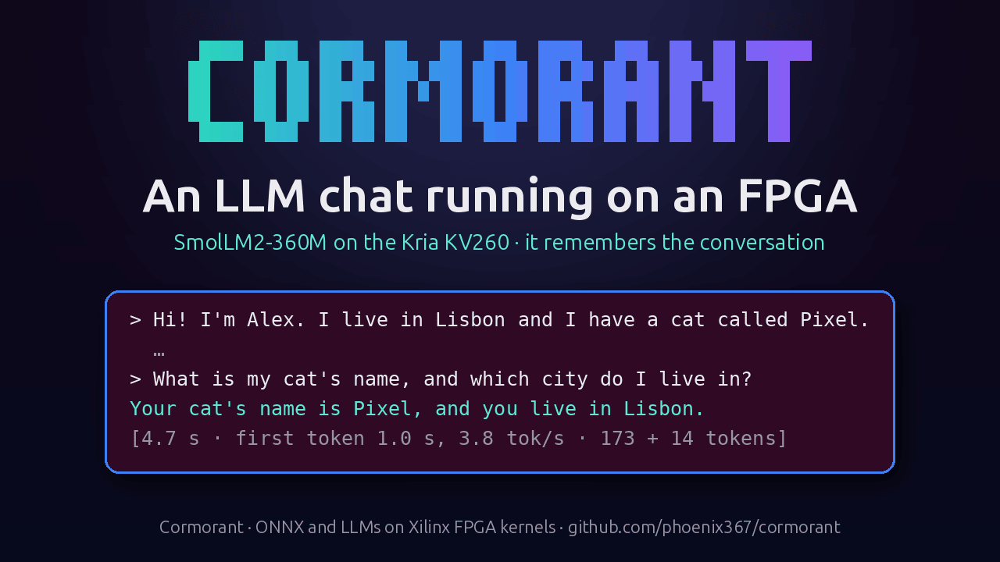

# Cormorant — FPGA Neural-Network Inference on the KV260

<p align="center">
  
</p>

## Introduction

Five kernels for the Xilinx Kria KV260 (Conv, VectorOP, MatMul, Pooling and
the row-ops unit, all in SystemVerilog) and a Python code generator that compiles
ONNX models — CNN classifiers, the YOLOv5n object detector, BERT-base,
Llama-family decoders, a ViT vision encoder, a VITS text-to-speech model, a
stereo-depth network and a speech-to-text model —
into self-contained C projects that drive the
kernels from Linux on the board.  Everything runs in 16-bit fixed point
(`ap_fixed<16,8>`, or per-tensor power-of-two exponents), and the board's
outputs are checked bit for bit against the generator's fixed-point
simulation.  An OpenAI-compatible server on the board serves the chat,
image and speech models.  The block design also brings the board's MIPI
camera (AR1335 behind the AP1302 ISP) into DDR, so live frames can be
classified on the board.

<p align="center">
  <a href="https://youtu.be/VVS7ExW0XYQ"></a><br/>
  <em>▶ <a href="https://youtu.be/VVS7ExW0XYQ">Watch the demo</a> (1 min): SmolLM2-360M chatting on the KV260, and remembering the conversation</em>
</p>

> **About this fork.**  This repository is an independent fork of Cormorant,
> developed and maintained by Ivan Gubochkin since the fork.  It is not
> affiliated with, endorsed by or supported by any company, institution or
> funding programme.

What is here:

- **Five FPGA kernels** in SystemVerilog, each with its C++ reference model and
  Verilator testbench (`kernels/`), and the Vivado block design that holds them
  (`hw/cormorant_hw_128`, a submodule) — [System architecture](#system-architecture).
- **The inference scheduler** (`inference-scheduler/`): ONNX models and
  Hugging Face checkpoints in, C projects and libraries out, with a fixed-point
  simulator that predicts every output bit.
- **Demos** (`demo/`): image classification, object detection, stereo depth,
  the live camera, BERT question answering, the chat server (chat, image chat,
  text to speech, speech to text), a voice assistant and a robot policy —
  [demo/README.md](demo/README.md), with the [validated models](demo/README.md#models)
  and where to get them.

---

## System architecture


The inference scheduler compiles each model into a C library on the host:
a project per CNN demo, and the libraries the chat server loads.  On the
board, the library keeps the weights and buffers in XRT buffers and runs
what no kernel implements as host ops on the Arm Cortex-A53 cores.  Its
kernel calls go straight to the five FPGA kernels, with the A53 sleeping on
their interrupts, or, for the larger models, to firmware on a Cortex-R5
core, which replays them with interrupt-driven waits while the A53 sleeps.
Every result is checked bit for bit against the scheduler's fixed-point
simulation.  Beside the kernels, the block design's camera capture path
writes the MIPI camera's frames into DDR for the Linux video drivers.
[`doc/ARCHITECTURE.md`](doc/ARCHITECTURE.md) is the hardware architecture
document (requirements, interconnect and control path, clocks and reset,
memory, datapath, interfaces, verification, timing and utilization); the
diagram is drawn by [`doc/images/architecture.py`](doc/images/architecture.py).

**The kernels.**  All five are written in SystemVerilog.  The first four are drop-ins
for the Vitis HLS kernels they replaced, whose C++ stays as the reference
model in each kernel's `model/` directory; the row-ops unit was written
against an integer specification in Python.  All data
ports are 128-bit AXI masters with 64-bit addresses and 16-byte-aligned
bases, and the control registers are AXI-Lite.  The kernels close timing
at 300 MHz out of context; the board runs them at 250 MHz (an MMCM in the
block design, [FMAX_250_PLAN](doc/plans/FMAX_250_PLAN.md)).  Compile-time
bounds come from [`platforms/kv260.json`](platforms/kv260.json).

| Kernel | ONNX ops | Highlights | Reference |
|---|---|---|---|
| **VectorOPKernel** | `Add`, `Sub`, `Mul`, `Div`, `Relu`, `Clip(0,6)`, `LeakyRelu`, SiLU, `Gelu`, `Softmax` | SystemVerilog: 8 lanes per cycle (`Div`: 1), broadcast / strided operands (`outer` × `size` runs, stride-0 replay), an activation fused after an op; an activation unit (LeakyReLU, SiLU, GELU erf / tanh: the exact function, rounded to nearest) and a softmax unit (rows, or keys-major columns written transposed; within 1 LSB of the exact softmax) | [VECTOROP_RTL_KERNEL](doc/kernels/VECTOROP_RTL_KERNEL.md), [ACTIVATIONS_PLAN](doc/plans/ACTIVATIONS_PLAN.md), [SOFTMAX_PLAN](doc/plans/SOFTMAX_PLAN.md) |
| **MatmulKernel** | `MatMul` | SystemVerilog: 2 × 64 DSP MACs (128 MAC/cycle) on panels of 8 A rows, packed-B weight layout (32-column tiles), K ≤ 4096, batched; image mode reads B in ConvKernel's layout through both read ports, so a weight shared with ConvKernel is stored once | [MATMUL_RTL_KERNEL](doc/kernels/MATMUL_RTL_KERNEL.md) |
| **ConvKernel** | `Conv` (incl. depthwise), `MatMul`s routed here by the cost model | SystemVerilog: 16 × 16 MAC grid, two output pixels per cycle (512 MACs in 32 cascades of 16 DSP48E2), kernels ≤ 7×7, stride / dilation / padding / bias, ≤ 1024 in / 1280 out channels; a chunk's drain overlaps the next one's compute | [CONV_RTL_KERNEL](doc/kernels/CONV_RTL_KERNEL.md) |
| **PoolingKernel** | `MaxPool`, `AveragePool`, `LpPool` and the Global variants | SystemVerilog: 8 channel lanes, windows ≤ 7×7, two output positions per cycle, dilation, `count_include_pad` | [POOL_RTL_KERNEL](doc/kernels/POOL_RTL_KERNEL.md) |
| **RowOpsKernel** (the row-ops unit) | `LayerNormalization`, BERT's `Transpose`s; the transformer frontends' residual adds, RMSNorms, SiLU · up, RoPE, dequantisation, KV-cache copies | SystemVerilog: 4 lanes per cycle on rows of ≤ 4096 elements, int32 residual rows and float32 output, per-column parameters and the sigmoid / rsqrt tables in UltraRAM; bit-exact with a Python integer specification | [ROWOPS_RTL_KERNEL](doc/kernels/ROWOPS_RTL_KERNEL.md), [HOSTOPS_PLAN](doc/plans/HOSTOPS_PLAN.md) |

The PS ports each kernel uses, the interconnect and the camera capture path are in
[`doc/ARCHITECTURE.md`](doc/ARCHITECTURE.md) (§6.6 for the camera).

**The inference scheduler** ([`inference-scheduler/`](inference-scheduler/)) maps an
ONNX graph onto the kernels and the A53 cores and writes a C project
(`CMakeLists.txt`, `inference.c`, weights in `.dat` files, a test program) for Linux
with XRT buffers or for bare metal.  It puts each MatMul on MatmulKernel or
ConvKernel by a cost model, fuses activations into a producing op, runs what no
kernel implements (LayerNorm / GELU subgraphs, `Concat`, `Resize`, `Gather`, …) as
host ops, and overlaps kernels on different lanes with pool slots shared by
liveness.  Frontends write the graphs of models ONNX does not carry well — Llama-family
and Gemma 3 decoders with their KV caches, a ViT vision encoder, Piper (VITS) text to
speech, Moonshine speech to text, SmolVLA, V-JEPA 2, LightStereo-S — with per-tensor
power-of-two exponents instead of the fixed `ap_fixed<16,8>` (8 fractional bits).
An optional planner (`--plan`) picks MatMul tactics and the issue order from the
bitstream's measured performance model.  Reference:
[INFERENCE_SCHEDULER.md](doc/scheduler/INFERENCE_SCHEDULER.md); CLI, generated
project and C API: [USER_GUIDE.md](inference-scheduler/doc/USER_GUIDE.md).

---

## Quick start

### 1. Clone

```bash
git clone https://github.com/phoenix367/cormorant.git cormorant && cd cormorant
git submodule update --init      # hw/: Vivado block design and RTL test stand (hardware builds only)
```

### 2. C simulation of the kernels (no board needed)

The reference models' headers include the Vitis HLS headers, so source Vitis first.

```bash
source <Xilinx>/2025.2/Vitis/settings64.sh
mkdir build && cd build && cmake ..
make -j8     # every C-simulation executable (incl. TestMatmulModelBlas when a BLAS was found)
ctest
```

Or build them one by one: `make TestVectorOpModel TestConvModel TestConvModelGrid
TestMatmulModel TestPoolModel` (the reference models; + `TestMatmulModelBlas` with a
BLAS) and `TestMatmulRtl TestVectorOpRtl TestPoolRtl TestConvRtl TestRowOpsRtl`
(Verilator 5.x for the five RTL kernels).

### 3. The scheduler and its tests

```bash
cd inference-scheduler
python3 -m venv .venv && .venv/bin/pip install -r requirements.txt
.venv/bin/python test/gen_all_models.py          # the test ONNX models
.venv/bin/python -m pytest test/ -q              # 1940 tests (the first run downloads the 435 MB BERT model)
.venv/bin/python inference_scheduler.py mymodel.onnx --out-dir /tmp/mymodel
python3 ../tools/facts/facts.py install-hook     # optional: git commit checks the facts of facts.yaml it touches
```

### 4. Build the hardware

```bash
cd build
cmake ..
make synthesize_kv260            # IP export + C drivers of the five kernels (Vivado packaging of the RTL)
make build_hw_kv260              # Vivado: bitstream in hw/cormorant_hw_128/.../impl_1/
make dtbo_kv260_cormorant        # device-tree overlay: build/dts/kv260/design_cormorant.dtbo
make dtbo_kv260_cormorant_capture   # the same plus the MIPI camera: build/dts/kv260/design_cormorant_capture.dtbo
```

The bitstream has the camera capture path; either overlay drives the kernels,
and the capture one adds the camera's video pipeline (never apply it over a
bitstream without the path).

`make build_hw_kv260` packages the five SystemVerilog kernels itself, so
the separate `synthesize_kv260` step is only needed for the C drivers
(used by the board tests and the demos: `build/kernels/<k>_rtl/driver/`;
`make driver_vectorop_rtl driver_conv_rtl driver_matmul_rtl driver_pool_rtl driver_rowops_rtl`
writes them alone, with Python and no Vivado) without a bitstream build.
Do not generate demo or test projects while a driver target rewrites its
directory.  `hw/cormorant_hw_128/build.sh` uses the `vivado` that Vitis's
`settings64.sh` put on `PATH`.  Expected warnings: Vivado's `File not found
as '…/utils_1/imports/synth_1/design_cormorant_wrapper.dcp'; using path …`
(the project file carries the maintainer's old incremental-synthesis
checkpoint path; incremental synthesis is off) and `dtc`'s `reg_format` /
`avoid_default_addr_size`.  The build (and the RTL behaviour tests) modify
tracked `.bd` / `.xci` / `.xpr` files in the `hw/` submodules — do not
commit them.

See [doc/build-and-test/BUILD_TARGETS.md](doc/build-and-test/BUILD_TARGETS.md) for every target.

### 5. Prepare the board and load the bitstream

The KV260 runs the Kria Ubuntu 22.04 image (kernel 5.15 `xilinx-zynqmp`) with
XRT 2.13 (`sudo apt install xrt`), gcc and CMake.  For the BERT and chat demos
reserve 1.4 GB of CMA with `cma=1400M` on the kernel command line.  Ubuntu's
image sets 1000M; this sets the boot script, reboots and checks the size
(then load the bitstream again):

```bash
cd inference-scheduler
cp bitstream_config_kv260.json.example bitstream_config_kv260.json   # set ssh.host and the paths
.venv/bin/python -m src.remote.cma_boot --config bitstream_config_kv260.json               # report
.venv/bin/python -m src.remote.cma_boot --config bitstream_config_kv260.json --set 1400M --reboot
```

Keep the cores out of the PSCI core power-down idle state.  With the board's
boot firmware (TF-A v2.8, 2023.2) a core can be parked there for good and
the board hangs ([CHAT_PLAN §18](doc/plans/CHAT_PLAN.md)).  `demo/chat/deploy.py`
installs the rule; by hand:

```bash
# from the host (the checkout)
scp board/kv260/kv260-no-cpu-powerdown.conf root@<board>:/tmp/
# on the board
sudo cp /tmp/kv260-no-cpu-powerdown.conf /etc/tmpfiles.d/
sudo systemd-tmpfiles --create /etc/tmpfiles.d/kv260-no-cpu-powerdown.conf
cat /sys/devices/system/cpu/cpu*/cpuidle/state1/disable    # 1 for every core
```

Then, from the host:

```bash
cd inference-scheduler
.venv/bin/python upload_bitstream.py --config bitstream_config_kv260.json
# on the board: cat /sys/class/uio/uio*/name  →  axi-pmon (×4, uio0–3), fabric_vecop fabric_matmul fabric_conv fabric_pool fabric_rowops
```

For the camera demo, point `dtbo` in `bitstream_config_kv260.json` at the capture
overlay and keep `overlay_name` `pl` ([demo/camera](demo/camera/README.md)).

If the same design is already loaded under another overlay name,
`upload_bitstream.py` stops before loading anything, with `The kernels' UIO
devices already exist …`.  It also stops while the Cortex-R5 firmware runs
(stop the chat server first, `demo/chat/deploy.py --stop`); once the firmware is
stopped it removes the R5's overlays above ours itself.  See
[REMOTE_TESTING.md](inference-scheduler/doc/REMOTE_TESTING.md#bitstream-upload-upload_bitstreampy).

### 6. Run on the board

```bash
cp remote_config.json.example remote_config.json                     # set ssh.host and driver dirs
.venv/bin/python run_remote_tests.py --config remote_config.json      # every test model, checked on the board
```

or run a demo: `cd demo/<name>` and follow its README.

Every test layer — the RTL behaviour tests, the board's kernel benchmarks, the
fact registry, and `run_tests.py`, which runs the host ones into one report — is in
[doc/build-and-test/TESTING.md](doc/build-and-test/TESTING.md) and
[REMOTE_TESTING.md](inference-scheduler/doc/REMOTE_TESTING.md).

---

## Results on the board

KV260, programmable logic at 250 MHz, 16-bit fixed point.  The production bitstream
since 2026-10-28 is `b4e63457057a`: the 250 MHz design of
[FMAX_250_PLAN](doc/plans/FMAX_250_PLAN.md) with VectorOPKernel's activation unit
([ACTIVATIONS_PLAN](doc/plans/ACTIVATIONS_PLAN.md)) and softmax unit
([SOFTMAX_PLAN](doc/plans/SOFTMAX_PLAN.md)), its second read port on a PS port of its
own ([PS_PORTS_PLAN](doc/plans/PS_PORTS_PLAN.md)), ConvKernel's x port past the CCI
([DEPTHWISE_PLAN](doc/plans/DEPTHWISE_PLAN.md) §8), the row-ops unit, a fifth kernel
that runs the transformers' norms, residual adds and SiLU·up and Piper's flow
inputs in fixed point ([HOSTOPS_PLAN](doc/plans/HOSTOPS_PLAN.md)), with its GATE op
and SCALE flag ([RPU_PLAN](doc/plans/RPU_PLAN.md) §14), the kernels' second area pass
([AREA_PLAN](doc/plans/AREA_PLAN.md) §6) and the MIPI camera's capture path
([demo/camera](demo/camera/README.md)).

The results were measured 2026-10-18 on `04259a7af917`, the production bitstream
before it (the kernels before their second area pass, no camera path): every
kernel call runs as fast on `b4e63457057a` (its performance model and the 72
kernel benchmarks, AREA_PLAN §6.5), and these figures were not measured again.  The
chat models', Piper's and Moonshine's figures are from 2026-10-17 (RPU_PLAN §14.12,
ASR_PLAN); the chat-server Piper figures from 2026-10-01, at 100 MHz; the camera's
from 2026-10-27 on `b4e63457057a`.  The board ran the A53's interrupt waits and, as
a soak test, the cores' deep idle state (about 2 % on the chat decode).

| Model | Result | Source |
|---|---|---|
| ResNet-18, 224×224 | **20.0 ms (50.0 FPS)** per image | [FMAX_250_PLAN](doc/plans/FMAX_250_PLAN.md), [PS_PORTS_PLAN](doc/plans/PS_PORTS_PLAN.md) (20.5 ms with VectorOP's two reads on one PS port; 47.4 ms at 100 MHz, [CONV_RTL_PLAN](doc/plans/CONV_RTL_PLAN.md); 59.9 ms on the HLS ConvKernel, [RESNET18_15FPS_PLAN §3.3](doc/plans/RESNET18_15FPS_PLAN.md)) |
| MobileNet V1 / V2, 224×224 | **20.5 / 17.6 ms** per image | [FMAX_250_PLAN](doc/plans/FMAX_250_PLAN.md) (41.2 / 38.1 ms at 100 MHz) |
| LightStereo-S stereo depth, 640×480 | **469 ms (2.13 FPS)** per pair, EPE 0.667 px on 42 Middlebury / ETH3D pairs (float 0.650 on the same input); 133 ms at 320×256; RealSense D435 pairs taken on the board: depth within 10 % of the camera's own on 91 % of the pixels (projector on) | [STEREO_PLAN](doc/plans/STEREO_PLAN.md), [demo/stereo_depth](demo/stereo_depth/README.md) |
| YOLOv5n object detection, 640×640 | **47.6 ms (21.0 FPS)** per image (the network on the FPGA; decode + NMS on the host), COCO128 mAP@0.5:0.95 0.343 (float 0.349) | [YOLO_PLAN](doc/plans/YOLO_PLAN.md), [demo/object_detection](demo/object_detection/README.md) |
| MNIST convnet / LeNet | 0.115 / 1.232 ms per image, 98.92 / 97.35 % top-1 (LeNet float 97.37 %) | [LENET_PLAN](doc/plans/LENET_PLAN.md), [demo/mnist](demo/mnist/README.md) |
| BERT-base SQuAD (bertsquad-12, 256 tokens) | **267 ms** per inference (p50 of 50), EM/F1 equal to float32 | [BERT_PLAN](doc/plans/BERT_PLAN.md) status, [PS_PORTS_PLAN](doc/plans/PS_PORTS_PLAN.md) (427 ms with both VectorOP reads on one PS port), [SOFTMAX_PLAN](doc/plans/SOFTMAX_PLAN.md) (525 ms with the softmax on the host), [ACTIVATIONS_PLAN](doc/plans/ACTIVATIONS_PLAN.md) (541 ms with the GELUs on the host too; 839 ms at 100 MHz, [FMAX_250_PLAN](doc/plans/FMAX_250_PLAN.md)) |
| SmolLM2-135M-Instruct | **20.4 tokens/s** decode, 16-token prefill 0.08 s, 256-token prefill 0.39 s | [CHAT_PLAN §19](doc/plans/CHAT_PLAN.md), [FMAX_250_PLAN](doc/plans/FMAX_250_PLAN.md) |
| SmolLM2-360M-Instruct | **7.8 tokens/s** decode, 16-token prefill 0.19 s, 256-token prefill 1.02 s, 758 MiB CMA | [CHAT_PLAN §20](doc/plans/CHAT_PLAN.md), [video](https://youtu.be/VVS7ExW0XYQ) (at 100 MHz) |
| SmolVLM-256M-Instruct (image chat) | **1.6 s** per image for the vision encoder (7.7 s at first), then 49 ms per token decode | [CHAT_PLAN §23, §24](doc/plans/CHAT_PLAN.md), [FMAX_250_PLAN](doc/plans/FMAX_250_PLAN.md), [OFFLOAD_PLAN](doc/plans/OFFLOAD_PLAN.md) |
| stories15M (TinyStories story writing, llama2.c) | **6.0 ms** per token decode (~166 tokens/s), 255-token prefill 32 ms, 35 MiB CMA; perplexity 3.322 (float 3.314) | [CHAT_PLAN §27](doc/plans/CHAT_PLAN.md), [Stories](demo/chat/doc/STORIES.md) |
| Gemma-3-270M-it (QK-norm, GELU MLP, 512-token sliding windows, 262k vocabulary) | **11.4 tokens/s** decode (87.7 ms per token), 16-token prefill 0.14 s, 256-token prefill 0.57 s, 548 MiB pool; perplexity 36.96 (float 36.75) | [CHAT_PLAN §31](doc/plans/CHAT_PLAN.md) |
| Piper en_US-lessac-medium (text to speech, 22 050 Hz) | **0.15 s** per 1.49 s of audio (real-time factor 0.11), text encoder 24 ms and duration predictor 49 ms per 88 phonemes; through the chat server the first sound after 1.0–1.5 s, real-time factor 0.58–0.79 end to end (at 100 MHz); listen: ▶ [hello](demo/tts/samples/hello.mp3), ▶ [paragraph](demo/tts/samples/paragraph.mp3) | [TTS_PLAN §4–§7](doc/plans/TTS_PLAN.md), [OFFLOAD_PLAN](doc/plans/OFFLOAD_PLAN.md), [samples](demo/tts/README.md#samples) |
| MobileNet V1 on the AR1335 MIPI camera, 640×480 | **20.7 ms** per frame, about 16 frames/s end to end with the annotated frames streamed to the host | [demo/camera](demo/camera/README.md) |
| Moonshine base (speech to text, English) | **1.10 s** per LibriSpeech utterance (8.4 s of audio on average, RTF 0.13), WER 2.93 % (float 3.02 %); through the chat server 1.3 s for 10 s of audio | [ASR_PLAN §6–§7](doc/plans/ASR_PLAN.md), [Speech to text](demo/chat/doc/SPEECH_TO_TEXT.md) |
| SmolVLA (vision-language-action, `lerobot/smolvla_base`) | **3.96 s** per chunk of 50 actions from two 480×640 cameras (1.31 s per camera image, 0.47 s prefix, 0.86 s for the ten denoising steps); actions within 4.0 % of float with the same noise (the policy's own spread between two noise samples: 66 %), bit-exact with the specification on 24 SO100 samples | [VLA_PLAN](doc/plans/VLA_PLAN.md), [demo/vla](demo/vla/README.md) |
| V-JEPA 2 ViT-L video classification (Something-Something v2, `facebook/vjepa2-vitl-fpc16-256-ssv2`) | **13.8 s** per video (16 frames at 256×256 = 2048 tokens; 0.26 s of it the A53's resize and crop), 742 MiB CMA; accuracy 71.0 % on 100 clips, float's too; bit-exact with the specification on 8 videos | [VJEPA2_PLAN](doc/plans/VJEPA2_PLAN.md), [demo/video_classification](demo/video_classification/README.md) |

The BERT, SmolLM2 and SmolVLM logits, the YOLOv5n head maps and the Piper
audio samples are bit-exact with the scheduler's simulation; Moonshine's
transcripts with its specification, token for token.
The FPGA design (`hw/cormorant_hw_128`, bitstream `b4e63457057a`) uses 68 % of the DSPs
(845 / 1248), 74.3 % of the LUTs (87 013 / 117 120), 142 / 144 BRAM and
58 / 64 URAM.

---

## Documentation

**[doc/README.md](doc/README.md)** is the index — a "where do I find…" table
and every document with a one-line summary:

| Folder | Topic |
|---|---|
| [`doc/build-and-test/`](doc/build-and-test/) | build targets, test layers ([TESTING.md](doc/build-and-test/TESTING.md)), platform JSON, RTL simulation issues |
| [`doc/kernels/`](doc/kernels/) | per kernel: a reference and an optimisation log; [`doc/ARCHITECTURE.md`](doc/ARCHITECTURE.md): the hardware architecture |
| [`doc/scheduler/`](doc/scheduler/) | the scheduler reference and the profiler |
| [`inference-scheduler/doc/`](inference-scheduler/doc/) | scheduler user guide, architecture, DAG, model preparation, board testing |
| [`doc/plans/`](doc/plans/) | project plans and their measured results |
| [`demo/`](demo/README.md) | one README per demo, and the validated models with their sources |
| [`tools/facts/`](tools/facts/README.md) | the fact registry ([`facts.yaml`](facts.yaml)): facts that code and docs repeat, checked by `facts.py` and a pre-commit hook |
| [`tools/cpu_baseline/`](tools/cpu_baseline/README.md) | the FPGA's BERT, SmolLM2, SmolVLM, Piper and Moonshine results against onnxruntime on the board's four A53 cores (BERT_PLAN §4, CHAT_PLAN §26, TTS_PLAN §8, ASR_PLAN §9) |

---

## License

Copyright 2026 Ivan Gubochkin; portions copyright 2025 GradeBuilder SL — the
code from GradeBuilder S.L.'s Cormorant up to the fork (commit `ca27075`,
2026-08-21).  Every source file names its copyright holders in its first
lines; [NOTICE](NOTICE) explains the notices and lists the third-party code.
Licensed under the Apache License 2.0 — see [LICENSE](LICENSE).
