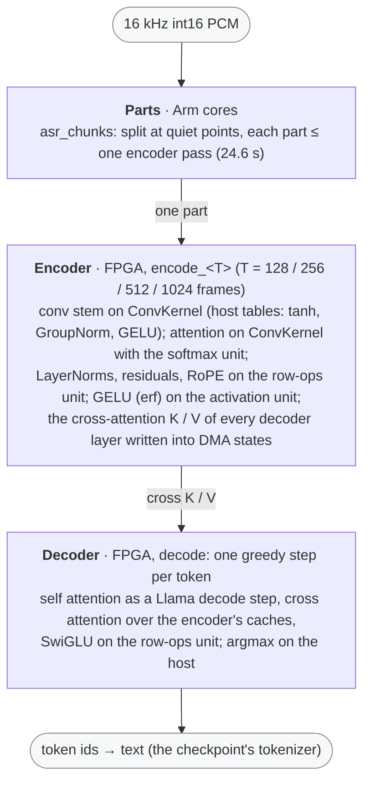

# Speech to text on the KV260 (Moonshine)

This directory runs [Moonshine](https://huggingface.co/UsefulSensors)
(UsefulSensors, MIT; base and tiny, English) on this repo's FPGA kernels,
as the library `libmoonshine_<size>.so`, and serves it as OpenAI's
`POST /v1/audio/transcriptions` in the
[chat server](../chat/doc/SPEECH_TO_TEXT.md) (the `moonshine` backend,
which [Miranda](../miranda/README.md) listens through).

Plan, study and results: [`doc/plans/ASR_PLAN.md`](../../doc/plans/ASR_PLAN.md).
- §1–§2: the candidate screen (Whisper ruled out) and the numeric study.
- §4: the scheduler frontend (`inference-scheduler/src/moonshine.py`).
- §5: the library and its host gate.
- §6: the board gate.
- §7: the chat server.
- §8: the phrase check (Miranda's key phrase).



## Results (2026-10-17, production bitstream `04259a7af917`)

- **Output:** every token id of the 200 LibriSpeech test-clean evaluation
  utterances bit-exact with the specification (`scripts/moonshine_q.py`) on
  the board, so the board's word error rate is the specification's:
  **2.93 %** for base (float 3.02 %), **4.58 %** for tiny (float 4.49 %).
- **Speed** (ASR_PLAN §6, the A53 driving the kernels):

  | | moonshine-tiny | moonshine-base |
  |---|---:|---:|
  | `encode_128` / `_256` / `_512` / `_1024` (median) | 60 / 120 / 242 / 578 ms | 108 / 206 / 439 / 961 ms |
  | a decode step (median) | 10.0 ms | 18.3 ms |
  | per utterance (mean of 200, 8.4 s of audio), real-time factor | 626 ms, 0.074 | 1098 ms, 0.131 |
  | `asr_open`, weights in the page cache | 0.22 s | 0.40 s |

- **Against the CPU** (2026-10-19, ASR_PLAN §9): onnxruntime on the board's
  four A53 cores, on the same 200 utterances.  Moonshine-base's real-time
  factor is 0.358 in fp32 (WER 3.02 %, the float model's) and 0.258 in int8
  (2.98 %).  The board's is 0.130 (2.93 %), 2.8× / 2.0× faster.
- **Through the chat server** (base, the Cortex-R5 driving the encoder): a
  10 s recording is transcribed in 1.3 s.
- **Memory:** base 185.8 MiB of CMA (the server reserves 200 MB), tiny
  95 MiB.

## Files

```
demo/asr/
├── src/asr_api.{c,h}            — libmoonshine_<size>.so: asr_open / asr_transcribe / asr_close, the steps
│                                  (asr_chunks, asr_encode, asr_decode_step), asr_last_logits for the phrase check
├── src/asr_bench.c              — the board gate's runner (utterances, repetitions, re-open, profile)
├── moonshine-{base,tiny}_opt_formats.json — the calibrated exponents (asr_study.py formats)
├── scripts/
│   ├── asr_study.py             — fetch / select / validate / screen / study / ablate / formats / score / window (ASR_PLAN §1–§2)
│   ├── asr_study_inputs.json    — the pinned checkpoints, LibriSpeech archives and the selected utterances
│   ├── moonshine_np.py, whisper_np.py — the float64 references
│   ├── moonshine_q.py           — the specification: the int16 datapath, bit for bit what the library computes
│   ├── asr_costs.py             — the candidates priced on the performance model (proxy graphs)
│   ├── generate_asr_project.py  — src/moonshine.py's encode_<T> + decode entries -> build/<model>_project
│   ├── asr_host_emu.py          — the generated C on the host vs the specification; --lib-check: the chat backend over it
│   └── asr_board.py             — build / install on the board, the board gate (bit-exact, timing, profile)
├── assets/                      — not in git: the checkpoints, LibriSpeech, the study's results
└── build/                       — not in git: the generated projects
```

The scheduler parts are in `inference-scheduler/`:
- `src/moonshine.py`: the frontend (`MoonshineFrontend`).
- `src/asr_nodes.py`: the `Asr*` ops (host ops and row-ops nodes).
- Tests: `test/test_moonshine.py`.

## Commands

From the repo root.  What they need:
- the scheduler's venv (`inference-scheduler/.venv`, README Quick start
  §3) and ffmpeg on the host (it decodes LibriSpeech's FLAC);
- the board set up as in the top-level README, and the board settings of
  `demo/bert_squad/bert_squad_config.json` (ssh, `local.driver_dirs`: the
  kernels' driver sources, which the project generator copies too);
- for the board steps, the chat server's install directory
  (`remote.dir` of `demo/chat/chat_config.json`, default `/root/kv260_chat`):
  `asr_board.py` installs the library into its `lib/`.

```bash
PY=inference-scheduler/.venv/bin/python
# 1. the checkpoints and LibriSpeech (fetch needs only numpy)
$PY demo/asr/scripts/asr_study.py fetch          # Moonshine tiny / base, Whisper tiny.en / base.en (0.8 GB) +
                                                 # LibriSpeech test-clean / dev-clean (0.66 GB), SHA-256 checked
# (the study itself — validate / screen / study / formats — runs in .venv-export
#  with torch and transformers: ASR_PLAN §2 "Commands and runtimes")
# 2. the library project and its host checks
$PY demo/asr/scripts/generate_asr_project.py --model moonshine-base   # -> demo/asr/build/moonshine-base_project, ~50 s, 2.9 GB
$PY demo/asr/scripts/asr_host_emu.py --project demo/asr/build/moonshine-base_project               # the generated C == the spec, ~5 min
$PY demo/asr/scripts/asr_host_emu.py --project demo/asr/build/moonshine-base_project --lib-check   # the chat server's backend over it
# 3. the board (the chat server owns the FPGA: stop it first)
$PY demo/chat/deploy.py --stop
$PY demo/asr/scripts/asr_board.py --project demo/asr/build/moonshine-base_project --out demo/asr/build/board_base.json
#   gate + install: the 200 utterances bit-exact, ~15 min (--utts auto: one per bucket); --install-only: build and install only
.venv-export/bin/python demo/asr/scripts/asr_study.py score --model moonshine-base --ids demo/asr/build/board_base.json   # the board's WER
$PY demo/chat/deploy.py                          # with "moonshine" in chat_config.json server.backends
```

`generate_asr_project.py` defaults to `moonshine-tiny`; pass
`--model moonshine-base` for the model the chat server serves.  The
transcription API, its parameters and the phrase check are documented in
the chat server's [Speech to text](../chat/doc/SPEECH_TO_TEXT.md) guide.

## Notes

- **Buckets.**  The encoder is one entry per bucket of 128 / 256 / 512 /
  1024 frames (one frame per 384 samples: 3.1–24.6 s of audio), the audio's
  valid length a runtime input.  The largest bucket plans the encoder's
  weight layouts and the others reuse them, so the project holds one copy
  of every weight.
- **Long recordings** are split at quiet points (`asr_chunks`, the
  specification's `chunks` integer for integer) into parts of at most one
  encoder pass; each part is encoded and decoded on its own.
- **Who drives the kernels.**  With the Cortex-R5 firmware running (the
  chat server's `--rpu`), the library's policy puts the encode entries on
  the R5 and the A53 sleeps meanwhile; `INFERENCE_RPU=0` / `1` overrides it.
- **The phrase check** (`asr_last_logits`): the decoder fed a given phrase,
  then greedy on — Miranda's key-phrase detection uses it through the
  server's `kv260_wake_phrase` field (ASR_PLAN §8).
