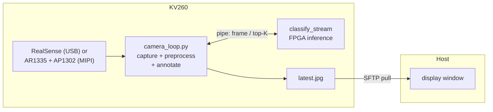

# Camera classification KV260 demo

Real-time ImageNet classification from a live camera on the KV260 FPGA
platform — an **Intel RealSense** on USB, or the starter kit's own **AR1335**
sensor behind the carrier card's AP1302 ISP over MIPI CSI-2 (*MIPI camera*
below) — using **MobileNetV1 1.0/224** running on this repo's own kernels
(Conv / Pool / VectorOP / MatMul) — no Vitis-AI / DPU.
The shipped `mobilenet_v1_1.0_224_no_softmax` variant ends in a 1×1 Conv
classifier, which the scheduler runs as a MatMul on MatmulKernel (`--fc-conv`).

Connect a camera to the board, run the orchestrator, and the demo
will

  1. download the MobileNetV1 ONNX model + the ImageNet 1001-class labels,
  2. generate a self-contained KV260 inference project with
     `inference-scheduler`,
  3. build it on the board over SSH,
  4. start a board-side loop that captures camera frames, runs inference on
     the FPGA, and annotates each frame with the top-5 prediction,
  5. stream the annotated frames back over SSH and show them in a window on
     your host.



> **Frame rate.** The pipeline keeps one frame in flight, so the display rate
> is bounded by the per-frame inference time.  The transcript below (May 2026)
> was recorded with an early ConvKernel: 2.46 s per frame, ~0.4 FPS.  The
> current kernels run MobileNetV1 in ~20.7 ms per frame and the display
> refreshes at ~16 fps with either camera (October 2026: a RealSense D435,
> and the MIPI camera's run under *MIPI camera*): at that speed the capture,
> preprocessing, JPEG encoding and the host's SFTP pull
> (`display.poll_interval_ms`) set the rate.  The overlay shows inference
> latency, display refresh rate, and whole-board (SOM) power draw.

## Layout

```
demo/camera/
├── README.md
├── requirements.txt                      — host Python deps
├── camera_config.json.example
├── run_demo.py                           — one-shot orchestrator
├── scripts/
│   ├── download_assets.py                — fetch ONNX + labels
│   ├── generate_project.py               — schedule the model into a CMake project
│   ├── deploy_and_run.py                 — upload, build, run, display
│   └── _config_help.py                   — "config missing" help text
├── src/
│   ├── classify_stream.c                 — persistent board-side inference host
│   └── board/                            — uploaded to the KV260
│       ├── camera_loop.py                —   RealSense / MIPI capture + annotate loop
│       ├── preprocessing.py              —   NCHW ap_fixed<16,8> frame encoder
│       ├── visualization.py              —   OpenCV overlay helpers
│       └── power_monitor.py              —   whole-board power sampling thread
├── assets/
│   ├── labels/imagenet_1001_labels.txt   — populated by download_assets.py
│   └── models/                           — ONNX downloads
└── build/
    ├── projects/<model>/                 — generated CMake project
    ├── stream/latest.jpg                 — host-pulled annotated frames
    └── ...
```

## How it works

The camera demo cannot use a one-shot batch classifier: `inference_init()`
loads all the model weights into DDR and binds the kernel drivers, which is
expensive. So the board runs a **persistent** inference host:

- **`classify_stream`** (C, on the board) — calls `inference_init()` *once*,
  then loops forever: read one raw frame from stdin, run inference, write a
  one-line top-K JSON to stdout.
- **`camera_loop.py`** (Python, on the board) — captures colour frames
  (`--source realsense`: pyrealsense2; `--source mipi`: the ISP's NV12
  frames through V4L2, keeping only the newest), preprocesses them, drives
  `classify_stream` over a pipe (one frame in flight), annotates the frame,
  and writes `latest.jpg` atomically.
- **`deploy_and_run.py`** (host) — builds the project, launches the board
  loop, and SFTP-pulls `latest.jpg` into a display window.

## Prerequisites

### Host

* Python 3.10+, `pip install -r requirements.txt`
  (gdown, numpy, onnx, onnxsim, paramiko, **opencv-python** for the display
  window — a headless host can use `--save-only` instead).
* Generated driver sources for the four kernels (the RTL kernels' by
  `driver_conv_rtl` / `driver_matmul_rtl` / `driver_vectorop_rtl` /
  `driver_pool_rtl`):

  ```bash
  # from the repo root
  mkdir -p build && cd build
  cmake ..
  make synthesize_kv260
  ```

  The driver sources only describe the kernels' AXI-Lite registers, so they
  are the same for every `AXI_BUS_WIDTH` (the bitstream on the board is the
  128-bit block design, `make build_hw_kv260`).
  Override `local.driver_dirs` if you keep the build tree elsewhere.

### KV260 board

* Linux with the cormorant bitstream and overlay loaded
  (`inference-scheduler/upload_bitstream.py`, see the root README), so
  `/dev/uio*` exposes `fabric_vecop` / `fabric_matmul` / `fabric_conv` /
  `fabric_pool` (the four kernels this model uses).
* `gcc`, `cmake ≥ 3.19`, `make`.
* XRT runtime via `pkg-config xrt` or `/opt/xilinx/xrt`.
* Passwordless `sudo` for the SSH user (XRT requires root).
* An **Intel RealSense** camera on USB 3.0 — or the MIPI camera (*MIPI
  camera* below; it needs only OpenCV and numpy on the board).
* **Board setup** — the board-side capture loop needs these in the Python
  interpreter named by `run.board_python`:

  RealSense is **not** in the apt sources of the stock Kria Ubuntu 22.04
  (arm64) image: `apt-cache policy librealsense2-utils python3-pyrealsense2`
  lists no candidate, so the `apt-get` line below only works where a
  RealSense package repository is configured.  Otherwise build librealsense
  with its Python bindings from source
  ([IntelRealSense/librealsense](https://github.com/IntelRealSense/librealsense),
  `-DBUILD_PYTHON_BINDINGS=ON`) — untested here: this README has no
  verified build recipe for the board (4 GB RAM, no swap).

  ```bash
  # RealSense — librealsense + the Python bindings (where a package exists)
  sudo apt-get install -y librealsense2-utils python3-pyrealsense2

  # OpenCV + numpy (in the Kria apt sources)
  sudo apt-get install -y python3-opencv python3-numpy
  ```

  Verify on the board:

  ```bash
  python3 -c "import pyrealsense2, cv2, numpy; print('deps ok')"
  rs-enumerate-devices            # should list the connected camera
  ```

  If `run.board_python` points at a venv (e.g. the PYNQ venv
  `/usr/local/share/pynq-venv/bin/python3`), install the packages there
  instead. `deploy_and_run.py --check-only` probes all of this for you.

### MIPI camera (AR1335 + AP1302)

The KV260 Vision AI Starter Kit's AR1335 sensor module sits on the carrier
card's IAS connector behind an onsemi AP1302 ISP, which scales and
colour-processes the 4208 × 3120 image and sends YUV 4:2:0 over 4-lane MIPI
CSI-2 into the PL.  It needs a bitstream with the block design's **camera
capture path** (`hw/cormorant_hw_128/scripts/bd_mipi_capture.tcl`; the
`hw/cormorant_hw_128` README's *Camera capture path*): a MIPI CSI-2 receiver
on bank 66, a frame-buffer writer that puts NV12 frames into DDR through
`S_AXI_HP3_FPD`, the AXI I²C controller of the ISP's bus and the ISP's reset
on EMIO GPIO, on their own 200 MHz clock beside the kernels' 250 MHz — the
first such bitstream is `b4e63457057a`, production since 2026-10-28.  Load
it with the overlay `dts/kv260/cormorant_capture.dts` — the five kernels of
`cormorant.dts` plus the camera's V4L2 media pipeline (AP1302 → CSI-2
receiver → frame buffer → `/dev/videoN`) — and keep the overlay name `pl`,
in `inference-scheduler/bitstream_config_kv260.json`:

```bash
make -C build dtbo_kv260_cormorant_capture     # → build/dts/kv260/design_cormorant_capture.dtbo
```
```json
"bitstream": {
  "bit":  "<the capture build>/design_cormorant_wrapper.bit",
  "hwh":  "<the capture build>/design_cormorant.hwh",
  "dtbo": "../build/dts/kv260/design_cormorant_capture.dtbo",
  "overlay_name": "pl"
}
```

Never apply that overlay over a bitstream without the capture path: the
Linux drivers would access an unmapped PS port.  The drivers (`ap1302`,
the CSI-2 receiver's, `xilinx-frmbuf`, `xilinx-video`) and the ISP firmware
(`/lib/firmware/ap1302_ar1335_single_fw.bin`, package
`linux-firmware-xilinx-ap1302`) come with the Kria Ubuntu 22.04 image, and
`media-ctl` / `v4l2-ctl` with `v4l-utils-xlnx`.  After the load:

```bash
media-ctl -p -d /dev/media2      # the one with ap1302.4-003c, ar1335 0, 80000000.csiss, cap_vcap output 0
                                 # (media2 here: a RealSense on USB takes media0 / media1)
dmesg | grep ap1302              # "AP1302 revision 0.2.6 detected"
```

The ISP's firmware goes over I²C at every overlay load (~2 s); a
`CRC mismatch` line means the driver retried the download (seen once in four
loads, the first after a bitstream without the path, and the next attempt
succeeded).  Then set `"camera": {"source": "mipi"}`: the board loop sets
the ISP's output to `camera.width` × `camera.height` (`media-ctl`) and
streams NV12 at 30 fps through `v4l2-ctl` (the video node is
multiplanar-only, which OpenCV's V4L2 backend cannot read); `camera.fps` is
ignored.  The receiver's own pad formats are set best effort: it refuses
them (`EINVAL`) on this kernel and streams the ISP's frames anyway.

A 60-second run on `b4e63457057a` (2026-10-27, 640 × 480, `--save-only`):

```
Preflight (remote)
    …
    OK      board python deps (numpy, cv2)
    OK      media-ctl / v4l2-ctl
    OK      AP1302 ISP in a media graph  ap1302.4-003c
    …
    camera_loop: MIPI 'ap1302.4-003c' -> /dev/video4 streaming 640x480@30
      frame 0: notebook (36.1%)  infer=20.9ms  display=0.0fps  power=4.8W
      frame 100: monitor (32.8%)  infer=20.6ms  display=16.2fps  power=6.2W
      …
      frame 910: notebook (26.1%)  infer=20.6ms  display=16.2fps  power=5.4W
    camera_loop: stopping (stop file) after 919 frame(s)
    classify_stream: 919 frame(s) processed — shutting down
```

## Configure

```bash
cd demo/camera
cp camera_config.json.example camera_config.json
$EDITOR camera_config.json          # set ssh.host, key_file, etc.
```

Key fields beyond the SSH / driver paths:

| Field | Meaning |
|-------|---------|
| `run.board_python` | Python on the board with opencv/numpy (and pyrealsense2 for a RealSense) |
| `camera.source` | `realsense` (default: USB) or `mipi` (the AR1335 / AP1302 through the capture path, *MIPI camera*) |
| `camera.{width,height,fps}` | Colour stream geometry (`mipi`: the ISP scales to it; 30 fps, `fps` ignored) |
| `run.duration_s` | Auto-stop after N seconds (0 = run until `q`) |
| `run.target_fps` | Throttle the board loop (0 = uncapped) |
| `display.poll_interval_ms` | How often the host pulls a fresh frame |
| `display.save_only` | Headless host: save frames instead of a window |

## Run the demo

One-liner that does download → generate → deploy:

```bash
.venv/bin/python run_demo.py
```

Or step-by-step:

```bash
.venv/bin/python scripts/download_assets.py
.venv/bin/python scripts/generate_project.py
.venv/bin/python scripts/deploy_and_run.py
```

A window opens showing the live annotated camera feed. Press **`q`** (or
`ESC`) in the window — or `Ctrl-C` — to stop; the board loop is signalled to
shut down cleanly and the remote scratch directory is removed.

Sample output (host `~/projects/axi_demo/demo/camera`, board at
`192.168.100.8` with a RealSense D435; May 2026, with the ConvKernel of that
time — the scheduler now also emits a host `SpaceToDepth` stem node and
runs the classifier as a MatMul, 62 nodes in all, see the
image-classification README):

```
$ ./run_demo.py

=== download_assets ===
ONNX models → demo/camera/assets/models
  ✓ mobilenet_v1_1.0_224_no_softmax.onnx  (16,908,384 B)
  cached imagenet_1001_labels.txt (1001 lines)
done

=== generate_project ===
[mobilenet_v1] scheduling mobilenet_v1_1.0_224_no_softmax.onnx
Model      : demo/camera/assets/models/mobilenet_v1_1.0_224_no_softmax.onnx
Inputs     : ['input:0[1, 3, 224, 224]']
Outputs    : ['MobilenetV1/Logits/SpatialSqueeze:0[1, 1001]']
Nodes      : 58
  [  0] Conv         [1, 3, 224, 224] x [32, 3, 3, 3] x [32]   -> [1, 32, 112, 112]
  [  1] Clip         [1, 32, 112, 112]                          -> [1, 32, 112, 112]
  …  (depthwise-separable Conv / Clip blocks repeating to 14×14, 7×7) …
  [ 54] AveragePool  [1, 1024, 7, 7]                            -> [1, 1024, 1, 1]
  [ 55] Conv         [1, 1024, 1, 1] x [1001, 1024, 1, 1] x [1001] -> [1, 1001, 1, 1]
  [ 56] Reshape      [1, 1001, 1, 1]                            -> [1, 1, 1, 1001]
  [ 57] Squeeze      [1, 1, 1, 1001]                            -> [1, 1001]
Weights    : 20 large weight(s) written to build/projects/mobilenet_v1/weights/
[mobilenet_v1] active kernels: VectorOPKernel, ConvKernel, PoolKernel
wrote 1 project(s) under demo/camera/build/projects

=== deploy_and_run ===

Preflight (local)
    OK   assets/labels/imagenet_1001_labels.txt    10,484 B
    OK   project 'mobilenet_v1' on disk
    OK     driver/xvectoropkernel.h  (VectorOPKernel)
    OK     driver/xconvkernel.h      (ConvKernel)
    OK     driver/xpoolingkernel.h   (PoolKernel)
    OK     board/camera_loop.py
    OK     board/preprocessing.py
    OK     board/visualization.py
    OK     board/power_monitor.py

Connecting to root@192.168.100.8:22 …
  connected

Preflight (remote)
    OK   cmake                                 cmake version 3.22.1
    OK   gcc                                   gcc 11.4.0
    OK   xrt headers                           xrt via pkg-config
    OK   uio (VectorOPKernel: fabric)          /dev/uio4
    OK   uio (ConvKernel:     fabric_conv)     /dev/uio6
    OK   uio (PoolKernel:     fabric_pool)     /dev/uio7
    OK   board python deps (pyrealsense2, numpy, cv2)
    OK   RealSense camera detected             1 device(s)

Uploading → /tmp/camera_demo
  uploaded 54 project + 2 label file(s)
  cmake …
  make classify_stream …
  build OK

  ── streaming from the KV260 — press q to quit ──
    camera_loop: loaded 1001 class labels
    power_monitor: source='xlnx_platformstats'  initial=3.18 W
    camera_loop: launching /tmp/camera_demo/projects/mobilenet_v1/build/classify_stream
    classify_stream: model=mobilenet_v1 classes=1001 input_numel=150528 warmup=1 top_k=5
    classify_stream: ready — streaming frames
    camera_loop: RealSense 'Intel RealSense D435' streaming 640x480@30
      frame 0:  patio    (12.8%)  infer=2463.6ms  display=0.3fps  power=3.2W
      frame 10: umbrella (17.5%)  infer=2463.6ms  display=0.4fps  power=3.4W
      frame 20: yurt     (16.4%)  infer=2463.6ms  display=0.4fps  power=3.3W
      frame 30: yurt     (22.6%)  infer=2463.3ms  display=0.4fps  power=3.4W
    camera_loop: stopping (stop file) after 38 frame(s)
    classify_stream: 38 frame(s) processed — shutting down

cleanup /tmp/camera_demo
```

Each annotated frame's bottom strip reads
`infer <ms>   display <fps>   power <W>   frame <N>`.

Notable behaviour visible in the run:

- **Only three kernels were active in this run.**  The `no_softmax`
  MobileNetV1 ends in a 1×1 `Conv` (node 55) rather than a fully-connected
  `MatMul`, so `[mobilenet_v1] active kernels: VectorOPKernel, ConvKernel,
  PoolKernel` (today that classifier runs as a MatMul on MatmulKernel).
- **Power source picked automatically.**  `xlnx_platformstats` (the SOM
  INA260 sensor, 3.18 W idle) was selected at startup; see *Power
  measurement* below for the fallback chain.
- **Per-frame inference latency ≈ 2.46 s** in this run — the
  image-classification demo's MobileNetV1 time with the ConvKernel of
  that date (it is ~20.5 ms now); the pipeline is one-frame-in-flight,
  so display refresh capped at ~0.4 fps.

### Power measurement

The board samples whole-board (SOM) power on a background thread and picks a
source once at startup, in this order:

1. **XRT** — `pyxrt` electrical info. The XRT power API
   (`xrt::info::device::electrical`) is an Alveo datacenter-card feature and
   is normally **not** populated on the KV260's embedded zocl stack, so this
   is tried first but usually falls through.
2. **`xmutil xlnx_platformstats`** — the SOM INA260 sensor (`SOM total
   power`). This is the reliable KV260 source and what the demo typically
   uses.
3. **hwmon** — `/sys/class/hwmon/*/power1_input`. Best-effort last resort.

If none are available the overlay shows `power n/a`. Tune the sample rate
with `run.power_poll_s`.

## Useful options

| Flag | Effect |
|------|--------|
| `--skip-download` | reuse cached ONNX + labels |
| `--skip-generate` | reuse the generated project under `build/projects/` |
| `--skip-deploy` | only regenerate the local CMake project |
| `--force-download` | re-fetch all assets |
| `--save-only` | headless host: save frames to `build/stream/` instead of a window |
| `--check-only` | run preflight checks for every stage and exit |
| `--no-cleanup` (deploy script) | leave the remote work_dir for inspection |
| `--plan` (generate script; also `--perf-model`, `--plan-report`, `--pool-budget-mib`) | planning mode ([`doc/plans/TACTICS_PLAN.md`](../../doc/plans/TACTICS_PLAN.md) §9): tactics and issue order from the bitstream's performance model, bit-identical results; or `"plan": true` in the config |

`--check-only` is the fastest way to confirm the board is ready — it probes
SSH, the kernels' UIO devices, and the board-side camera (the RealSense, or
the ISP's media graph and the V4L2 tools for `mipi`) and OpenCV
dependencies without uploading anything.

## Troubleshooting

| Symptom | Fix |
|---------|-----|
| `board python deps … MISSING` | install pyrealsense2 / opencv / numpy on the board — see *Board setup* |
| `RealSense camera detected … MISSING` | check the USB 3.0 connection; run `rs-enumerate-devices` on the board |
| `AP1302 ISP in a media graph … MISSING` (`mipi`) | the loaded bitstream has no capture path, or the overlay is the plain `cormorant.dts` — load the capture bitstream with `cormorant_capture.dts` (*MIPI camera*); then `dmesg \| grep -E "ap1302\|csiss\|frmbuf"` |
| `media-ctl / v4l2-ctl … MISSING` (`mipi`) | `sudo apt-get install v4l-utils` (the Kria image ships `v4l-utils-xlnx`) |
| `error: no frame from the camera for 5 s`, `stopping (camera stopped)` (`mipi`) | no frames from the ISP: `v4l2-ctl -d /dev/videoN --stream-mmap --stream-count=10 --verbose` on the board shows whether the pipeline streams |
| `opencv-python not installed on the host` | `pip install -r requirements.txt`, or run with `--save-only` |
| display window never updates | the board loop loads the weights and starts the camera before the first frame; watch the per-frame log on the console |
| every prediction looks wrong | usually a normalize mismatch — `preprocess.normalize` must match how the model was trained (`tf` for the stock MobileNetV1) |
