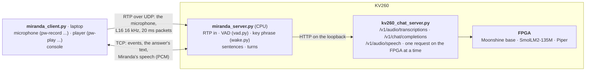

# Miranda — a voice assistant on the KV260

Say "Hello Miranda" and a request; Miranda answers aloud.  The console client
runs on your laptop and streams the microphone to the board; everything else
— voice activity detection, speech recognition, the answer and its speech —
runs on the KV260: the VAD on its CPU, the three models on the FPGA.

```
$ python3 demo/miranda/miranda_client.py --server 192.168.100.8
Miranda · 192.168.100.8:8770 · say “Hello Miranda” and your request · Ctrl-C quits
(warming up the models on the board…)
(listening)
  · Good morning, everyone. this is just a conversation.
You: Haloma Randa, what is the capital of France?
Miranda: The capital of France is Paris. It's a beautiful city with many famous landmarks and historical sites.
  [first word 0.1 s · answer 1.1 s · speech 5.6 s from 1.3 s]
(listening)
You: Hello, Miranda.
Miranda: yes? (listening for your request)
You: Tell me something about the moon
Miranda: The moon, also known as the planet Earth's natural satellite, orbits our planet once every 29 days. ...
  [first word 0.1 s · answer 4.5 s · speech 21.1 s from 4.9 s]
(listening)
```

(A recording spoken by Piper on the board, streamed with `--input`: the
speech recognizer heard its "Hello Miranda" as "Haloma Randa", and Miranda
still woke.  Lines with `·` were heard without the key phrase.)

## The dialogue mode

To talk without saying "Hello Miranda" before every phrase, switch to the
dialogue mode.  It ends by itself after 15 s without speech
(`--dialogue-timeout`).

```
You: Hello, Miranda. let's talk.
(dialogue mode on: talk without “Hello Miranda”; it ends after 15 s of silence or when you say goodbye)
Miranda: Sure, let's talk. I'm listening.
(your turn — dialogue mode)
You: What is the capital of Italy?
Miranda: The capital of Italy is Rome.
(your turn — dialogue mode)
You: And what about Spain?
Miranda: Spain is also known as Castile and León.
(your turn — dialogue mode)
You: Good-bye
(dialogue mode off: you said so — say “Hello Miranda” again)
Miranda: Goodbye!
(listening)
  · This should not be answered.
```

| | On | Off |
|---|---|---|
| **By voice** | "Hello Miranda, let's talk" (or "let's chat", "start a dialogue", "conversation mode", "can we have a conversation") | "Goodbye", "Bye bye", "That's all, thank you", "See you later", "Good night", "Stop the dialogue" |
| **From the client** | `d` + Enter in the console; with `--dialogue`, every "Hello Miranda" opens a dialogue | `d` + Enter |
| **By itself** | — | after `--dialogue-timeout` seconds without speech (the server's default 15 s; the client may ask for another value) |

- **Requests.**  In the dialogue mode every segment the VAD finds is a
  request.  A "Hello Miranda" in front of it is dropped, and the key phrase
  alone restarts the silence timer.
- **Silence.**  It is measured on the audio's own timeline from the end of
  Miranda's speech, so her own speaking time does not count.
- **Context.**  The chat model sees the earlier turns (`--history`, 4), so
  follow-ups such as "And what about Spain?" work.

## How it works



A session goes through four states:

| State | What happens | The microphone |
|---|---|---|
| `listening` | The VAD cuts the stream into speech segments.  Each segment is transcribed (Moonshine).  A transcript holding the key phrase wakes Miranda, and the text after the phrase is the request. | streamed |
| `awake` | The key phrase came alone ("Hello Miranda." then a pause).  The next segment is the request, or after `--awake-timeout` (8 s of audio) she listens again.  The key phrase said again restarts the wait. | streamed |
| `dialogue` | Every segment is a request; no key phrase needed (above).  After the dialogue timeout without speech she goes back to `listening`. | streamed |
| `thinking` | The request and the earlier turns go to the chat model (SmolLM2-135M), and the answer streams to the console as text. | muted |
| `speaking` | Finished sentences go to text to speech (Piper) and the speech streams to the client, which plays it.  The client reports when playback is over, and Miranda then listens again. | muted until the player has finished, plus 0.25 s |

- **Voice activity detection** (`vad.py`, numpy on the A53).  It is the
  likelihood-ratio detector of Sohn, Kim and Sung (1999), on 20 ms frames:
  - per frequency bin of the speech band (150 Hz–4 kHz), the log likelihood
    ratio of speech + noise against noise, with the decision-directed a
    priori SNR;
  - the noise spectrum is learnt from the first frames that are not
    digital silence (a recorder's leading zeros), then tracked in the frames
    judged silent;
  - when the last 1.5 s were stationary (the frames' power within 10 dB:
    a noise floor stays within 5 dB, speech moves by more than 12 dB), the
    noise is raised to their minimum (minimum statistics), so a louder room
    is not taken for speech for long;
  - it keeps the noise between turns, so speech in the first frames after
    the microphone resumes is heard;
  - frames below −62 dBFS are silence.

  A segment opens after 3 speech frames (it starts 0.3 s earlier) and
  closes after 0.7 s of silence (`--vad-hangover-ms`) or 24 s.  It costs
  2.5 % of one A53 core per stream.  On LibriSpeech utterances separated by
  pauses, with pink noise from none up to −35 dBFS, it found every
  utterance and made no segment from noise.
- **The key phrase, checked against the audio.**  Moonshine takes no
  prompt, but the library lets the caller choose each token the decoder is
  fed.  So every segment is transcribed with the
  chat server's phrase check (`kv260_wake_phrase`,
  [Speech to text](../chat/doc/SPEECH_TO_TEXT.md#the-phrase-check)):
  - the decoder is fed "Hello Miranda" as its first tokens;
  - the margin sums, over the phrase's tokens the decoder would not have
    written itself, how much less likely each is than its own choice (in
    nats; 0: it writes the phrase itself);
  - when the margin is at least `--wake-margin` (−10), the transcript is
    decoded on from the phrase, so it starts with "Hello, Miranda";
    otherwise it is the plain transcript.

  Awake or in a dialogue, a transcript that starts with the phrase is the
  phrase said again, not the request.

  On the board a clear "Hello Miranda" scores 0, and ordinary speech scores
  below −15 (196 LibriSpeech utterances), and greetings to someone else
  below −10.  A speaker whose "Hello Miranda" Moonshine writes as "Hello,
  Meganda", "Homey granda" or "How old me, Randa?" scored −7.67, 0, −5.75,
  −2.68 and −2.15: five of five kept.  "Hello" with a name that rhymes ("Hello Veranda", "Hello
  Amanda") scores −3 to −11 and may wake her.  The check adds 3 ms to a
  segment on average.
- **The key phrase in the transcript** (`wake.py`).  The recognizer writes
  "Hello Miranda" in many ways, so a transcript holds the phrase in any of
  three cases:
  - **by words:** each word of the phrase is matched by letter similarity
    (≥ 0.8), and a recognizer word may also be two words run together;
  - **by sound:** one to four words carry the phrase's consonants in order.
    Vowels, h, w and y are dropped, and voiced / voiceless pairs are folded:
    "Haloma Randa" and "Hello Miranda" are both l-m-r-n-t, while "Hello
    Rhonda" (l-r-n-t) is not the phrase;
  - **by name:** the greeting is what the recognizer mangles most ("How
    old, Miranda", "Oh, Mjolanda", "How woe, meogandha"), so a word shaped
    like "Miranda" after at most two short words at the start is enough:
    similar letters, the same first and last consonant, at most one of its
    consonants missing ("Muganda").  "Hello Amanda" wakes her too; "Hello
    Rhonda", "Veranda" or "Rwanda" do not.

  The phrase can be changed with `--wake`.
- **The answer.**
  - SmolLM2-135M gets the request and the last 4 turns, with a system
    message asking for one to three short spoken sentences.
  - The answer stops after 3 sentences (`--max-sentences`); the chat server
    stops generating when the stream closes.  An answer cut at
    `--max-tokens` (100) is spoken up to its last whole sentence.
  - SmolLM2-135M is the default because it stays loaded in CMA next to
    Moonshine and Piper (330 + 200 + 55 MB).  SmolLM2-360M would swap with
    them on every turn.
- **The FPGA.**  Every model runs through the chat server's API on the
  board's loopback.  The chat server owns the FPGA, runs one request at a
  time and keeps the models loaded.  So the speech is synthesized after
  the answer is complete; its text shows on the console as it is written.
- **Not hearing herself.**  The client streams the microphone only while
  the server listens.  It stops before Miranda thinks and stays silent until
  her speech has finished playing.  On the board, 0 packets arrived while
  the server was not listening (its log counts them).

## Install and run

Miranda needs the chat server on the board (`demo/chat`, [Deploying](../chat/doc/DEPLOY.md))
with a speech-to-text, a chat and a text-to-speech model: `moonshine`,
`smollm2` and `piper` in `server.backends` of `demo/chat/chat_config.json`.

```bash
PY=inference-scheduler/.venv/bin/python
$PY demo/miranda/deploy.py                       # checks the chat server, uploads, starts kv260-miranda
python3 demo/miranda/miranda_client.py --server 192.168.100.8
$PY demo/miranda/deploy.py --status              # | --stop
```

- **`deploy.py`** uploads the server to `<chat dir>/miranda` and starts it as
  the transient systemd unit `kv260-miranda` (`journalctl -u kv260-miranda`)
  on port 8770: TCP for control, UDP for RTP.  It reads the board, ssh and
  the chat server's port and API key from `demo/chat/chat_config.json`.
  Arguments after `--` go to `miranda_server.py` (`--wake`,
  `--wake-margin`, `--no-wake-check`, `--save-segments DIR`,
  `--max-sentences`, `--awake-timeout`, `--vad-*`, `--system` ...).
- **Tuning the key phrase for your voice.**  The server's log shows each
  segment's margin (`journalctl -u kv260-miranda`):

  ```
  [1] heard (1.5 s, asr 227 ms, phrase -11.61 no): 'It is the weather today.'
  [1] heard (3.1 s, asr 430 ms, phrase -2.88 kept) WAKE: 'Hello, Miranda. What is the capital of France?'
  ```

  (Piper's "It is the weather today." and "Haloma Randa, what is the
  capital of France?" in −50 dBFS noise; a margin that stopped below the
  limit is where the sum stopped, the whole one is lower.)  `-- --save-segments DIR` also keeps every
  segment as a WAV file on the board, with its state, transcript and margin
  in `DIR/segments.jsonl`.  Say "Hello Miranda" a number of times and talk
  as usual; a `--wake-margin` between the margins of your key phrases and
  those of your other speech separates them.
- **The client** needs Python 3 and nothing else.
  - **Microphone:** the first recorder found (`pw-record`, `parecord`,
    `arecord`, ffmpeg from PulseAudio), or `--mic "CMD"`.
  - **Speech:** the first player found (`pw-play`, `paplay`, `aplay`,
    `ffplay`, sox's `play`), or `--player "CMD"` (`{rate}` is replaced by
    the sample rate).
  - **Without a microphone:** `--input FILE.wav` streams a recording
    instead.  `--save FILE.wav` keeps Miranda's speech, `--player none`
    skips playing, and `--turns N` exits after N answers.
  - **Dialogue mode:** `--dialogue` opens it with every "Hello Miranda",
    `--dialogue-timeout S` sets its silence limit, and `d` + Enter toggles
    it.
- **The server's log** has a line per segment heard, with its length, the
  recognition time and the phrase check's margin (`phrase -3.91 kept`), and
  one per turn: the request, the answer and the timings.

## Protocol

[`miranda_proto.py`](miranda_proto.py) describes it in full.
- **Microphone:** RTP (RFC 3550) over UDP to port 8770.  Payload type 96 =
  L16/16000/1 (big-endian 16-bit, mono, 16 kHz), 20 ms per packet, the
  client's SSRC announced in its hello.  The marker bit opens a talkspurt:
  the first packet, and the first after the microphone was muted.  The
  server puts packets back in order, fills a small loss with silence and
  drops late packets.
- **Control:** one TCP connection to port 8770, carrying frames of kind (1
  byte), length (4 bytes) and payload: `J` for a JSON message, `A` for
  speech PCM.
  - The client sends `hello` (with `dialogue`: `auto` / `off` and
    `dialogue_timeout`), `dialogue` (`on`: switch the mode), `playback_done`
    and `bye`.
  - The server sends `welcome`, `state`, `heard`, `query`, `answer_delta`,
    `answer_done`, `audio_start` / `A` frames / `audio_end`, `dialogue`
    (`on`, `reason`: voice / client / auto / silence, `timeout`), and
    `error`.

## Measured

2026-10-17, the board's chat server with Moonshine base, SmolLM2-135M and
Piper resident (the session above):
- **A segment's transcription:** 200–420 ms for 1.3–3.2 s of speech.
- **The answer:** first word after 0.1–0.2 s; 1.1 s for two sentences, 4.5 s
  for three long ones.
- **Speech:** it starts 1.3–4.9 s after the request; Piper makes it faster
  than it plays.
- **Warm-up per session:** 0.4 s with the models loaded.  It takes longer
  when the chat server must load them first: Moonshine 12.7 s and
  SmolLM2-135M 22 s in the chat server's log.
- **The VAD on the board:** 2.5 % of one core per stream.
- **The phrase check** (`doc/plans/ASR_PLAN.md` §8): Piper's "Haloma Randa,
  what is the capital of France?" is transcribed "Helumor Renda, …" without
  it and "Hello, Miranda. What is …" with it (margin −2.37); +2.7 ms per
  segment on average.

## Limits

- **Half duplex:** no barge-in; while Miranda speaks she does not listen.
- **In the dialogue mode everything heard is a request**, including speech
  meant for someone else.  The silence limit and "goodbye" end it.
- **Speech after the answer:** the FPGA runs one request at a time, so the
  speech starts once the answer is complete, not sentence by sentence.
- **Answer quality** is SmolLM2-135M's.
- **The key phrase is checked at the start of a segment only.**  Said
  later in a sentence ("So, hello Miranda!"), only the transcript can hold
  it.  The phrase check also needs the segment to fit one encoder pass
  (24.6 s; the VAD cuts at 24 s).
- **English only.**
- **Every word said near the microphone is transcribed** (on the board) to
  look for the key phrase.

## Tests

```bash
cd demo/miranda/tests && ../../../inference-scheduler/.venv/bin/python -m unittest -v   # 22 tests, ~45 s
```

They cover:
- RTP and its reordering, the control frames;
- the VAD on synthetic speech and noise: a recorder's leading zeros, a
  noise floor that rises, speech right after the microphone resumes;
- the key phrase in its spellings and near misses, among them the
  recognizer's renderings of a real speaker's "Hello Miranda";
- the phrase check: which segments are checked, the margin against
  `--wake-margin`, `--no-wake-check`, `--save-segments`;
- the sentences;
- whole sessions: the client streaming a recording to the server, which
  talks to the chat server running fake backends (a scripted recognizer, the
  echo chat model, a fake voice).  They check the request with the key
  phrase, the key phrase alone then the request, the awake timeout, the
  three-sentence cap, the history, and that no audio reached the server
  while it was not listening.
- the dialogue mode: on and off by voice, `--dialogue` ending after
  silence, and the client's switch over the control protocol.
