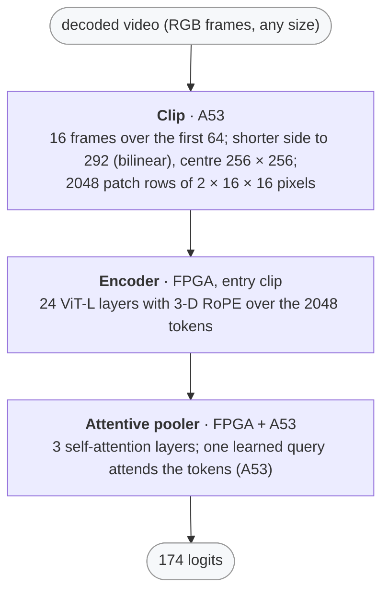

# V-JEPA 2 video classification on the KV260

This directory runs Meta's [V-JEPA 2](https://huggingface.co/facebook/vjepa2-vitl-fpc16-256-ssv2)
ViT-L video classifier (MIT; 353 M parameters) on this repo's FPGA kernels as the
library `libvjepa2.so`.  Given a decoded video, it names the action in it — one of
the 174 classes of Something-Something v2 ("Pushing something from left to right",
"Spinning something that quickly stops spinning", …).

Plan, study and results: [`doc/plans/VJEPA2_PLAN.md`](../../doc/plans/VJEPA2_PLAN.md)
(§0 which V-JEPA 2 model fits, §1 the study, §2 the implementation, §3 the board).



## Results (2026-11-09, production bitstream `b4e63457057a`)

- **Speed** on the board, the A53 driving the kernels: **13.8 s per video** —
  0.26 s for the frames' resize and crop, 13.5 s for the network.  It is a
  recorded-clip classifier, not a real-time one.
- **Output:** the int16 datapath scores as float does on 100 Something-Something
  v2 clips (the same accuracy; one top-1 class in 100 differs, on a clip both
  get wrong) — VJEPA2_PLAN §1.3.  On the board the library equals the
  specification (`scripts/vjepa2_q.py`) bit for bit on all 8 gate videos; the
  repetitions and the close / re-open are identical (§3).
- **Memory:** 742 MiB of CMA (the chat server must be stopped); the weights are
  711 MB of files.

## Use

```python
import subprocess, numpy as np, sys
sys.path.insert(0, "demo/video_classification")
from vjepa2_lib import VJepa2                     # ctypes, numpy only

def decode(path):                                 # every frame, RGB (ffmpeg)
    w, h = (int(v) for v in subprocess.run(
        ["ffprobe", "-v", "error", "-select_streams", "v:0", "-show_entries", "stream=width,height",
         "-of", "csv=p=0", path], capture_output=True, text=True, check=True).stdout.split(","))
    raw = subprocess.run(["ffmpeg", "-v", "error", "-i", path, "-f", "rawvideo",
                          "-pix_fmt", "rgb24", "pipe:"], capture_output=True, check=True).stdout
    return np.frombuffer(raw, np.uint8).reshape(-1, h, w, 3)

vj = VJepa2("/root/vjepa2/lib/libvjepa2.so")
logits = vj.classify(decode("clip.webm"))         # uint8 [n][h][w][3] -> float32 [174]
for c in np.argsort(-logits)[:5]:
    print(f"{logits[c]:7.2f}  {vj.labels[c]}")
```

- Only the first 64 frames matter: the sampler takes 16 of them at a step of
  about 4 (a shorter video: every 4th frame, the last one repeated).
- The snippet runs on the board as it is (Ubuntu 22.04's ffmpeg 4.4, numpy):
  13.8 s for the study's first video, its top-1 the label.  ffmpeg versions
  convert YUV to RGB slightly differently (4.4 and 6.1 give different bytes for
  the same video), so the logits move a little with the decoder; the library is
  exact on the frames it is given.
- `vj.frame(rgb)` and `vj.classify_clip(clip)` run the steps separately: the
  model's 256 × 256 frame, and 16 such frames → logits.
- In C: `vjepa2_open`, `vjepa2_classify(frames, n, h, w, logits)`,
  `vjepa2_label(c)`, `vjepa2_close` (`src/vjepa2_api.h`).

## Reproduce

```bash
PY=.venv-export/bin/python                         # the study's venv: scripts/requirements-study.txt
$PY demo/video_classification/scripts/vjepa2_study.py fetch      # checkpoint, SSv2 subset, 216 pinned clips
$PY demo/video_classification/scripts/vjepa2_study.py validate   # numpy float64 vs transformers' torch
$PY demo/video_classification/scripts/vjepa2_study.py study -n 100 --jobs 8 \
    --policies bf16,pow2+p14+vgelu+vsmx+rowops,pow2+p12+vgelu+vsmx+rowops       # ~7 h
$PY demo/video_classification/scripts/vjepa2_study.py formats    # -> vjepa2_vitl_ssv2_<policy>_formats.json (14 min)
SPY=inference-scheduler/.venv/bin/python
$SPY demo/video_classification/scripts/generate_vjepa2_project.py   # -> build/vjepa2_project (14 min, 6.5 GB)
$SPY demo/video_classification/scripts/vjepa2_sched_check.py -n 2   # the simulation vs the study's logits
$SPY demo/video_classification/scripts/vjepa2_host_emu.py -n 1 --spec   # the generated C on the host (hours)
$SPY demo/video_classification/scripts/vjepa2_board.py -n 8         # build on the board, the gate
```

The board gate holds the board lock; stop the chat server first
(`demo/chat/deploy.py --stop`): it owns the FPGA and most of the CMA.

## Files

```
demo/video_classification/
├── src/vjepa2_api.{c,h}          — libvjepa2.so: open / classify / classify_clip / frame / sample_frames / label
├── src/vjepa2_bench.c            — the board gate's runner (videos, repetitions, re-open)
├── vjepa2_lib.py                 — the library from Python (ctypes)
├── vjepa2_vitl_ssv2_pow2+p12+vgelu+vsmx+rowops_formats.json — the calibrated exponents (vjepa2_study.py formats)
├── scripts/
│   ├── vjepa2_study.py           — fetch / validate / study / ablate / costs / formats (VJEPA2_PLAN §1)
│   ├── vjepa2_study_inputs.json  — the pinned checkpoint, dataset and clips
│   ├── vjepa2_q.py               — the specification: the float64 reference and the int16 datapath
│   ├── generate_vjepa2_project.py — src/vjepa2.py's clip entry -> build/vjepa2_project
│   ├── vjepa2_sched_check.py     — the scheduler's simulation of the real model vs the specification
│   ├── vjepa2_host_emu.py        — the generated C on the host vs the specification
│   ├── vjepa2_board.py           — build on the board, the board gate (bit-exact, timing)
│   └── requirements-study.txt    — the study's venv (the chat studies' + pyarrow)
├── assets/                       — not in git: the checkpoint, the dataset, the clips, the study's results
└── build/                        — not in git: the generated project
```
