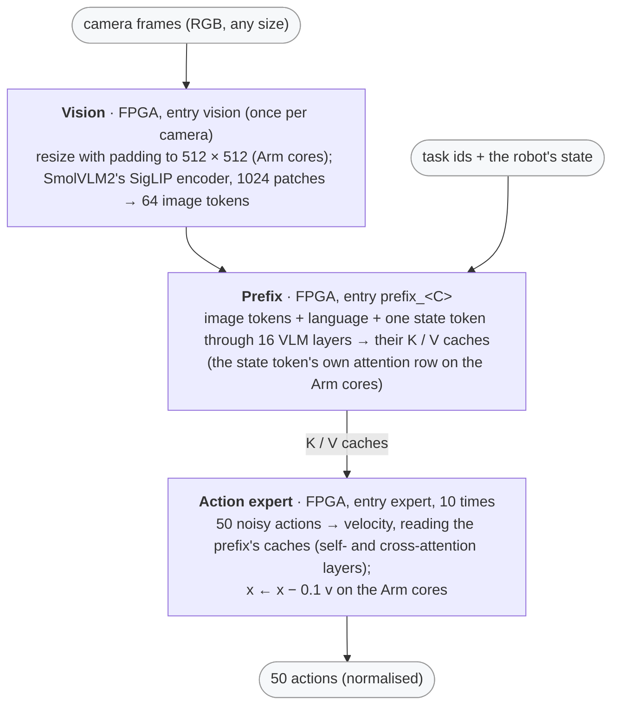

# SmolVLA on the KV260 (vision-language-action)

This directory runs [SmolVLA](https://huggingface.co/lerobot/smolvla_base)
(Hugging Face's LeRobot, Apache-2.0; 450 M parameters) on this repo's FPGA
kernels as the library `libsmolvla.so`.  Given camera frames, a task in words
("Pick up the cube and place it in the box.") and the robot arm's joint
state, it returns the next 50 actions (target joint positions).  The checkpoint
is `smolvla_base`, the pretrained policy meant for fine-tuning; a fine-tuned
SmolVLA of the same shape only needs its formats calibrated and the project
regenerated.

Plan, study and results: [`doc/plans/VLA_PLAN.md`](../../doc/plans/VLA_PLAN.md)
(§1 the study, §2 the implementation, §3 the board).



## Results (2026-11-01, production bitstream `b4e63457057a`, with the faster vision encoder of VLA_PLAN §4)

- **Speed** on the board, two cameras (480 × 640, as the SO100 datasets), the
  A53 driving the kernels:

  | step | time |
  |---|---:|
  | each camera's image (resize + vision encoder) | 1.31 s |
  | the prefix (16 VLM layers over 141 rows) | 0.47 s |
  | ten denoising steps | 0.86 s |
  | **a chunk of 50 actions** | **3.96 s** |

  One camera: 2.44 s (prefix 0.30 s, steps 0.83 s); three: 5.51 s (prefix
  0.67 s, steps 0.90 s).  The vision encoder went from 1.66 to 1.31 s per
  image in VLA_PLAN §4: its scores query-major for the softmax unit's row
  mode, its linears and row ops in two pipelined row pieces.  `vla_open`
  loads 794 MB of weights: 1.4 s from the page cache, 17 s from the SD card
  the first time.
- **Output:** on 24 SO100 evaluation samples every action bit-exact with the
  specification (`scripts/smolvla_q.py`), the repetitions and the close /
  re-open identical (VLA_PLAN §3, §4).  The
  specification's actions are within 4.0 % (relative L2) of the float model's
  with the same noise; the policy's own spread between two noise samples is
  66 %, lerobot's default bf16 inference 1.4 % (VLA_PLAN §1).
- **Memory:** 701 MiB of CMA (the chat server must be stopped), the 94 MB
  embedding table in host memory.

## Use

```python
import sys; sys.path.insert(0, "demo/vla")
from vla_lib import SmolVLA                      # ctypes, numpy only
vla = SmolVLA("/root/smolvla/lib/libsmolvla.so")
vla.set_image(0, top_rgb)                        # uint8 [h][w][3]
vla.set_image(1, wrist_rgb)
actions = vla.act(2, ids, state, seed=7)         # [50][32] float32, normalised
```

- `ids`: SmolVLM2's tokenizer (the project's `weights/tokenizer.json`) on the
  task + "\n", at most 48.
- `state`: the joint state normalised by the dataset's mean / std (the robot's
  6 values; the rest of the 32 are zero).
- The actions come out normalised the same way; the robot's are the first 6.
  Un-normalise them with the dataset's action stats.
- The noise: any standard normal [50][32] (`noise=`), or the library's seeded
  `vla_noise(seed)`.  A chunk is one sample of the policy's distribution.

## Reproduce

```bash
PY=demo/vla/assets/.venv-lerobot/bin/python          # the study's venv: scripts/requirements-study.txt
$PY demo/vla/scripts/vla_study.py fetch              # checkpoint, tokenizer, the SO100 samples (pinned)
$PY demo/vla/scripts/vla_study.py validate           # numpy float64 vs lerobot's torch
$PY demo/vla/scripts/vla_study.py study --torch      # the policies (~1 h)
$PY demo/vla/scripts/vla_study.py formats            # -> demo/vla/smolvla_base_<policy>_formats.json
inference-scheduler/.venv/bin/python demo/vla/scripts/generate_vla_project.py    # -> demo/vla/build/smolvla_base_project
inference-scheduler/.venv/bin/python demo/vla/scripts/vla_host_emu.py -n 1       # the generated C on the host
inference-scheduler/.venv/bin/python demo/vla/scripts/vla_board.py               # build on the board, the gate
```

The board gate holds the board lock; stop the chat server first
(`demo/chat/deploy.py --stop`): it owns the FPGA and most of the CMA.

## Files

```
demo/vla/
├── src/vla_api.{c,h}            — libsmolvla.so: vla_open / vla_set_image / vla_act / vla_close, vla_noise, vla_resize
├── src/vla_bench.c              — the board gate's runner (samples, repetitions, re-open)
├── vla_lib.py                   — the library from Python (ctypes)
├── smolvla_base_pow2+p12+vgelu+vsmx+rowops_formats.json — the calibrated exponents (vla_study.py formats)
├── scripts/
│   ├── vla_study.py             — select / fetch / validate / study / ablate / formats / costs (VLA_PLAN §1)
│   ├── vla_study_inputs.json    — the pinned checkpoint, tokenizer, datasets and sample frames
│   ├── smolvla_q.py             — the specification: the float64 reference and the int16 datapath
│   ├── generate_vla_project.py  — src/smolvla.py's entries -> build/smolvla_base_project
│   ├── vla_host_emu.py          — the generated C on the host vs the specification
│   ├── vla_board.py             — build on the board, the board gate (bit-exact, timing)
│   └── requirements-study.txt   — the study's venv (lerobot 0.6.1, CPU torch)
├── assets/                      — not in git: the checkpoint, the datasets, the study's results
└── build/                       — not in git: the generated project
```
