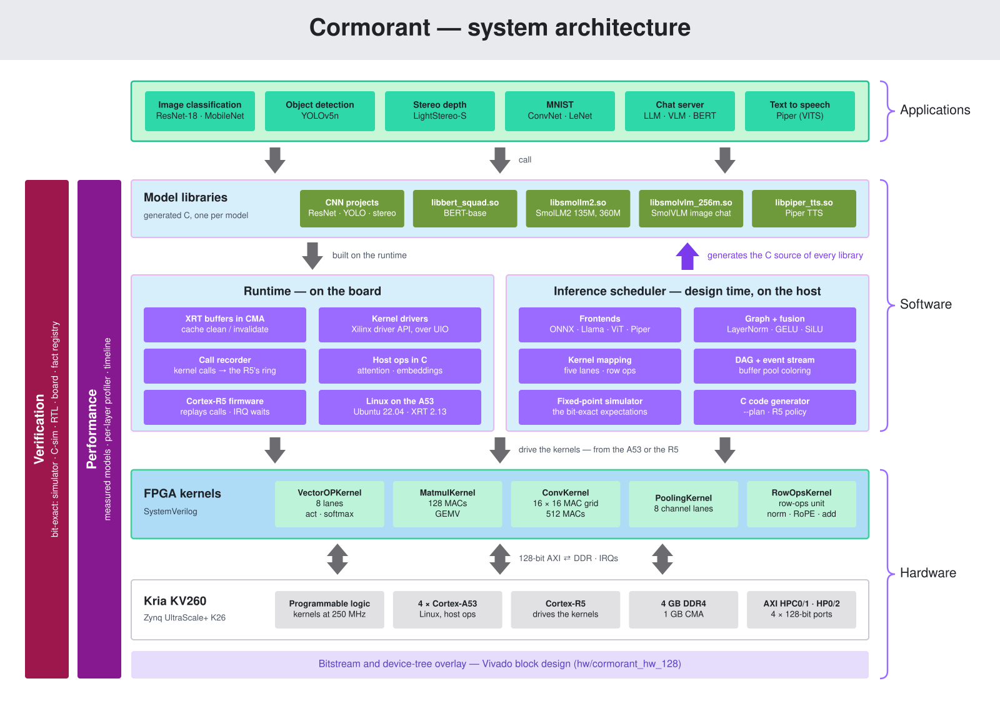
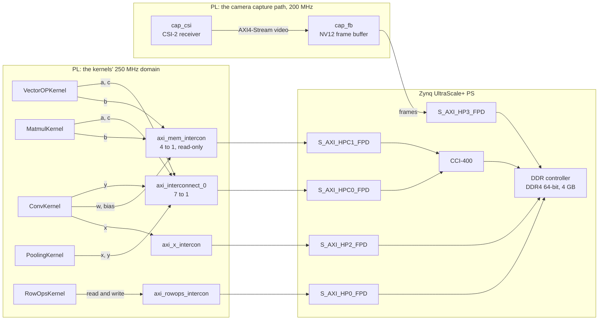
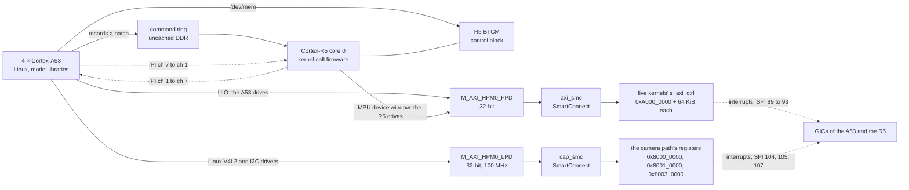
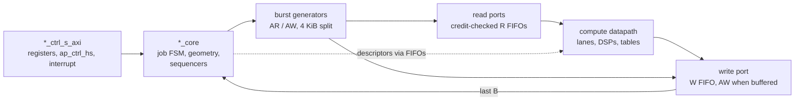
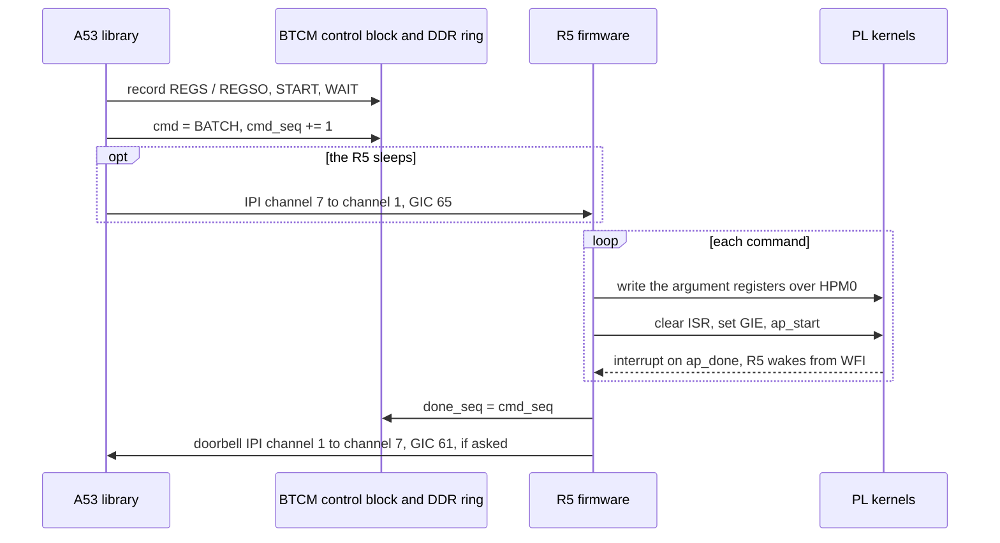
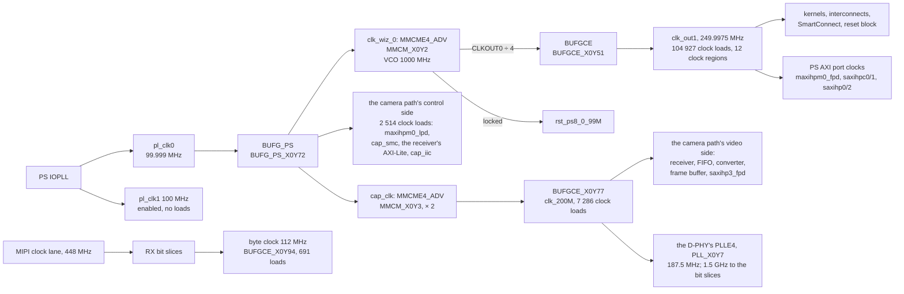
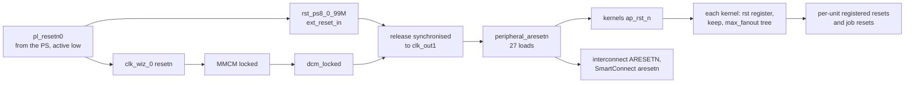
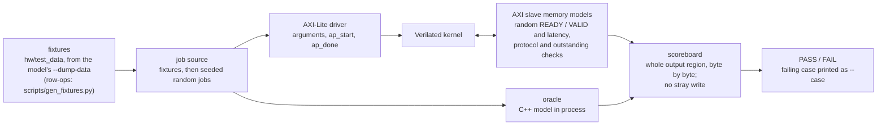
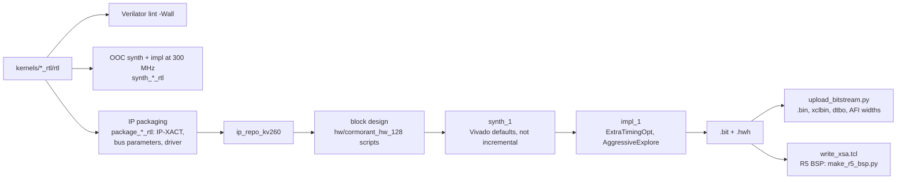

# Cormorant — hardware architecture

Cormorant is a neural-network inference accelerator on the Kria KV260: five
fixed-point kernels in the programmable logic (PL) of a Zynq UltraScale+
K26, driven by the Arm cores of the same device.  This document describes
the hardware in the order of an FPGA architecture document: requirements,
top-level structure, clocks and reset, memory, datapath, interfaces,
verification, and implementation.  The numbers are those of the production
bitstream `b4e63457057a` (since 2026-10-28) unless a section says otherwise.

| topic | document |
|---|---|
| each kernel's contract, micro-architecture and invariants | [`doc/kernels/*_RTL_KERNEL.md`](kernels/) |
| the block design and its scripts | [`hw/cormorant_hw_128/README.md`](../hw/cormorant_hw_128/README.md) |
| the scheduler (the software that compiles models for the kernels) | [`inference-scheduler/doc/ARCHITECTURE.md`](../inference-scheduler/doc/ARCHITECTURE.md), [`doc/scheduler/INFERENCE_SCHEDULER.md`](scheduler/INFERENCE_SCHEDULER.md) |
| the Cortex-R5 runtime and the power measurements | [`doc/plans/RPU_PLAN.md`](plans/RPU_PLAN.md) §9–§11 |
| the 250 MHz timing closure | [`doc/plans/FMAX_250_PLAN.md`](plans/FMAX_250_PLAN.md) |
| the PS port assignment | [`doc/plans/PS_PORTS_PLAN.md`](plans/PS_PORTS_PLAN.md), [`doc/plans/DEPTHWISE_PLAN.md`](plans/DEPTHWISE_PLAN.md) §8 |
| build targets and tests | [`doc/build-and-test/`](build-and-test/) |

---

## 1. Executive summary and system requirements

### 1.1 What the hardware does

The PL holds five kernels, each an AXI4 master with an AXI4-Lite register
block:

| kernel | computes | peak rate |
|---|---|---|
| **VectorOPKernel** | element-wise Add, Sub, Mul, Div, Relu, Relu6; LeakyReLU, SiLU, GELU, GELU-tanh; softmax over rows or columns | 8 elements per cycle (Div: 1) |
| **MatmulKernel** | batched C = A · B, tiled; a GEMV mode for one-row products | 128 MACs per cycle (GEMV: 16, port-bound) |
| **ConvKernel** | 2-D convolution, group 1 or depthwise; MatMuls lowered onto it | 512 MACs per cycle |
| **PoolingKernel** | Max, Average and Lp pooling, and their global forms | one window beat per cycle |
| **RowOpsKernel** (the row-ops unit) | row operations of transformers: residual add, RMSNorm / LayerNorm, SiLU · up, RoPE, transposes, copies, dequantisation to float32; Piper's windowed LeakyReLU rows (FOLD) and gates (GATE) | one 4 × 32-bit word per cycle |

The kernels share no data path.  Each call reads its operands from DDR and
writes its results to DDR, and software on the Arm cores chains the calls.
Calls on different kernels overlap.  The Cortex-A53 cores run Linux, the
model libraries and the operations no kernel implements.  The kernel calls
are issued either by the A53 or by bare-metal firmware on a Cortex-R5 core
(§2.4).

### 1.2 Target applications, throughput and latency

Every workload runs at batch 1, and per-inference latency is the figure of
merit.  The project had no external requirement specification.  Its plans
set targets as it went: ResNet-18 at ≥ 15 FPS
([`RESNET18_15FPS_PLAN.md`](plans/RESNET18_15FPS_PLAN.md), met at 100 MHz
and exceeded 3× since), interactive chat on SmolLM2, and faster-than-real-time
speech synthesis.  Results on the board at 250 MHz, measured 2026-10-18 on
`04259a7af917`, the production bitstream before `b4e63457057a` (the chat models'
and Piper's on 2026-10-17; `b4e63457057a` runs every kernel call as fast,
[`AREA_PLAN.md`](plans/AREA_PLAN.md) §6.5):

| workload | input | result |
|---|---|---|
| ResNet-18 | 224 × 224 | 20.0 ms (50 FPS) |
| MobileNet V1 / V2 | 224 × 224 | 20.5 / 17.6 ms |
| YOLOv5n | 640 × 640 | 47.6 ms (21.0 FPS) |
| LightStereo-S | 640 × 480 pair | 469 ms |
| BERT-base SQuAD | 256 tokens | 267 ms |
| SmolLM2-135M / 360M | chat decode | 20.4 / 7.8 tokens/s |
| SmolVLM-256M | one image | 1.6 s |
| Piper TTS | text | real-time factor 0.11 |

Each result is bit-exact with the scheduler's fixed-point simulation of the
same model.  Accuracy is set by the numerics studies (Q8.8 with calibrated
power-of-two exponents), not by the hardware.  The README's "Results on the
board" table is the reference for these numbers.

### 1.3 Power envelope

There is no power budget beyond the starter kit's own supply and fan.
Board power is measured with the INA260 on the carrier's 5 V rail
(RPU_PLAN §11.2, 2026-10-13, on `1cedaf2ed816`):

| state | board power |
|---|---|
| idle, no server, R5 asleep | 4.62 W |
| chat server loaded, idle | 4.72–4.77 W |
| back-to-back SmolLM2-135M chat | 6.2 W |

On `b4e63457057a`, the camera demo classifying live AR1335 frames at about
16 frames a second reads 4.8–6.6 W, most often 5.3 W (its own INA260
sampling, 2026-10-28).

Vivado's routed power estimate for `b4e63457057a` gives 7.40 W on-chip
(vectorless, junction 42.2 °C; low confidence, because the camera's input
pins have no activity specified — the internal nodes are at medium).  Of
that, the PS8 is 2.44 W, signals 1.56 W, CLB logic 0.91 W, DSPs 0.51 W,
URAM 0.48 W, block RAM 0.43 W, clocks 0.42 W, the MMCMs and the D-PHY's PLL
0.25 W, I/O 0.04 W and PL static 0.36 W.  The estimate assumes default
toggle rates and does not match the measured load: the whole board draws
less than Vivado's on-chip total.  The software-side savings are measured:
- the R5 sleeping between commands saves about 50 mW;
- the A53 power-down idle state saves about 9 mW.

### 1.4 External interfaces

| interface | where | use |
|---|---|---|
| DDR4, 64-bit, 4 GB | PS DDR controller | all kernel operands and results; the Linux memory |
| AXI4 (4 data paths) and AXI4-Lite (1 control path) | PS–PL boundary | the kernels' memory traffic and registers (§6) |
| AXI4 (1 data path) and AXI4-Lite (1 control path) | PS–PL boundary | the camera capture path's frames (`S_AXI_HP3_FPD`) and its control (`M_AXI_HPM0_LPD`, §6.6) |
| PL-to-PS interrupts, 5 + 3 lines | PS–PL boundary | kernel completion (§6.3); the camera's receiver, frame buffer and I²C |
| MIPI CSI-2, 4 lanes; I²C | PL pins: HP bank 66 (CSI-2), HD bank 45 (I²C, the ISP's reset and standby); the carrier's IAS0 connector | the AR1335 camera behind the AP1302 ISP (§6.6) |
| Gigabit Ethernet | PS (carrier) | the chat server's HTTP API, development access |
| USB 3 | PS (carrier) | cameras (RealSense D435, webcam) |
| UART | PS (carrier, FT4232H channel B) | serial console |

The kernels use no package pins.  The camera capture path is the only PL
I/O: 14 pins for the carrier's MIPI camera (CSI-2, I²C, the ISP's reset and
standby; §6.6).  There is no PCIe and no Ethernet MAC in the PL.

### 1.5 Device, board and toolchain

| item | value |
|---|---|
| board | Kria KV260 Vision AI Starter Kit (`kv260_som:part0:1.4`) |
| device | K26 SOM, part `xck26-sfvc784-2LV-c`: Zynq UltraScale+ MPSoC, speed grade -2LV, commercial temperature grade, package SFVC784 |
| fabric | 117 120 LUTs, 234 240 flip-flops, 1 248 DSP48E2, 144 RAMB36 tiles, 64 URAM288 |
| processors | 4 × Cortex-A53 at 1.33 GHz (Linux); 2 × Cortex-R5F at 533 MHz (one used, bare metal) |
| hardware tools | Vivado / Vitis 2025.2 |
| RTL simulation | Verilator 5.020; xsim (Vivado 2025.2) for the IP and block-design tests |
| board software | Ubuntu 22.04, kernel 5.15.0-xilinx-zynqmp, XRT 2.13, `cma=1400M` |

---

## 2. Top-level architecture

### 2.1 Block diagram

The datapath: every kernel port is a 128-bit AXI4 master, and four PS slave
ports carry the kernels' traffic to DDR.  A fifth, `S_AXI_HP3_FPD`, carries
the camera's frames (§6.6); the camera path shares nothing else with the
kernels.

The control path (§2.3) and the processors that drive it:

The block design (`hw/cormorant_hw_128`, `design_cormorant`) contains:
- the PS (`zynq_ultra_ps_e_0`);
- the clock wizard `clk_wiz_0` and the reset block `rst_ps8_0_99M`;
- the five kernels;
- four AXI interconnects for data;
- one SmartConnect for control;
- an interrupt concatenation;
- the camera capture path (`hw/cormorant_hw_128/scripts/bd_mipi_capture.tcl`,
  every cell prefixed `cap_`): the MIPI CSI-2 receiver subsystem
  `cap_csi`, an AXI4-Stream FIFO and subset converter, the frame-buffer
  writer `cap_fb`, the AXI I²C controller `cap_iic`, the SmartConnect
  `cap_smc` on `M_AXI_HPM0_LPD`, its clock wizard `cap_clk`, two reset
  blocks, an interrupt concatenation on `pl_ps_irq1` and two EMIO GPIO
  slices.

The kernels' IP identifiers keep the `xilinx.com:hls:<Kernel>:1.0` VLNVs of
the Vitis HLS kernels they replaced, so the block design and its drivers did
not change when the RTL went in.

### 2.2 Data flow

A model runs as a sequence of kernel calls and host operations.  The
scheduler fixes it at compile time.  Every intermediate tensor goes through
DDR:

1. The A53 writes the inputs into a physically contiguous buffer pool in DDR
   (from CMA) and cleans its caches over them.
2. Each kernel call reads its operands from the pool through its read ports
   and writes its output tensor back through its write port.  The next call
   on any kernel reads it from there.
3. Operations no kernel implements (embeddings, some attention steps, the
   sampler) run on the A53 between kernel calls.  They read and write the
   same pool.
4. The A53 invalidates its caches over the outputs and reads them.

There is no kernel-to-kernel streaming: the graphs are too varied in shape
for a fixed pipeline of units to pay off.  DDR traffic is the price.  The
kernels hide it with deep read FIFOs and many outstanding bursts (§4.3), and
the five kernels can run at the same time on separate PS ports (§4.5).

### 2.3 Control path and datapath

**System level.**  The control path is 32-bit AXI4-Lite from the PS's
`M_AXI_HPM0_FPD` through the SmartConnect to each kernel's `s_axi_ctrl`
(64 KiB apart from `0xA000_0000`), plus one interrupt line per kernel back
to the PS.  A kernel call is a block of argument registers followed by
`ap_start`; completion is `ap_done` (and the interrupt, when enabled).  The
datapath is the kernels' 128-bit AXI4 masters into the PS's slave ports.

**Inside a kernel.**  Every kernel separates a job controller from a
streaming datapath:

| kernel | control path (job FSM and sequencing) | datapath |
|---|---|---|
| VectorOPKernel | `vo_ctrl_s_axi`, `vo_core` (7-cycle configuration; the `outer × words` product as three 16 × 16 partial products), `vo_burstgen` | `vo_rd_port` × 2 (tail mask, stride-0 replay RAM), `vo_compute` (8 lanes) + `vo_div`, `vo_act` + `vo_act_rom`, `vo_smx` + `vo_smx_rom` (with its own phase sequencer), `vo_wr_port` |
| MatmulKernel | `mm_ctrl_s_axi`, `mm_core`, `mm_walker` (batch → 8-row panel → ≤ 512-column chunk), `mm_rungen` × 2; the units synchronise on monotonic counters | `mm_axi_rd` × 2, `mm_gearbox` × 2 (lane rotation), `mm_awr` → `mm_abuf` (A panel), `mm_xpf` × 2 (tap sets), `mm_lane` × 2 (64 MACs each), `mm_drain`, `mm_packer`, `mm_axi_wr` |
| ConvKernel | `cv_ctrl_s_axi`, `cv_core` (configuration through one pipelined multiplier and three dividers, about 40 cycles per job; the contract check; the sweep sequencer with a 4-deep descriptor FIFO per unit) | `cv_xload`, `cv_patch` (line buffer), `cv_wload`, `cv_bias`, `cv_engine` (weight cache, MAC grid of 32 `cv_mac_chain`s, two accumulator buffers), `cv_drain` (transposer), `cv_ywriter` |
| PoolingKernel | `pl_ctrl_s_axi`, `pl_core` (one pipelined multiplier, a 6-step divider, about 30 cycles per job; the chunk sequencer with 4-deep chunk FIFOs) | `pl_loader`, `pl_emit` (line buffer, window beats), `pl_reduce` (accumulators, finaliser), `pl_writer` |
| RowOpsKernel | `ro_ctrl_s_axi`, `ro_core` (job FSM, geometries, the op multiplexer, the TLOAD table loader, the descriptor chains), `ro_rd_arb` (round-robin AR merge), the scalar FSM of `ro_norm` | `ro_rd_port` × 2, `ro_param`, `ro_stream` (COPY, ADDX, DEQUANT, MULACT, GATE), `ro_norm`, `ro_rope`, `ro_xpose`, `ro_fold` (FOLD: row sequencer, eight lanes, packer, its own write bursts), `ro_wr_port` |

The control path is narrow and slow-changing.  Its timing is kept off the
datapath's critical paths by registering every configuration product before
use: geometry is computed once per job, a few cycles before the first
burst.

### 2.4 Who issues the kernel calls: A53 or R5

The interface to a kernel is the same whichever processor drives it.  A
generated model library decides per entry which one does
(`inference-scheduler/src/rpu_policy.py`).

- **A53.**  The library writes each call's registers through UIO and starts
  the kernel.  It waits only where a later call or a host op needs the
  result: it sleeps on a timer until just before the call's predicted end
  (the scheduler's performance model), reads the kernel's ISR from there, and
  falls back to sleeping on the kernel's interrupt through its UIO device
  (`runtime/inference_irq.[ch]`; §6.3).  On ResNet-18 and BERT that costs
  0.1–0.4 % latency for 81–85 % less A53 CPU.
- **R5.**  The library records each call's register block into a command ring
  in uncached DDR instead of writing it.  It flushes the batch to the R5
  before each host op.  The R5 writes the registers, starts the kernel and
  sleeps in WFI until the kernel's interrupt.  The R5 maps the kernels'
  1 MiB register window as device memory, so its register writes are posted.

The R5 costs 1.0 µs per call and 10.6 µs per batch, plus 61 µs per
inference and 38 µs for every further wake from its idle sleep.  The
policy puts an entry on the R5 when that overhead is at most 5 % of its
predicted inference time.  That covers every model but the two sub-3-ms MNIST
networks.  A ResNet-18 inference then costs the A53 0.65 ms of CPU instead
of 20 ms.  The control block (protocol version 5), the ring format and the
doorbell handshakes are in §6.4.

### 2.5 Multi-die and floorplan

The K26 is a monolithic device: there are no super logic regions, no SLL
crossings and no inter-die budget.  The floorplan constraint that takes
their place is the device's column structure:
- the PS sits on the left edge, so every PL-PS AXI port enters there;
- the DSP and URAM resources sit in fixed columns.

| kernel | placement constraint seen in context |
|---|---|
| ConvKernel | 512 grid DSPs across 10 DSP columns; 48 URAMs fill three quarters of the URAM column ([`CONV_RTL_KERNEL.md`](kernels/CONV_RTL_KERNEL.md)) |
| MatmulKernel | 128 MAC DSPs across columns X0–X5, far from its A-panel BRAMs ([`MATMUL_RTL_KERNEL.md`](kernels/MATMUL_RTL_KERNEL.md)) |
| all | the wide fan-outs (resets, job start, configuration fields) reach DSP / BRAM / URAM columns across the die, so they go through register trees (§8.3) |

No Pblocks are used, and no LOC constraints beyond the camera's package
pins (§6.6).  Placement is left to Vivado (`place_design -directive
ExtraTimingOpt`); it put the camera path in the device's top row of clock
regions (X0Y3–X2Y3), around its receiver's bit slices in X1Y3.

---

## 3. Clocks, clock-domain crossings and reset

### 3.1 Clock tree

The kernels have one clock.  `pl_clk0` (100 MHz from the PS's IOPLL) feeds
the kernels' MMCM, `clk_wiz_0`, which is configured as follows:
- multiply by 10, divide by 1, VCO at 1000 MHz;
- `CLKOUT0` divided by 4, giving 250 MHz;
- bandwidth `OPTIMIZED`, output jitter 110 ps, phase error 99 ps.

One global buffer distributes it to all of the kernels' logic.  The bitstream
thus sets its own kernel clock.  The bitstream loader still checks that PL0
is at the 100 MHz the hardware description expects, and sets it if not.  A
wrong PL0 would scale the kernel clock with it.

The camera capture path (§6.6) brings the other clocks, none of them on the
kernels' side:
- `pl_clk0` itself clocks the path's control side (`M_AXI_HPM0_LPD`, its
  SmartConnect, the receiver's AXI-Lite port, the I²C controller);
- a second MMCM, `cap_clk`, makes 200 MHz from it: the D-PHY's reference and
  the video clock of the receiver, the stream FIFO and converter, the frame
  buffer and `S_AXI_HP3_FPD`;
- inside the CSI-2 receiver, a PLLE4 makes the bit slices' clocks, and the
  RX bit slices recover the 112 MHz byte clock from the camera's 448 MHz
  clock lane (896 Mb/s per lane).

A sixth global buffer carries no clock: Vivado placed EMIO GPIO 0, the frame
buffer's reset (§3.4), on `BUFGCE_X0Y26` for its 1 134 loads.  `pl_clk1` is
enabled in the PS configuration but drives nothing; it is a candidate for
removal (§9).  No regional or divided clock buffers are used.  Vivado's
methodology check adds three advisories:
- CLKC-40: a PLLE4 could replace each MMCM, since one integer output needs no
  MMCM;
- CLKC-56: the MMCMs have no LOC;
- CLKC-58: neither has the D-PHY's PLL.

### 3.2 Clock domains and their maximum frequencies

| domain | frequency | source | logic |
|---|---|---|---|
| `clk_out1_design_cormorant_clk_wiz_0_0` | 250 MHz (4.000 ns) | MMCM `clk_wiz_0` | the kernels, their interconnects and SmartConnect; the PL side of their PS AXI ports (500 847 timed endpoints) |
| `clk_200M_design_cormorant_cap_clk_0` | 200 MHz (5.000 ns) | MMCM `cap_clk` | the camera path's video side and `S_AXI_HP3_FPD` (20 713 endpoints) |
| `clk_pl_0` | 100 MHz | PS IOPLL | the two MMCMs' input; the camera path's control side and `M_AXI_HPM0_LPD` (5 417 endpoints) |
| `mipi_phy_if_clk_p_FIFO_WRCLK_OUT` | 112 MHz (8.928 ns) | the camera's clock lane, 448 MHz, through the RX bit slices | the receiver's byte-clock logic (1 961 endpoints) |
| `GEN_PLL_IN_IP_USP.pll0_clkout0` | 187.5 MHz | the D-PHY's PLLE4, from `cap_clk` | the bit slices' control (16 endpoints) |
| `clk_pl_1` | 100 MHz | PS IOPLL | none |
| A53 cluster | 1.33 GHz | PS APLL | Linux, host ops |
| R5 | 533 MHz | PS (`dpll_to_lpd`) | the kernel-call firmware |
| DDR4 | 1066 MHz (2133 MT/s) | PS DPLL, set by the boot firmware | memory |

Each kernel's maximum frequency is measured out of context.  The flow is
Vivado synthesis with `PerformanceOptimized`, then `ExtraTimingOpt`
placement, routing and post-route physical optimisation, at 3.333 ns
(300 MHz):

| kernel | OOC slack at 300 MHz | est. Fmax OOC |
|---|---|---|
| VectorOPKernel | +0.210 ns | ≈ 320 MHz |
| MatmulKernel | +0.006 ns | ≈ 301 MHz |
| ConvKernel | +0.001 ns | ≈ 300 MHz |
| PoolingKernel | +0.184 ns | ≈ 318 MHz |
| RowOpsKernel | +0.002 ns | ≈ 300 MHz |

These are the production RTL's, after the second area pass
([`AREA_PLAN.md`](plans/AREA_PLAN.md) §6.2, 2026-10-24); the pass traded
some of Matmul's and Conv's out-of-context slack for area (+0.115 and
+0.026 ns before) and gave the row-ops unit some (−0.027 ns before).

In context the five kernels share the device, the interconnects and the
paths to the PS.  The whole design closes 4 ns with +0.040 ns (§8.4).  The
50 MHz between the out-of-context target and the in-context clock is the
margin that routing across the full, almost-full device consumes.

### 3.3 Clock-domain crossings

Inside the kernels there are none.  Every flip-flop, BRAM, URAM and DSP of
the kernels and their interconnects is on `clk_out1`, and Vivado's clock
interaction table has no path between `clk_out1` and any other clock.

The camera capture path has crossings, all inside Xilinx IP:

| crossing | where | constraint (the IPs' own XDC) |
|---|---|---|
| `clk_pl_0` ↔ `cap_clk` | `cap_smc`'s asynchronous FIFOs toward the frame buffer's registers (on the video clock), the receiver's register bank, the reset synchronisers | `set_max_delay -datapath_only` |
| byte clock → `cap_clk` | inside the CSI-2 receiver's encrypted core (42 clock-enable-controlled crossings) | `set_max_delay -datapath_only` |
| byte clock ↔ `clk_pl_0`, the D-PHY's PLL ↔ `cap_clk` | the receiver's status and control | false paths |

`report_cdc` on the routed design counts 234 crossing endpoints, all
safe: none unsafe, none unknown, every one with `ASYNC_REG` where it needs
it.  The methodology report's two warnings from the path are LUTAR-1, a LUT
driving the reset of an XPM synchroniser inside the receiver IP, and
TIMING-18, the I²C pads without I/O delays (§6.6).

At the PS–PL boundary the crossings are in hardened PS logic:

| crossing | between | mechanism |
|---|---|---|
| `S_AXI_HPC0/HPC1/HP0/HP2_FPD` | `clk_out1` and the PS's FPD interconnect clock | the ports' AFI FIFOs (asynchronous, in the PS) |
| `M_AXI_HPM0_FPD` | the FPD clock and `clk_out1` | the same, in the master direction |
| `S_AXI_HP3_FPD`, `M_AXI_HPM0_LPD` | `cap_clk` / `clk_pl_0` and the PS | the same, for the camera path |
| `pl_ps_irq0[4:0]`, `pl_ps_irq1` | `clk_out1` / the camera's clocks and the GIC | level signals held until software clears the source, so a synchroniser cannot miss one |
| `pl_resetn0` | the PS and `clk_out1` | `rst_ps8_0_99M` synchronises its release (§3.4) |
| EMIO GPIO 0 / 1 | the PS and `cap_clk` / the ISP | quasi-static resets that software changes while the stream is stopped (§3.4) |

Because the kernels have one domain, their RTL needs no synchroniser cells,
no `ASYNC_REG`, no `set_clock_groups` and no `set_max_delay -datapath_only`.
A second clock inside the kernels (for example a slower clock for a
low-power mode) would need all of these; §8.2 lists what the constraints
would have to gain.

### 3.4 Reset

- **Sources.**  `pl_resetn0` is the kernels' only reset source, from the PS
  and active low.  It resets the MMCM and is the external reset of the
  `proc_sys_reset` instance.  The MMCM's `locked` holds the reset block
  until the clock is stable.
- **Distribution.**  One output, `peripheral_aresetn`, synchronised to
  `clk_out1`, resets the five kernels, the four data interconnects and the
  SmartConnect.  `interconnect_aresetn` is unused, and the interconnects take
  the peripheral reset.
- **The camera path's resets** are its own.  `cap_rst_lite` (on `clk_pl_0`,
  from `pl_resetn0`) resets its control side, and `cap_rst_video` (on
  `cap_clk`, from `pl_resetn0` and `cap_clk`'s `locked`) the receiver's video
  side, the FIFO and the converter.  Two EMIO GPIOs are software resets that
  Linux drives through the overlay's `reset-gpios`:
  - GPIO 0 (Linux GPIO 78) is the frame buffer's `ap_rst_n`, toggled by the
    frame-buffer driver; it is not synchronised to `cap_clk` (as in AMD's
    platform), so it must only change while the IP is idle.  It reaches its
    1 134 loads through a global buffer.
  - GPIO 1 (Linux GPIO 79) leaves the device as the ISP's reset pin,
    `ap1302_rst_b`.
- **Inside the kernels: synchronous only.**  No always block has a reset in
  its sensitivity list.  Each kernel registers `rst <= !ap_rst_n` once, marks
  it `(* keep *)` with a `max_fanout`, and builds a register tree from it.
  Each unit then registers its own copy, and job-level state uses separate
  registered job resets (`urst_*`).
  - **Why synchronous:** the DSP48E2, BRAM and URAM pipeline registers only
    have synchronous resets, so an asynchronous reset would keep those
    registers out of the primitives.
  - **Why a register tree:** one reset net cannot reach every column of
    the device in 4 ns.  The tree lets placement put each copy next to its
    loads.
- **Datapath registers without reset.**  Wide datapath registers (lanes,
  DSP operands, FIFO storage) have no reset.  Their contents are qualified by
  valid bits, which do reset.  This keeps the reset fan-out small and lets
  Vivado pack registers into SRLs and primitive registers.
- **Contract after reset.**  A kernel comes out of reset idle (`ap_idle = 1`)
  with its interrupt enables cleared.  The argument registers keep their
  last written values across calls.  The R5 path relies on that to write
  only the registers that changed (REGSO, §6.4).

### 3.5 Power-on and configuration sequence

The PS boots from the SOM's QSPI flash with the starter kit's boot
firmware.  That firmware configures the PS (DDR controller, PLLs, MIO)
before Linux starts, so the PS settings of `design_cormorant` (the DDR
speed bin, the PS clocks) are not what runs on the board.  Only the PL part
of the bitstream is loaded, at run time:

1. `inference-scheduler/upload_bitstream.py` converts the `.bit` to the flat
   `.bin`.  It checks PL0 against the hardware description's 100 MHz and
   sets it if needed.
2. It removes the previous overlay, and first a `pynq` overlay that a PYNQ
   image's login shell may have inserted above it.  The kernel removes an
   overlay only when no overlay applied later touches the same nodes
   ("overlay #N is not topmost"), while configfs reports success either way;
   a refused removal would leave the old overlay in the live tree, so the
   script stops and asks for a reboot.  The R5's `rpu` and `rpu-ipi`
   overlays refuse it the same way: they are applied when the chat server or
   `rpu_board.py` starts the firmware and stay after it stops, and since every
   overlay here adds to `/__symbols__` the kernel will not remove ours from
   under them ("#2 overlaps with #4 @/__symbols__", 2026-10-28).  Once the R5
   has run, a reload needs a reboot (§9).
3. Linux's FPGA manager programs the PL.  The script checks the state reads
   "operating".
4. It loads a memory-topology-only xclbin into XRT's `zocl`, for the buffer
   objects.
5. It applies the device-tree overlay: `design_cormorant_capture.dtbo` on
   the production bitstream (five UIO nodes, `zocl`, the `afi0` node, and
   the camera's media pipeline — the receiver, the frame buffer, the I²C
   controller and the AP1302 behind it, whose driver then loads the ISP's
   firmware over I²C, about 2 s), or `design_cormorant.dtbo` without the
   camera.  It then checks that every UIO
   device holds the interrupt the overlay gives it; a device that kept an
   old one is rebound once.
6. It writes the AFI port-width registers last, because applying the overlay
   resets them (§8.6).

When `pl_resetn0` is released, the MMCM locks, the reset block releases
`peripheral_aresetn`, and the kernels are idle and ready for register
writes.  The R5 firmware is started
afterwards through remoteproc, by the R5 tools or the chat server's
deploy script.

Reprogramming the PL while a kernel has AXI transactions in flight can
wedge a PS port.  The board tools stop the chat server (and the R5) first.
After a hang the board is rebooted before reloading, and a board hang is
never debugged over SSH.

---

## 4. Memory and storage

### 4.1 On-chip memory budget

In-context utilization per instance, from the routed design of the
production `b4e63457057a` (2026-10-28; `report_utilization -hierarchical`):

| instance | LUT | of which LUTRAM | SRL | FF | RAMB36 | RAMB18 | URAM | DSP |
|---|---:|---:|---:|---:|---:|---:|---:|---:|
| VectorOPKernel | 9 578 | 542 | 188 | 10 714 | 30 | 0 | 0 | 35 |
| MatmulKernel | 14 062 | 6 620 | 22 | 12 113 | 38 | 0 | 0 | 138 |
| ConvKernel | 13 715 | 3 898 | 487 | 36 174 | 40 | 40 | 48 | 518 |
| PoolingKernel | 10 749 | 3 408 | 26 | 10 367 | 2 | 0 | 0 | 29 |
| RowOpsKernel | 27 160 | 4 024 | 744 | 21 742 | 6 | 0 | 9 | 125 |
| `axi_interconnect_0` (HPC0) | 1 862 | 0 | 10 | 3 734 | 0 | 0 | 0 | 0 |
| `axi_mem_intercon` (HPC1) | 1 283 | 0 | 0 | 2 030 | 0 | 0 | 0 | 0 |
| `axi_smc` (control) | 932 | 0 | 1 | 965 | 0 | 0 | 0 | 0 |
| `axi_rowops_intercon` (HP0) | 149 | 0 | 0 | 667 | 0 | 0 | 0 | 0 |
| `axi_x_intercon` (HP2) | 69 | 0 | 0 | 312 | 0 | 0 | 0 | 0 |
| the camera capture path (`cap_*`, §6.6) | 7 428 | 624 | 341 | 9 987 | 6 | 0 | 1 | 0 |
| **design** | **87 013** | **19 116** | **1 822** | **108 908** | **122** | **40** | **58** | **845** |

The kernels are those of the second area pass
([`AREA_PLAN.md`](plans/AREA_PLAN.md) §6: −11.8 k LUTs against
`04259a7af917`, whose RowOpsKernel held 35 337 LUTs and 133 DSPs).  The
capture path's six RAMB36 are the frame-buffer writer's line buffers (4) and
the CSI-2 receiver's (2), its URAM the receiver's.

Every RAM of the kernels is inferred from their RTL, with no XPM or IP
memories; the camera path's IPs build theirs from XPM macros
(`report_ram_utilization` counts both as inferred: 100 %).  In the kernels the
primitive is chosen with `(* ram_style *)` / `(* rom_style *)` attributes (41
in the RTL).  The rule is:
- block RAM for FIFOs deep enough to cover the DDR latency;
- URAM for large single-purpose stores;
- distributed RAM for shallow or wide-and-shallow buffers that need an
  asynchronous read.

### 4.2 Buffers and tables per kernel

| kernel | structure | size | primitive | ports / read latency | purpose |
|---|---|---|---|---|---|
| VectorOP | read FIFO × 2 | 512 × 128 | BRAM | simple dual-port, registered + skid | absorb DDR latency for a and b |
| | replay RAM × 2 | 256 × 128 | BRAM | SDP | replay a stride-0 (broadcast) operand on chip |
| | port and compute output FIFOs | 8 × 128, 32 × 128 | LUTRAM | async read | stage decoupling |
| | write FIFO | 512 × 128 | BRAM | SDP | hold a whole burst before AW |
| | softmax buffer | 8 banks × 2048 × 16 | BRAM | 2-cycle read; skewed in column mode | one softmax row or column block |
| | activation ROM | 4096 × 7 (3 786 used) | BRAM ROM, init from the bitstream | 2 read ports, output register; 1 RAMB36 per 2 lanes | SiLU / GELU correction table (`scripts/gen_act_rom.py`) |
| | exponential ROM × 4 | 4096 × 17 | BRAM ROM | 2 read ports; 2 RAMB36 per 2 lanes | `2^(−k/4096)` (`scripts/gen_smx_rom.py`) |
| Matmul | A panel | 16 × (128 × 256) | BRAM, 32 RAMB36 | 2-cycle read | the 8-row A panel, one RAM per (lane, row) |
| | accumulators | 128 × (64 × 32), as 32 RAMs of 64 × 128 | LUTRAM | async read, read-modify-write | one 32-bit word per MAC and beat; the 4 rows of a half-group share one RAM and its addresses |
| | tap FIFOs | 16 × 128 per beat lane | LUTRAM | | x-prefetch tap sets |
| | read FIFO × 2, write FIFO | 512 × 128, 512 × 144 | BRAM | SDP | DDR latency; data + strobes |
| Conv | weight cache | 16 columns × 512 × 256 | 8 columns BRAM, 8 URAM | double-banked: the next sweep fills while the current one is read | weight slabs |
| | accumulators | 2 × 4096 × 512 | URAM | output register | two buffers: drain overlaps compute |
| | line buffer | 16 channel banks × 16 rows × 64 columns × 16, two copies | BRAM | | the next output row loads beside the window reads |
| | column, weight-vector FIFOs | 256 × 256, 512 × 256 | BRAM | SDP | |
| | transposer | 8 banks × 1024 × 16 | BRAM | | output-channel-major to NCHW |
| | patch FIFO, replay file, row buffer, bias RAM, y FIFOs | 64 × 512; 2 × 64 × 256; 16 × 32 × 128; 2 × 128 × 128; 32 × 145 + 8 × 52 | LUTRAM | async read | |
| | operand skew | none in SRLs | weight-cache read addresses, DSP A registers | | weight lane l reaches DSP l l + 1 cycles late: group k of 4 lanes reads its RAM 4k cycles later, the A1 / A2 / AD registers add the rest; the patch lanes through register copies into the B port |
| Pool | read FIFO | 256 × 128 | BRAM | SDP | |
| | line buffer | 8 channels × 8 column banks × 16 rows × 8 words | LUTRAM | async read | window rows |
| | row buffers, W / AW FIFOs, bundle FIFO | 2 × 8 banks; 32 × 145, 8 × 68; 32 × 32 | LUTRAM | | |
| | reciprocal table | 64 × 24 | constant logic | | `round(2^23 / d)` for averages |
| RowOps | parameter RAM | 2 × 4096 × 72 | URAM | port A loads, port B reads; 2-cycle read | per-column G, Bq', shifts (16 bytes per column) |
| | sigmoid table | 4096 × 49, four copies | URAM | 2 ports each | MULACT's and GATE's σ, interpolated |
| | rsqrt table | 8192 × 32 (two per word) | URAM | | NORM's first reciprocal-sqrt estimate |
| | norm ring | 4096 × 128 (2 URAMs) | URAM | | a row held between the sum pass and the emit pass |
| | read FIFO × 2, write FIFO | 256 × 128, 256 × 144 | BRAM | SDP | |
| | transpose banks, RoPE buffers, output FIFOs | 8 × 128 × 128; 2 × 16 words; 32 × 128 | LUTRAM | async read | |

**ROM versus RAM.**  The VectorOP tables are ROMs.  Their contents are
generated into the RTL (`vo_act_rom.sv`, `vo_smx_rom.sv`) and come with the
bitstream; ctest `VectorOpRtlActRom` / `VectorOpRtlSmxRom` check the
generated files are current.  URAM has no initial contents, so the row-ops
unit's tables are RAMs.  They are loaded once per bitstream by the TLOAD
job from a 64 KiB image in DDR, and every library that uses the unit runs
TLOAD at init.

### 4.3 FIFO sizing and flow control

All five kernels use one first-word-fall-through FIFO module per kernel
(`vo_fifo`, `mm_fifo`, `cv_fifo`, `pl_fifo`, `ro_fifo`) with a choice of
storage:
- **LUTRAM:** distributed RAM with an asynchronous read.
- **BRAM:** block RAM with a registered read and a 4-entry LUTRAM ring
  (three entries used) behind it, so it still sustains one pop per cycle.
  The ring replaced a three-register skid stage that cost about 200 LUTs and
  400 FFs per FIFO (`doc/plans/AREA_PLAN.md` step 1).

The depths follow three rules:

1. **Reads are credit-checked.**  A read burst is issued only when its FIFO
   can take every beat of it, so `RREADY` is tied high and a stalled
   datapath never back-pressures the PS port.  A read FIFO's depth therefore
   bounds the data in flight: 512 beats for VectorOP and Matmul (8 KiB per
   port), 256 for Pool and RowOps.
2. **Writes are issued when buffered.**  VectorOP issues `AW` only once all
   of the burst's beats are in its write FIFO, so a slow producer never
   holds the write channel or the interconnect's W path.
3. **Pipeline-to-FIFO.**  A stage's output FIFO is deeper than the pipeline
   that feeds it, so stopping a pipeline at a full FIFO never drops what is
   still in flight.  For example, VectorOP's 32-entry compute FIFO exceeds
   its 5 + 7 stages ([`VECTOROP_RTL_KERNEL.md`](kernels/VECTOROP_RTL_KERNEL.md)
   invariants).

### 4.4 External memory

| property | value |
|---|---|
| devices | DDR4 on the K26 SOM, 4 GB, 64-bit, no ECC |
| rate | 2133 MT/s (DPLL 1066 MHz, set by the boot firmware), 17 GB/s peak |
| PS address map | `DDR_LOW` `0x0000_0000`–`0x7FFF_FFFF` (2 GB), `DDR_HIGH` `0x8_0000_0000`–`0x8_7FFF_FFFF` (2 GB) |
| kernel addressing | physical, 64-bit address fields; the kernels' address arithmetic is 48-bit (bytes) / 44-bit (128-bit words), the upper bits zero — the PS ports' physical space is 40 bits; the SMMU stays in bypass |
| buffers | one contiguous pool per model library, from CMA (`cma=1400M`) as an XRT buffer object, carved by the scheduler into weights, persistent states and coloured intermediate slots |
| caching | the pool is mapped cacheable for the A53; the runtime cleans before a kernel reads and invalidates after a kernel writes; the R5's command ring is uncached |

The chat server's model pools are 216 MiB (BERT), 299 MiB (SmolLM2-135M),
758 MiB (SmolLM2-360M) and 495 MiB (SmolVLM-256M), beside Piper's 54 MiB
and Moonshine base's 186 MiB.  That is more than the
CMA area together, so the server keeps what fits resident and swaps the
rest.  A large pool can fail to allocate after uploads and builds even with
enough free CMA.  `inference-scheduler/src/remote/cma.py` drops the page
cache and compacts memory first.

An SMMU-mapped variant (kernel `AxPROT = 010` and an IOVA window in
`DDR_HIGH`) was built and passed the model suite.  It is kept on a branch:
production keeps physical addressing.

### 4.5 Arbitration and bandwidth

Each kernel port is 128 bits at 250 MHz, 4 GB/s per direction.
Arbitration happens at two levels:

1. **In the PL.**  The two shared interconnects (`axi_interconnect_0`, 7
   to 1, and `axi_mem_intercon`, 4 to 1) are AXI Interconnects with a
   shared-address, multiple-data crossbar: round-robin address arbitration
   between their slave ports.  The HP2 and HP0 interconnects carry one
   master each.  All four have register slices on their slave ports, and
   `axi_interconnect_0` and `axi_rowops_intercon` on their master ports as
   well.  `axi_mem_intercon` also has address-decode stages (`axi_mmu`) on
   its four slave ports.  The
   interconnects are sized from the outstanding-transaction counts each IP
   declares in its packaging (§6.1).  Without those declarations the crossbar
   gives every slot 2.
2. **In the PS.**  HPC0 and HPC1 reach DDR through the CCI-400, where they
   compete with the A53's traffic.  HP0 and HP2 go straight to the DDR
   controller's ports, and so does HP3, the camera's frame buffer (a
   640 × 480 NV12 stream at 30 frames a second is 14 MB/s, 1920 × 1080 at 30
   is 93 MB/s: nothing beside the kernels' GB/s).

The assignment of kernel ports to PS ports is measured, not designed
(PS_PORTS_PLAN, DEPTHWISE_PLAN §8.5, HOSTOPS_PLAN phase 3):
- **VectorOP's b on HPC1.**  Its two reads are then on separate ports: a
  256 K-element ADD moves 8.5 GB/s, against 5.7 GB/s with both on HPC0.
- **ConvKernel's x on HP2.**  It bypasses the CCI, which returned its
  144-byte row runs at about 0.4 beats per cycle.  Depthwise and
  few-channel 1 × 1 convs became 27–67 % faster.
- **The row-ops unit on HP0.**  It has a path of its own beside the other
  kernels.
- **Outputs on HPC0.**  Every experiment that moved an output to an HP port
  was slower.

At the DDR level, the scheduler places a binary VectorOP call's three
operands in different DDR banks (address bits 14–15): about 20 % faster
memory-bound calls (`inference-scheduler/src/bank_phase.py`).

### 4.6 Alignment and staging contract

- **Run starts.**  Every run (a contiguous span the kernel reads or writes)
  starts 16-byte aligned, so a beat never straddles two words.
- **4 KiB boundaries.**  Bursts never cross one.  The burst generators split
  them, so the PS never sees an illegal burst.
- **Last words.**  The last word of every output run is written whole
  (VectorOP: tail lanes zero).  The other kernels write byte strobes on their
  first and last beats (Matmul, Pool, Conv's y) or on byte granules (the
  row-ops unit's TRANSPOSE).
- **Allocations.**  The scheduler allocates 64-byte-aligned buffers with
  enough slack for whole last words.

On-chip staging replaces caches.  The kernels have no general cache; each
holds exactly the reuse its algorithm has:
- the A panel (Matmul);
- the weight cache and the line buffer (Conv);
- the line buffer (Pool);
- the replay RAM for broadcast operands (VectorOP);
- the norm ring and the parameter RAM (row-ops unit).

---

## 5. Datapath and processing

### 5.1 Number formats

| format | where | encoding |
|---|---|---|
| Q8.8 (`ap_fixed<16,8>`) | every 16-bit tensor element | two's complement, `1.0 = 0x0100`, range [−128, 128) |
| per-tensor / per-channel power-of-two exponents | transformer, ViT, TTS and stereo graphs | the same 16-bit integers, with the scale carried by the scheduler; constant weights at `f_w = f_out + 8 − f_in` |
| int32 at 2^−15 | the row-ops unit's residual stream | 32-bit integer rows |
| `ap_fixed<32,16>` | Matmul, Conv and Pool accumulators | 32-bit, wraps modulo 2^32 |
| IEEE float32 | the row-ops unit's DEQUANT output (logits) | round to nearest, ties to even |

There is no floating-point arithmetic in the PL beyond DEQUANT's output
conversion.

### 5.2 Bit growth, rounding and saturation

Each kernel's numeric behaviour is fixed by its reference model:
- VectorOP, Matmul, Conv and Pool by the C++ model in
  `kernels/<k>_rtl/model/`, the retired HLS kernel;
- the row-ops unit by the Python specification
  `inference-scheduler/src/rowops_spec.py`.

The scheduler's simulator computes the same.

| operation | growth | rounding | saturation |
|---|---|---|---|
| VectorOP ADD / SUB | 17-bit sum | exact | to Q8.8 (`sat17`) |
| VectorOP MUL | Q16.16 product | `>>> 8`, floor | to Q8.8 |
| VectorOP DIV | 25-bit quotient | toward zero | to Q8.8 (−128 ÷ −1/256 gives `0x7FFF`) |
| VectorOP LeakyReLU | 33-bit `x · alpha` (alpha in 2^−16) | round to nearest, ties to even | — |
| VectorOP SiLU / GELU / GELU-tanh | `max(x, 0) − rom[abs(x)]` | the table is built so the result is the exact function rounded to nearest, ties to even | — |
| VectorOP softmax | 17-bit exponential table, a 25-cycle restoring divider for `R = floor(2^40 / S)` | `P = min((e · R + 2^(39 − f_p)) >> (40 − f_p), 32767)` | at 32767; within 1 LSB of the exact softmax |
| Matmul, Conv | Q8.8 × Q8.8 = Q16.16 exact; sums in the 48-bit DSP P register, low 32 bits kept (wraps); Conv seeds the bias as `bias · 2^8` | `>>> 8`, floor, once at the output (`mm_drain`, `cv_drain`) | to Q8.8 (`sat16`) |
| Pool MAX / AVG / LP1 / LP2 | 32-bit sums (wrap); AVG multiplies by `round(2^23 / d)` and shifts 23; LP2 takes a 3-step Horner square root in `ap_fixed<24,4>` | floor at each step | to Q8.8 |
| row-ops NORM | exact S1 / S2 in 80-bit carry-save; a table rsqrt plus one Newton step (`ro_mul32`, 32 × 32 as four 16 × 16 products) | `rne_shr`: round to nearest, ties to even, in two stages (`rne_a` / `rne_b`) | `sat16` / `sat32` |
| row-ops MULACT | `silu_q = rne_shr(g · σ, 18)`; σ from a 24-bit table, interpolated | ties to even | as above |

The accumulators wrap instead of saturating because the HLS kernels did,
and the models are bit-exact references.  Overflow is excluded upstream:
the numerics studies record accumulator peaks far inside the range (for
example 295 of 32 768 in SmolLM2-135M).  The exponents the frontends
calibrate keep one bit of headroom.

### 5.3 DSP usage

| kernel | DSP48E2 | how they are used |
|---|---:|---|
| VectorOPKernel | 35 | one multiplier per lane in `vo_compute` (8), one per lane for LeakyReLU in `vo_act` (8, A / B / M / P registers), two per lane in `vo_smx` (16), three 16 × 16 partial products for the job geometry (3) |
| MatmulKernel | 138 | 128 MACs (`mm_mac`: AREG = BREG = 2, CREG, MREG, PREG; `P = C + A · B`, the accumulator from LUTRAM through C, no cascade) + 1 per run generator + 8 for the drain's lane sums, one per beat lane (`AREA_PLAN.md` §6.1) |
| ConvKernel | 518 | the MAC grid: 32 chains of 16 DSP48E2 in a PCIN / PCOUT cascade (2 pixels × 16 output channels × 16 input channels); the seed enters DSP 0's C port, DSP 15 accumulates over window positions; the weight on the A port (AREG = 2, and the AD register on lanes l % 4 ≠ 0: the end of its skew), the patch on the B port (BREG = 1), MREG = PREG = 1; the other 6 in control arithmetic, the configuration multiplier among them |
| PoolingKernel | 29 | control arithmetic and the finaliser's multiplies (AVG reciprocal, LP2 Horner steps) |
| RowOpsKernel | 125 | of which the stream ops 24 (32 × 25 and 39 × 17 products), RoPE 16, NORM 69 (44 × 32 emit product, `ro_mul32`; 77 before the second area pass), FOLD 8 (one reciprocal product per lane) |
| **total** | **845 / 1 248** | |

ConvKernel's chains are the only cascaded DSPs: a 16-deep partial-sum chain
needs no fabric adder tree.  Its operands arrive skewed by the weight
cache's read addresses and the DSPs' A registers, not by SRLs (§4.2).  The behavioural chain that Verilator simulates is checked cycle by
cycle against Vivado's DSP48E2 unisim model (§7.1).

### 5.4 Pipelines, latency and initiation interval

| kernel | initiation interval | pipeline depth | per-job setup | measured |
|---|---|---|---|---|
| VectorOP | one 128-bit word (8 elements) per cycle; DIV one element per cycle | compute 6 stages; activation +7; divider 26; softmax a shared 21-stage pipeline | 7 cycles | ≈ 0.96 words per cycle on large jobs, memory-bound; softmax row mode `75 + rows · (58 + 3 ⌈n/8⌉)` cycles |
| Matmul | 128 MACs per cycle (GEMM), 16 (GEMV) | MAC issue → B/A registers → M → P → accumulator write: 5 cycles; drain 9; an accumulator recurrence of 3 (rows shorter than 3 beats bubble) | the first A panel load | 123 MACs per cycle on 64 × 576 × 576; 15.4–15.9 on GEMV |
| Conv | one window position per cycle for a pixel pair (512 MACs) | issue → operand 6; issue → chain output 24; write-back 3 | about 40 cycles + the first weight slab | 1 × 1 kernels at half rate (two instants per pixel pair); the grid bound `n · out_h · ⌈out_w/2⌉ · G · max(kh · kw, 2)` cycles |
| Pool | one window beat per cycle | finaliser 9 stages, one channel (2 lanes) per cycle | about 30 cycles | global pools load-bound |
| RowOps | ≤ 1 output word (4 × 32-bit) per cycle; NORM 4 elements per cycle; COPY and RoPE half the port rate; FOLD one 8-element source word per cycle | stream ops 21 stages; NORM emit 17; RoPE 10; FOLD 10 | ~2 µs per job | `max(words read, words written) + ~2 µs` |

At system level, the latency budget of a kernel call includes the driver:
- **From the A53:** the shortest measured call is 1.7 µs, register writes to
  done (the performance model's `call_overhead_us`).
- **From the R5:** each call adds 1.0 µs.

The scheduler's performance model prices every call from these and from
per-family fits measured on the board.  When it was built it predicted every
measured workload within 2 % but SmolLM2-360M (−2.6 … −6.0 %)
([`doc/plans/TACTICS_PLAN.md`](plans/TACTICS_PLAN.md) §9).  The later checks
(`inference-scheduler/perf_models/README.md`) keep the CNNs and BERT within
0.4 %, but put the chat libraries 2.5–6.3 % and Moonshine's 128 / 256-frame
buckets 5–6 % under the board, and the Piper chunk 4.3 % over: the host-op
model predates the A53's interrupt waits, and a re-profile is open (§9).

---

## 6. Interfaces and bus protocols

### 6.1 AXI4 masters (data)

All data ports are AXI4 memory-mapped:
- 128-bit data, 64-bit addresses (bits 63:48 zero), INCR bursts of 16-byte beats;
- one ID (the row-ops unit's reads use two), so data arrives in order;
- `AxCACHE = 0011`, `AxPROT = 000`;
- no burst crosses a 4 KiB boundary;
- `RREADY` is tied high under the credit rule of §4.3.

| kernel | port | direction | PS port | max burst (beats) | outstanding | write strobes |
|---|---|---|---|---:|---:|---|
| VectorOP | `gmem0` a | read | HPC0 | 64 | 16 | |
| | `gmem1` b | read (none for unary ops) | HPC1 | 64 | 16 | |
| | `gmem2` c | write | HPC0 | 256 | 16 awaiting B | all ones; a run's last word whole, tail lanes 0 |
| Matmul | `gmem0` | read: A and B, the even 16-plane K blocks | HPC0 | 64 | 16 | |
| | `gmem1` | read: the odd K blocks (GEMV: half of B each) | HPC1 | 64 | 16 | |
| | `gmem2` C | write | HPC0 | 64 | 16 | partial on a run's first and last beat |
| Conv | `gmem0` x | read | HP2 | 16 | 16 | |
| | `gmem1` weights | read | HPC1 | 128 | 8 | |
| | `gmem2` bias | read | HPC1 | 256 | 2 | |
| | `gmem3` y | write | HPC0 | 64 | 8 | the run's own lanes |
| Pool | `gmem0` x | read | HPC0 | 16 (≤ 9 used) | 16 | |
| | `gmem1` y | write | HPC0 | 16 | 8 | first and last word |
| RowOps | `gmem0` | read (ARID 0 stream A, ARID 1 stream B) and write (AWID 0) | HP0 | 64 | 16 per direction | all ones except TRANSPOSE (byte granules) |

The burst lengths, outstanding counts and read- / write-only flags are
declared in each IP's packaging (`kernels/<k>_rtl/syn/package_ip.tcl`), as
the HLS exports declared them.  The interconnects size their slots from
them.  The fact registry entry `rtl.axi_masters` checks the declarations
against each kernel's package constants.

The camera path adds one more master, apart from the kernels: the frame
buffer's `m_axi_mm_video` (128-bit, write-only) into `S_AXI_HP3_FPD` (§6.6).

### 6.2 AXI4-Lite control slaves and register maps

| kernel | base | address bits | arguments |
|---|---|---:|---:|
| VectorOPKernel | `0xA000_0000` | 7 | 13 |
| MatmulKernel | `0xA001_0000` | 8 | 13 |
| ConvKernel | `0xA002_0000` | 8 | 24 |
| PoolingKernel | `0xA003_0000` | 8 | 19 |
| RowOpsKernel | `0xA004_0000` | 7 | 21 |

Every block has the HLS `ap_ctrl_hs` layout:

| offset | register | bits |
|---|---|---|
| `0x00` | control | 0 `ap_start`, 1 `ap_done` (clear on read), 2 `ap_idle`, 3 `ap_ready` (clear on read), 7 `auto_restart`, 9 interrupt |
| `0x04` | GIE | 0 global interrupt enable |
| `0x08` | IER | 0 done, 1 ready |
| `0x0C` | ISR | 0 done, 1 ready (toggle on write) |
| `0x10` up | arguments | 32-bit words; 64-bit addresses as two words |

The per-kernel maps are in each kernel document's register section.

**Source of truth: the driver generators.**  There is no CMSIS-SVD file.
The register map lives in one table per kernel, `REGS` in
`kernels/<k>_rtl/scripts/gen_driver.py`.  From it the generator writes:
- the C driver in the Vitis HLS driver format (`x<kernel>_hw.h`, the
  `X<Kernel>_Set_*` / `_Start` / `_IsDone` API, the Linux and standalone
  back ends, the `.mdd` / `.tcl` / `.yaml` metadata);
- the copy of that driver that the IP packaging embeds.

The ctest `<K>RtlDriver` checks `REGS` against the address constants of
`rtl/*_ctrl_s_axi.sv`.  The fact registry's `registers.<Kernel>` entries
check the scheduler and other consumers against the same table.  The same
`xparameters.h` and drivers serve the R5's BSP.

### 6.3 Interrupts

Each kernel's interrupt is `GIE && |ISR`, registered and level-high.  The
five lines are concatenated into `pl_ps_irq0[4:0]`:

| kernel | `pl_ps_irq0` bit | SPI | GIC id | used by |
|---|---:|---:|---:|---|
| VectorOPKernel | 0 | 89 | 121 | the A53's and the R5's waits |
| MatmulKernel | 1 | 90 | 122 | the A53's and the R5's waits |
| ConvKernel | 2 | 91 | 123 | the A53's and the R5's waits |
| PoolingKernel | 3 | 92 | 124 | the A53's and the R5's waits |
| RowOpsKernel | 4 | 93 | 125 | the A53's and the R5's waits |

The camera path's three lines go to `pl_ps_irq1` through their own
concatenation (`cap_irq`), owned by the Linux drivers of its overlay:

| source | `pl_ps_irq1` bit | SPI | GIC id | driver |
|---|---:|---:|---:|---|
| `cap_csi` (CSI-2 receiver) | 0 | 104 | 136 | `xilinx-csi2rxss` |
| `cap_fb` (frame buffer) | 1 | 105 | 137 | `xilinx-frmbuf` |
| — (tied 0) | 2 | 106 | 138 | |
| `cap_iic` (AXI I²C) | 3 | 107 | 139 | `xiic-i2c` |

Both processors use the same record, ISR bit 0 (IER bit 0 set), and raise
GIE only while they wait.  The R5 sets GIE on a lane before the lane's first
start in a batch and clears it at the end of the batch.  The A53, when it
drives, clears the ISR and raises GIE before each start and drops GIE after
its wait (`inference_irq.h`); Linux's `uio_pdrv_genirq` masks the line when
it fires, and the library unmasks it before each sleep.  So a kernel line is
up only while one of them waits on it, and either can drive a kernel after
the other.  The Linux overlay
(`dts/kv260/cormorant.dts`) gives each kernel's UIO node the same SPI, so an
interrupt-driven wait on the A53 can use it; the fact registry's
`board.irq_spi` checks the overlay and this table against the block design.

### 6.4 Inter-processor interrupts and the R5 control block

The A53 and the R5 talk through memory and IPI doorbells, never through the
PL:

| resource | address | role |
|---|---|---|
| R5 ATCM (64 KiB) | `0xFFE0_0000` | the firmware's code |
| R5 BTCM (64 KiB) | `0xFFE2_0000` | the firmware's data; the 512-byte control block at its start, which the A53 maps through `/dev/mem` |
| IPI channel 1 (RPU 0) | `0xFF31_0000`, SPI 33 (GIC 65) | the R5's channel: the A53 rings it here, the R5 rings the A53 from it |
| IPI channel 7 (PL 0 agent) | `0xFF34_0000`, SPI 29 (GIC 61) | UIO `rpu_ipi`: the A53's end of both doorbells |
| command ring | uncached DDR, one per library | REGS (an argument block), REGSO (only the changed registers), START, WAIT |

The control block (`runtime/rpu/rpu_ctrl.h`, protocol version 5) holds:
- the command and its sequence numbers;
- the ring address and the firmware's lane mask;
- counters and the fault state of a hung batch;
- the handshake words of both doorbells.

A library of another protocol version refuses to attach and drives the
kernels from the A53.

Both doorbells use a store–fence–load handshake: each side writes its own
flag, fences, then reads the other's, so a ring cannot be lost.
- **A53 → R5.**  The R5 sets `r5_sleeping` after 1 ms idle.  The A53 rings
  it only when that flag is set after a submission.
- **R5 → A53.**  The A53 asks for a doorbell when it would rather sleep than
  spin for longer than 50 µs.

A WAIT reads the kernel's done bit, which is cleared and confirmed before
each start.  It then sleeps in WFI with the lane's line unmasked and IRQs
held off, so no completion falls between the check and the sleep.  The
handler only masks the line.

### 6.5 AXI4-Stream

None in the kernels.  They exchange data only through DDR (§2.2), and inside
a kernel the stages are connected by valid / ready FIFOs, not AXI4-Stream.
The camera path is a video stream: the CSI-2 receiver's AXI4-Stream video
output (two YUV 4:2:0 8-bit pixels a beat, `tuser` start of frame, `tlast`
end of line) through a 512-deep `axis_data_fifo` and an
`axis_subset_converter` (32 → 48-bit `tdata`) into the frame-buffer writer.

### 6.6 Pins, I/O standards and termination

Up to `04259a7af917` the design used no package pins: 0 of 189 bonded IOBs,
no I/O constraints, no I/O standards, no termination and no I/O timing.
Every external interface is a PS peripheral on MIO or GTR pins, configured
by the boot firmware (§1.4).  A PL design that adds pins needs the
carrier's pinout (the KV260 carrier wires its PMOD and Raspberry Pi headers
and the camera connectors to PL I/O banks) and I/O constraints of its own.

The block design's camera capture path (since 2026-10-27,
`hw/cormorant_hw_128/scripts/bd_mipi_capture.tcl`; in the production
`b4e63457057a`) is the first to do so: 14 bonded IOBs — the AR1335 / AP1302
camera's 4-lane MIPI CSI-2 link on bank 66 (clock G1, data E1 F2 G3 E4:
5 differential inputs into the receiver's RX bitslices, 100 Ω termination),
its I²C (G11 / F10, LVCMOS33) and the ISP's reset and standby (J11 / J10),
these four on HD bank 45 —
constrained in `cormorant_hw_128.srcs/constrs_1/new/capture.xdc` and the
receiver IP's own constraints.  The I²C pads have no input or output delays
(Vivado's TIMING-18, §8.4): the bus runs at 400 kHz.  The path runs on its own 200 MHz MMCM, its
control on `M_AXI_HPM0_LPD`, its frames on `S_AXI_HP3_FPD`, its interrupts on
`pl_ps_irq1`, apart from the kernels (the `hw/cormorant_hw_128` README's
*Camera capture path*; the overlay `dts/kv260/cormorant_capture.dts`, the
consumer `demo/camera`).

---

## 7. Verification, simulation and debug

### 7.1 Strategy

Every level is checked bit-exactly against the level above it:

| level | device under test | checked against | tools |
|---|---|---|---|
| reference models | the C++ models (`kernels/<k>_rtl/model/`), the Python row-ops spec | naive references, BLAS, the exact functions | ctest `TestVectorOpModel`, `TestMatmulModel`, `TestMatmulModelBlas`, `TestConvModel`, `TestConvModelGrid`, `TestConvModelSweep`, `TestPoolModel` |
| kernel RTL | each kernel | the reference model, in process | Verilator testbench (§7.2); ctest `Test<K>Rtl`, lint `-Wall` |
| DSP primitives | ConvKernel's behavioural MAC chain | Vivado's DSP48E2 unisim model, cycle by cycle (199 899 cycles, 0 mismatches) | ctest `ConvRtlDsp` |
| synthesised netlist | Matmul, VectorOP, Pool | their RTL in lockstep, in xsim | `neteq_<k>_rtl` (`tools/neteq`) |
| packaged IP | each kernel's IP but the row-ops unit's, in the test stand's block design (PS VIP, interconnect, DDR model) | the checked-in fixtures | `behavior_test_<k>`, `sysim_<k>_rtl` (`hw/cormorant_test_stand`) |
| whole block design | the production block design with all five kernels and the PS VIP (the camera path is in it but not exercised: no MIPI stimulus) | per-kernel constant-fill cases and the row-ops fixtures, 123 cases | `sim_hw_kv260` (`hw/cormorant_hw_128` sim_1) |
| generated software | the generated C against software kernels | the scheduler's simulator | `inference-scheduler/test/host_emu.py`, also with incoherent caches |
| the board | the bitstream and the libraries | the simulator's expectations, bit for bit | `run_remote_tests.py` (the model suite), every demo and library gate |
| the camera path | the AR1335 stream through the receiver and the frame buffer into DDR | whole NV12 frames of the requested size (`v4l2-ctl` writes w × h × 3 / 2 bytes a frame), classified live | `demo/camera` with `camera.source` `mipi` |
| the R5 path | the R5-driven runs | the A53-driven runs, bit for bit | `rpu_board.py`, `llm_board.py --rpu r5` |
| the A53's interrupt waits | the A53 sleeping on the kernels' interrupts | the A53 polling, bit for bit | `rpu_board.py --mode irq` |

The netlist check exists because Verilator simulates two-state RTL as
written, while synthesis can disagree:
- Vivado mis-synthesised a variable written from two generate scopes
  (`Synth 8-4767`, the PoolingKernel bug of FMAX_250_PLAN);
- `neteq_vectorop_rtl` caught an X that two-state simulation could not see.

ConvKernel and the row-ops unit have no `neteq` target yet (§9).

### 7.2 Testbench architecture

The testbench is self-checking and transaction-level at its edges:
- the stimulus is a job (a register set and memory images);
- the oracle is the untimed reference model;
- the scoreboard compares memory images, not waveforms.

**The AXI slave models** (`tb/verilator/axi_models.h`) make the memory
side adversarial:
- READY and VALID are randomised, and so is the read latency;
- unwritten memory reads back as an address hash, so a read of the wrong
  address is visible.

**Protocol checks.**  The models check, on every cycle:
- payloads are stable while VALID is held;
- every burst is INCR with 16-byte beats and crosses no 4 KiB boundary;
- WLAST is correct;
- no port exceeds its declared outstanding count, which aborts the run.

**Timing modes:**
- `rand` (default);
- `fast`: always ready, 24-cycle latency — the `--perf` ideal memory;
- `slow`: low READY probabilities, 40–200-cycle latency;
- for Pool, `board` / `board2`: 150–900-cycle latency, throttled AR, split R.

All builds use `--x-assign unique --x-initial unique`.

### 7.3 Stimulus and coverage goals

| kernel | fixtures | random jobs in ctest | further |
|---|---:|---:|---|
| VectorOP | 212 | 300 (seed 1) | every Q8.8 input of each activation and of the softmax; ROM currency checks |
| Matmul | 50 (11 GEMV) | 200 | random reset values (`+verilator+rand+reset+2`) |
| Conv | 66 | 200 | zero-size and out-of-contract jobs |
| Pool | 45 | 200 | board-like timing modes |
| RowOps | 43 | 300 + 300 descriptor chains | 1 200 random over 4 seeds; after a TLOAD; 2 chain fixtures |

Thousands more random jobs per kernel were run by hand at each timing mode
during development (the kernel documents record them).

**What is covered and how.**  Coverage is argued by construction, not
measured:
- *Exhaustive input sweeps* where the input space is small: every 16-bit
  input of every activation and of the softmax.
- *Boundary fixtures* at the platform bounds (`platforms/kv260.json`),
  regenerated whenever a bound moves.
- *Seeded random geometry* over the whole contract: strides, broadcasts,
  tails, 4 KiB crossings and partial strobes, under adversarial memory
  timing.
- *The board suite's real models*, which exercise every scheduler path.

No functional coverage model and no code coverage are collected (§9).
Verilator's `--coverage` would give line and toggle coverage without
changes to the benches.

### 7.4 On-chip debug and observability

The production design has no debug cores: no ILA, VIO or debug bridge, and
no `mark_debug` nets.  With block RAM at 98.6 % and 40 ps of slack, an ILA
would cost both.  Observability comes from what the system already exposes:

| means | what it shows |
|---|---|
| the kernels' register blocks (readable over AXI4-Lite) | each kernel's idle / done state and its argument registers; `.claude/skills/board-deploy/scripts/read_kernel_regs.sh` reads them on a hang and names the stuck call |
| the R5 control block | the fault state of a hung batch: the lane, the command, the counters |
| the PS's DDR AXI performance monitor (APM, `0xFD49_0000`) | read and write bytes per DDR controller port; `runtime/ddr/zuplus_apm.c`, compiled with `INFERENCE_PROFILING` |
| the per-layer profiler (`INFERENCE_PROFILING`) | each kernel call's and host op's time on the board |
| the timeline (`--plan`, `timeline_html.py`) | the predicted schedule beside the measured per-node times |
| simulation | FST traces (`<k>_rtl_tb_fst`, `--trace`), `scripts/vcdq.py` VCD queries (Matmul), `--dump` / `--only` / `--case` to replay one failing job; the test stand's `+VERBOSE` probes (Conv) |

The kernels have no performance counters of their own.  Cycle counts come
from simulation (`perf_<k>_rtl`, ideal memory) and wall-clock times from
the board.

---

## 8. Synthesis, implementation and timing

### 8.1 Flow

The top-level CMake targets are `synthesize_kv260` (package the five IPs),
`ip_repo_kv260` and `build_hw_kv260` (`doc/build-and-test/BUILD_TARGETS.md`).
`prepare_bd` in `hw/cormorant_hw_128/scripts/build.tcl` upgrades the
locked IPs.  It then resets each kernel instance's m_axi widths to the IP's
default (`ip_defaults.tcl`), because an upgrade keeps an instance's old
parameter values.

Synthesis runs from scratch.  `AutoIncrementalCheckpoint` and
`WriteIncrSynthDcp` are off for `synth_1` and `impl_1`.  An incremental run
against a stale checkpoint once reused an old control block and dropped a
new register, while the hardware description and the drivers showed it.

### 8.2 Constraints

| constraint | where | content |
|---|---|---|
| primary clocks | the PS IP's generated XDC; the receiver IP's XDC | `create_clock` on `pl_clk0` (10 ns) and `pl_clk1`; on the camera's clock lane `mipi_phy_if_clk_p` (2.232 ns) |
| generated clocks | derived by Vivado | `clk_out1` (4 ns) from `clk_wiz_0`; `cap_clk`'s 200 MHz, the D-PHY PLL's clocks and the byte clock from the camera path |
| user XDC | `cormorant_hw_128.srcs/constrs_1/new/kernel_clock.xdc` | `MAX_FANOUT 32` on the `s_ready_i_reg` of the `m00` register slices of `axi_interconnect_0` and `axi_rowops_intercon` |
| user XDC | `cormorant_hw_128.srcs/constrs_1/new/capture.xdc` | the camera's 14 pins: `PACKAGE_PIN`; `DIFF_TERM_ADV TERM_100` on the MIPI pins (the receiver IP gives them `MIPI_DPHY_DCI`); `LVCMOS33` on the four bank-45 pins |
| I/O delays | — | none: the MIPI inputs are timed inside the receiver's bit slices, and the I²C, reset and standby pins are slow (Vivado's TIMING-18 on the I²C pads) |
| false paths, max delay | the camera IPs' own XDC | false paths into the XPM synchronisers' first stages and from the frame buffer's configuration registers; `set_max_delay -datapath_only` (5–30 ns) on the Gray-code and handshake buses of the crossings (§3.3) |
| false paths, multicycle paths, clock groups, max delay in the kernels | — | none: one clock domain, and `clk_pl_1` has no loads |
| RTL attributes | `kernels/*_rtl/rtl/*.sv` | `(* keep *)` 59, `(* keep, max_fanout *)` 5, `(* max_fanout *)` 6, `(* ram_style *)` 39, `(* rom_style *)` 2, `(* shreg_extract *)` 3, `(* srl_style *)` 2, `(* use_dsp *)` 6 (Matmul's drain: the lane sums in DSPs, the tap sums kept out of them) |

The kernels are timed entirely by their single generated clock.  If a second
clock is ever added to them, the constraints must gain:
- `set_clock_groups -asynchronous` (or explicit `set_max_delay
  -datapath_only` on each crossing);
- `ASYNC_REG` on the synchroniser flip-flops;
- the XPM CDC macros for the crossings themselves.

The camera path's IPs already bring exactly these for their own clocks.

### 8.3 RTL rules for timing closure

In-context timing is a property every kernel change must keep (CLAUDE.md,
FMAX_250_PLAN).  The rules, each learned from a failed closure:

1. **Register trees for wide fan-outs.**  Resets, job start and
   configuration fields go through trees of `keep` / `max_fanout`
   registers.  This matters most for anything that reaches the URAM, DSP or
   BRAM columns.
2. **Registered resets per kernel and per unit** (§3.4).
3. **No variable written from more than one generate scope.**  Vivado
   mis-synthesises it (`Synth 8-4767` in the log), while Verilator and xsim
   simulate it as written.  `neteq` exists to catch this class of bug.
4. **No full-width add after a burst-length computation.**  The burst
   generators were VectorOP's critical path.
5. **Configuration products registered before use.**  A multiplier or
   divider result is consumed several cycles after its operands are
   captured (§2.3).
6. **Register slices** on every data interconnect slave port, and on the
   master ports of `axi_interconnect_0` and `axi_rowops_intercon`.

### 8.4 Timing results

Post-route, post-physical-optimisation, production bitstream:

| metric | value |
|---|---|
| WNS (setup) | +0.040 ns |
| TNS | 0.000 ns |
| WHS (hold) | +0.010 ns |
| endpoints | 528 735 |
| methodology | no CDC warnings; ULMTCS-1 (control-set count warning), CLKC-40, CLKC-56 and CLKC-58 (MMCM / PLL advisories); from the camera's capture path LUTAR-1 (a LUT drives the reset of an XPM synchroniser inside the CSI-2 receiver IP) and TIMING-18 (the I²C pads without I/O delays, §6.6) |

On `de968ccc45da` (2026-10-15) the 20 worst setup paths were all within
0.029–0.089 ns, most of each path routing delay (60–97 %), and spread over:
- the row-ops unit's transposer: its byte mask from the job's `aux`
  register (the worst path: a CARRY8 and a LUT4; FOLD reads the same
  register), its LUTRAM banks' data from the read port's output FIFO, and a
  NORM DSP input;
- MatmulKernel's A-buffer read addresses and tap registers (`u_xpf`) and a
  lane's drain read;
- ConvKernel's job configuration (`mp3` → `reach_h`), the transposer's
  enable and the replay file's write enable;
- a PoolingKernel finaliser register and a VectorOP softmax DSP input.

On `04259a7af917` they lie within 0.027–0.098 ns: ConvKernel's patch
fan-out into the MAC grid (`g_ask` lv1 → lv2, the worst) and its weight
cache's read registers, addresses and write enable; MatmulKernel's A-buffer
writes, its read enable and a tap register (`u_xpf`); the row-ops unit's
NORM lanes and control-register writes (`a3_paths.txt` in the archive,
RPU_PLAN §14.10).

On `b4e63457057a` (2026-10-28) they lie within 0.040–0.121 ns: the HPC1
crossbar's s00 register slice (its `s_ready` into the read payload, the
worst), the row-ops unit's NORM (`u_nm`) and control-register writes,
PoolingKernel's reader lanes (`mode` → `accd`), ConvKernel's x loader
(`u_xl`) and weight-cache write address, and a VectorOP softmax counter
into its write FIFO's block-RAM enable.  None is in the capture path, which
runs on its own clock.

The first area pass (`de968ccc45da`) had moved the worst paths out of the
HPC1 crossbar and ConvKernel's DSP-chain operand skew (on `1cedaf2ed816`:
0.020–0.061 ns over the `axi_mem_intercon` address arbiter, the row-ops
unit's write FIFO, ConvKernel's URAM write data and operand skew, the NORM
DSP inputs).  On `b4e63457057a` the HPC1 crossbar leads again, now through
its s00 register slice instead of the address arbiter.

No single unit dominates.  The next addition will have to find its slack
across the design, not in one place.

The slack history across production bitstreams at 250 MHz:

| bitstream | change | WNS |
|---|---|---|
| `986cef4866a0` | first 250 MHz design: MMCM, register slices, kernel register trees | +0.105 ns |
| `6436623029f7` | VectorOP activation unit | +0.061 ns |
| `588d721997cb` | VectorOP softmax unit | +0.041 ns |
| `8599aa7a5f12` | VectorOP b on HPC1 | +0.114 ns |
| `f70ce632a97a` | ConvKernel x on HP2, line-buffer copies | +0.098 ns |
| `1cedaf2ed816` | the RowOpsKernel on HP0 | +0.020 ns |
| `de968ccc45da` | the row-ops unit's FOLD; the kernels' area pass (`doc/plans/AREA_PLAN.md`: −4.4 k LUT) | +0.029 ns |
| `33a799febc56` | ConvKernel's y channel pattern; the row-ops unit's descriptor chains | +0.022 ns |
| `04259a7af917` | the row-ops unit's GATE op and SCALE flag | +0.027 ns |
| `b4e63457057a` | the kernels' second area pass (`doc/plans/AREA_PLAN.md` §6: −11.8 k LUT); the MIPI camera's capture path (§6.6) | +0.040 ns |

The default implementation strategy missed 4 ns by tens of picoseconds.
`build.tcl` therefore runs these directives:
- `place_design -directive ExtraTimingOpt`;
- `phys_opt_design -directive AggressiveExplore`;
- `route_design -directive AggressiveExplore`;
- post-route `phys_opt_design -directive AggressiveExplore`.

### 8.5 Utilization against the headroom guideline

The usual guideline keeps 20–30 % headroom (70–80 % utilization) for timing
closure and for later changes.  The production design is past it on three
resources (block RAM, URAM, CLBs) and inside it on LUTs:

| resource | used | available | utilization | against 70–80 % |
|---|---:|---:|---:|---|
| CLB LUTs | 87 013 | 117 120 | 74.3 % | within |
| — as logic | 66 075 | | 56.4 % | |
| — as distributed RAM | 19 116 | 57 600 (LUTM) | 33.2 % | |
| — as shift registers | 1 822 | 57 600 (LUTM) | 3.2 % | |
| CLB registers | 108 908 | 234 240 | 46.5 % | within |
| CARRY8 | 2 615 | 14 640 | 17.9 % | within |
| CLBs (any part used) | 14 376 | 14 640 | 98.2 % | full: almost every CLB holds something |
| block RAM tiles | 142 (122 RAMB36 + 40 RAMB18) | 144 | 98.6 % | over |
| URAM | 58 | 64 | 90.6 % | over |
| DSP48E2 | 845 | 1 248 | 67.7 % | within |
| BUFGCE / MMCM / PLL | 5 / 2 / 1 | 112 / 4 / 8 | | |
| bonded IOB | 14 | 189 | 7.4 % | the camera (§6.6) |

What this means for the next change:
- **Block RAM and URAM are the binding resources.**  Two BRAM tiles and six
  URAMs are left (the camera's capture path took six tiles and one URAM, the
  row-ops unit's GATE two URAMs, RPU_PLAN §14.10).  A new buffer must come
  from LUTRAM, or from a kernel's existing storage.
- **LUTs are inside the guideline, CLBs are not.**  The FOLD design did not
  route at 83.4 % LUTs; the two area passes of `doc/plans/AREA_PLAN.md` took
  4.4 k and 11.8 k LUTs out of the kernels, and with the capture path
  (+7.4 k) the design sits at 74.3 %.  Almost every CLB still holds
  something, so placement has little room to spread a congested region; the
  slack stays small (+0.040 ns, after five rip-up iterations and 38 min of
  routing; `04259a7af917` needed nine and 131 min for +0.027 ns).
- **DSPs have room** (403 left).  Arithmetic is not the limit; memory and
  routing are.

### 8.6 Bitstream generation, version control and handoff

**Identity.**  A bitstream is named by its id: the first 12 hex digits of
the SHA-256 of the flat `.bin` the board loads
(`inference-scheduler/src/perf_calls.py`).  The id names:
- the board's performance model (`inference-scheduler/perf_models/kv260/<id>.json`);
- the regression baselines (`.claude/skills/perf-regression/baselines/kv260-<id>.json`);
- the fact registry's provenance of the utilization and board results
  (`facts.yaml`).

A rebuild that changes the bitstream changes the id, and with it which
models and baselines apply.

**Version control.**  The hardware projects are git submodules:
- `hw/cormorant_hw_128` holds the block design, the build scripts and the
  whole-design testbench;
- `hw/cormorant_test_stand` holds the per-kernel test benches.

The main repository pins their commits.  The kernels' RTL, packaging
scripts and drivers live in the main repository.  Each production bitstream
is archived with its build log, hardware description, and timing and
utilization reports in `/mnt/data/bitstreams/kv260_250_<id>/`; since
`b4e63457057a` also with its overlays and its hierarchical utilization,
power, clock and CDC reports.
The local, untracked `inference-scheduler/bitstream_config_kv260.json` (from
its `.json.example`) names the `.bit` the tools load.

**Handoff artefacts:**

| artefact | made by | consumed by |
|---|---|---|
| `.bit` → `.bin` (header stripped, 32-bit words byte-swapped) | `upload_bitstream.py` | Linux FPGA manager |
| `.hwh` | Vivado | the loader: the PS port widths, the PL0 frequency, the kernels' clock; the memory-topology xclbin |
| xclbin (memory topology only) | `xclbinutil` via the loader | XRT `zocl`: the buffer objects |
| `design_cormorant.dtbo` from `dts/kv260/cormorant.dts` | the build (`make dtbo_kv260_cormorant`) | Linux: UIO devices `fabric_vecop`, `fabric_matmul`, `fabric_conv`, `fabric_pool`, `fabric_rowops`; `zocl`; `afi0` |
| `design_cormorant_capture.dtbo` from `dts/kv260/cormorant_capture.dts` (only with the camera capture path, §6.6) | the build (`make dtbo_kv260_cormorant_capture`) | Linux: the same, plus the camera's V4L2 media pipeline (`ap1302`, the CSI-2 receiver, the frame buffer; `/dev/mediaN`, `/dev/videoN`) |
| AFI width registers (AFIFM `0xFD36_0000`–`0xFD3B_0000`, `0xFF9B_0000`; FPD SLCR) | the loader, after the overlay | the PS ports: 128-bit |
| `.xsa` (`write_hw_platform -fixed -include_bit`) | `tools/rpu/write_xsa.tcl` | `tools/rpu/make_r5_bsp.py`: the R5's standalone BSP (`xparameters.h`, `libxil`), rebuilt when kernels, addresses or interrupts change |
| C drivers | `kernels/<k>_rtl/scripts/gen_driver.py`, `make driver_<k>_rtl` | the generated model projects, the R5 firmware, the benchmarks |

The loader writes the AFI widths last on purpose: the overlay's `afi0` node
resets them when applied.  If the widths do not match the hardware
description's `C_SAXIGP*_DATA_WIDTH`, every kernel reads and writes garbage
([`.claude/skills/board-deploy/SKILL.md`](../.claude/skills/board-deploy/SKILL.md)).

A new bitstream is promoted to production in this order:
1. its board correctness suite passes;
2. its performance model is measured (`perf_calibrate.py`);
3. its baselines are recorded;
4. the chat server is redeployed with its bundle (the bitstream and overlay
   its unit loads after a boot) and the R5 firmware of its BSP; its libraries
   are regenerated only when the kernels' calls or registers changed.
`b4e63457057a`, whose kernels run every call as fast as `04259a7af917`'s,
needed no regeneration ([`AREA_PLAN.md`](plans/AREA_PLAN.md) §6.5).

---

## 9. Known issues and open items

- **Resource headroom** (§8.5).  BRAM 98.6 % (two tiles left), URAM 90.6 %,
  98.2 % of the CLBs in use, and +0.040 ns of slack.  The next kernel
  feature has to recover area or move storage to LUTRAM; the camera path
  took six BRAM tiles and one URAM.
- **`pl_clk1`** is enabled in the PS configuration and drives nothing.
- **Clocking advisories.**  Each MMCM could be a PLLE4 (CLKC-40), and
  neither they nor the D-PHY's PLL have a LOC (CLKC-56, CLKC-58).  None
  costs timing today.
- **The camera path's warnings** come with its IPs: LUTAR-1 inside the CSI-2
  receiver's reset synchroniser, TIMING-18 on the I²C pads (§3.3, §6.6).
  Its frame-buffer reset is a software GPIO, not synchronised to its clock
  (§3.4).
- **A PL reload after the R5 has run needs a reboot** (§3.5).  The R5's
  `rpu` / `rpu-ipi` overlays stay applied after the firmware stops, and the
  kernel refuses to remove the kernels' overlay from under them.  Removing
  them first, once the firmware is stopped, would avoid the reboot; neither
  loader does yet.
- **The host-op timing model** predates the A53's interrupt waits: the
  simulator puts the chat libraries and Moonshine's short buckets 2.5–6.3 %
  under the board (§5.4).  A re-profile (`perf_calibrate.py host --merge`)
  is open.
- **Verification gaps.**  ConvKernel and the row-ops unit have no
  netlist-equivalence target.  No functional or code coverage is measured
  (§7.3).
- **No in-fabric counters.**  Stall and bandwidth figures per kernel come
  from simulation or from the PS's DDR performance monitor, not from the
  kernels themselves.
- **The A53 power-down idle state** (`doc/plans/CHAT_PLAN.md` §18) once
  parked a core forever and hung the board, and is disabled at boot.  A
  4.6 h, 420 000-entry soak on 2026-10-13 did not reproduce it.
- **One job per board.**  The kernels and the CMA are shared, so every board
  tool takes the per-board lock.
