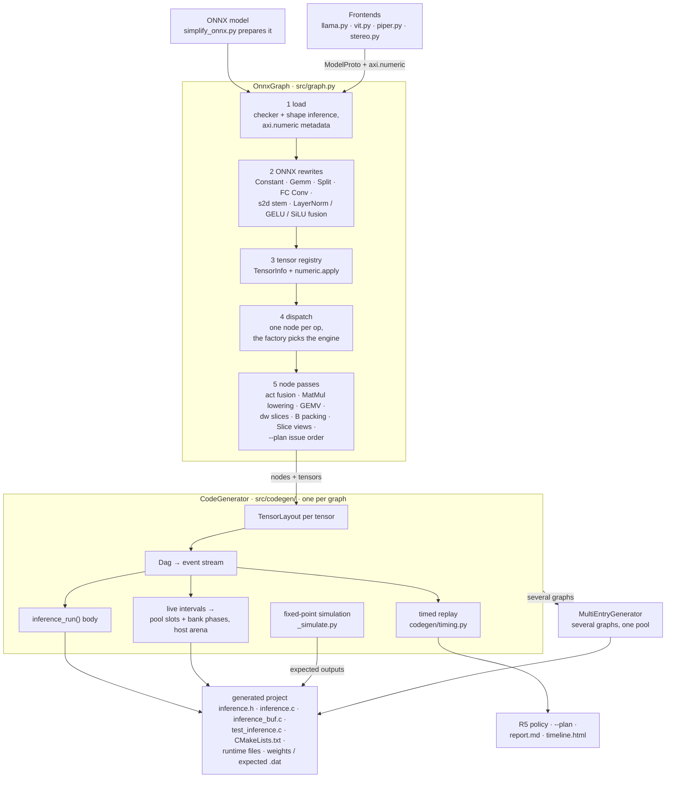
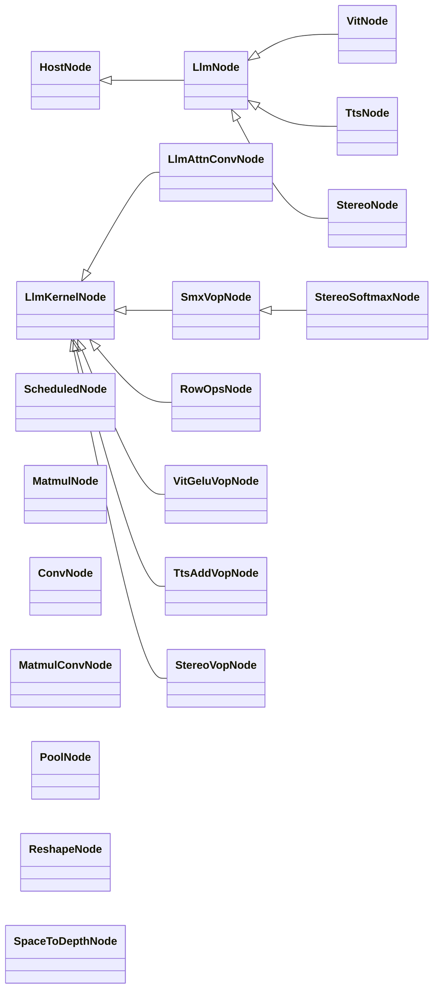
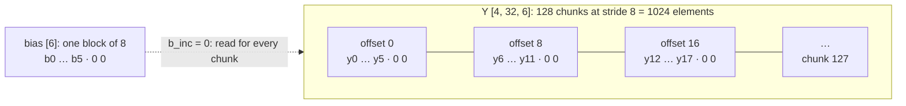
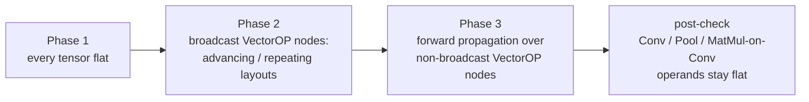
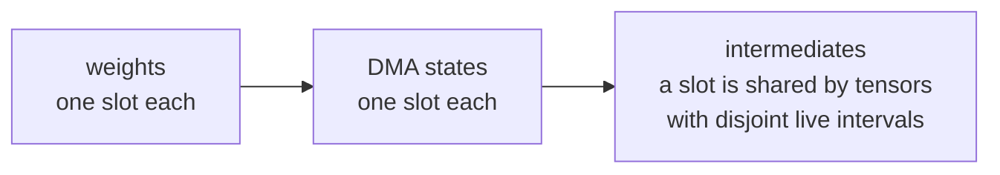
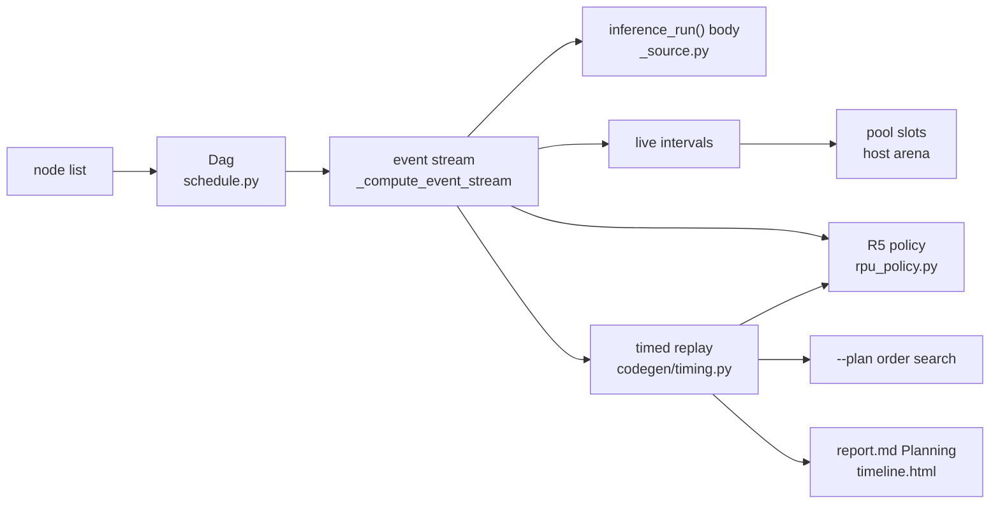
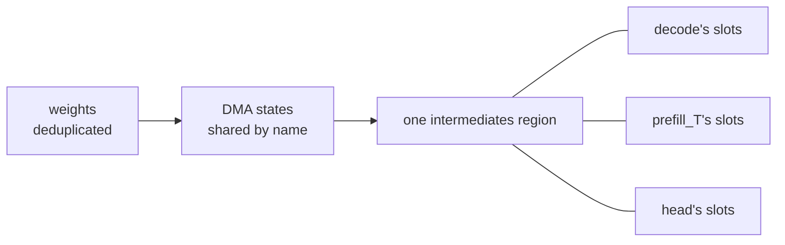
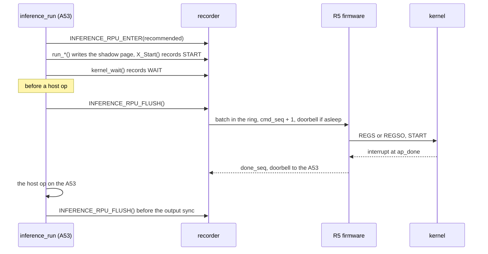
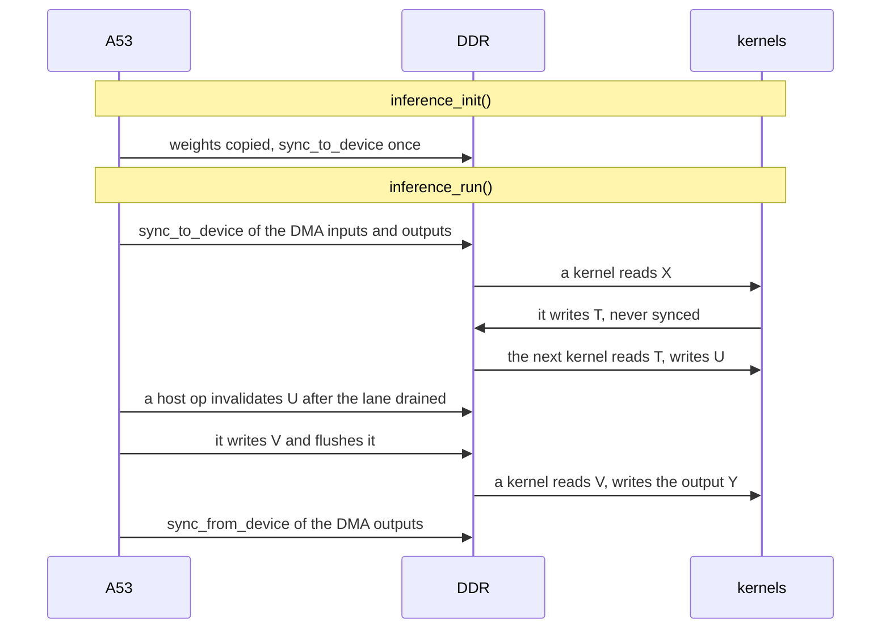

# Inference Scheduler — Internal Architecture

This document describes how the scheduler is built: the stages a model goes
through, the data each stage hands to the next, the invariants that tie them
together, and how to extend them.  It explains structure and reasons; it
does not repeat every rule.

- The technical reference — what each op, pass, numeric format and runtime
  feature does — is
  [`doc/scheduler/INFERENCE_SCHEDULER.md`](../../doc/scheduler/INFERENCE_SCHEDULER.md).
- The DAG, the event stream, liveness and slot colouring are specified in
  [`SCHEDULER_DAG.md`](SCHEDULER_DAG.md).
- The CLI, the generated project and its C API are in
  [`USER_GUIDE.md`](USER_GUIDE.md); the board tools in
  [`REMOTE_TESTING.md`](REMOTE_TESTING.md).

Last revised 2026-10-13.

---

## Table of Contents

1. [Overview](#1-overview)
2. [The pipeline](#2-the-pipeline)
3. [Source layout](#3-source-layout)
4. [Inputs: ONNX models and frontends](#4-inputs-onnx-models-and-frontends)
5. [Building the graph (OnnxGraph)](#5-building-the-graph-onnxgraph)
6. [Kernel lanes and node classes](#6-kernel-lanes-and-node-classes)
7. [Broadcasting on VectorOPKernel](#7-broadcasting-on-vectoropkernel)
8. [Tensor layouts and memory](#8-tensor-layouts-and-memory)
9. [The schedule: DAG and event stream](#9-the-schedule-dag-and-event-stream)
10. [Code generation (CodeGenerator)](#10-code-generation-codegenerator)
11. [Multi-entry projects](#11-multi-entry-projects)
12. [The simulator is the specification](#12-the-simulator-is-the-specification)
13. [Planning (`--plan`)](#13-planning---plan)
14. [The Cortex-R5 path](#14-the-cortex-r5-path)
15. [DataType abstraction](#15-datatype-abstraction)
16. [Cache coherency](#16-cache-coherency)
17. [Tests that pin the contracts](#17-tests-that-pin-the-contracts)
18. [Extending the scheduler](#18-extending-the-scheduler)

---

## 1. Overview

The scheduler turns one or more graphs into one self-contained C project.
The project drives the KV260's kernels from Linux (or bare metal), runs the
ops no kernel implements on the CPU, and carries a test that checks every
output bit for bit.  Five ideas shape the code.

1. **One node per op, one lane per kernel.**  Every op of the graph becomes
   one Python node object.  A node either occupies one hardware lane, runs
   on the CPU (a host node), or does no work at all (an alias).  There are
   five lanes, one per kernel in `src/kernels.py` `KERNEL_REGISTRY`:
   VectorOPKernel, MatmulKernel, ConvKernel, PoolingKernel (registry key
   `PoolKernel`) and RowOpsKernel, the row-ops unit.
2. **The engine is chosen where the node is made.**  The factory that turns
   an op into a node decides whether a kernel or the CPU runs it.  It reads
   the platform's capabilities (`platforms/<name>.json`) and the tensors'
   numeric annotations.  A unit may compute different numbers from the host
   op it replaces (the softmax and row-ops units compute integer
   specifications); the node then carries the unit's numbers.  Later passes
   choose among implementations that compute the same bits: a MatMul on
   ConvKernel or MatmulKernel, the GEMV or tiled path, depthwise slices,
   bank phases, the issue order.  (A fully-connected Conv rewritten as a
   MatMul is the one exception: it differs when the sum before the bias
   saturates, `src/fc_conv.py`.)
3. **The list order is the issue order.**  `OnnxGraph.nodes` is a
   topological order.  The generated `inference_run()` issues the nodes in
   that order from the calling thread.  Kernels on different lanes overlap;
   host ops run inline.
4. **The event stream is the single source of truth for time.**  One walk
   over the node list (`_CoreMixin._compute_event_stream`) decides where
   every `kernel_wait()` goes.  The C emitter, the buffer liveness (and so
   the sharing of pool slots), the timed replay of `--plan`, the Cortex-R5
   policy and the timeline view all read that same stream, so they cannot
   disagree about what runs when.
5. **The simulator is the specification of the numbers.**
   `src/codegen/_simulate.py` computes every tensor exactly as the kernels
   and the generated host code do.  The board test, the host emulation and
   every engine choice are checked against it.

---

## 2. The pipeline



The generated project holds `include/inference.h` (API, sizes,
`kernel_id_t`, the `INFERENCE_RPU_*` policy), `src/inference.c` (weights,
`run_*()` helpers, host-op C, init, run), `src/inference_buf.c` (DMA
buffers), `test/test_inference.c` (ramp inputs, run, compare with the
simulation), `CMakeLists.txt`, `scripts/`, `driver/`, `weights/*.dat`,
`expected/*.dat`, the runtime files (profiler, DDR counters, R5 recorder,
`rpu/rpu_host.c`), `report.md` and, with `--plan` / `--plan-report`,
`timeline.html`.

Two drivers run this pipeline:

- **`inference_scheduler.py`** — one ONNX model (positional argument), or
  several with `--entry NAME=MODEL.onnx` (a multi-entry project, §11).  It
  builds `OnnxGraph`s, a `CodeGenerator` (or a `MultiEntryGenerator`),
  writes the files, copies the runtime files and the drivers, and writes
  `report.md` (single-entry projects) and `timeline.html`.
- **The frontends' project generators** — `demo/chat/scripts/generate_llm_project.py`,
  `demo/tts/scripts/generate_tts_project.py`,
  `demo/stereo_depth/scripts/generate_project.py` and others build
  `onnx.ModelProto`s with a frontend, pass them to `OnnxGraph` in memory
  (no `.onnx` file) and write the project with the same generators.

The `--plan` order search (step 5) is the one place that runs code
generation inside graph construction: it builds throw-away
`CodeGenerator`s to replay candidate orders (§13).

---

## 3. Source layout

Grouped by role.  `inference-scheduler/CLAUDE.md` has the same list
alphabetically, with one line per file.

```
inference_scheduler.py   CLI: one model, or --entry NAME=MODEL.onnx ... (multi-entry)
simplify_onnx.py         ONNX → ONNX preparation: fixed shapes, onnxsim, BN fusion
                         (MODEL_PREPARATION.md)
perf_calibrate.py        the performance-model campaign of --plan
                         (cases / run / fit / host / simulate / rowops / all)
run_remote_tests.py, run_remote_perf.py, upload_bitstream.py, rpu_board.py
                         board tools (REMOTE_TESTING.md); rpu_board.py builds and
                         loads the Cortex-R5 firmware and gates projects on it
runtime/                 files copied verbatim into every project
                         (src/codegen/runtime_files.py): the profiler, its DDR
                         counters, the Cortex-R5 recorder inference_rpu.[ch]
runtime/rpu/             the Cortex-R5 firmware (rpu_main.c, rpu_irq.c, the protocol
                         rpu_ctrl.h, lscript.ld, CMake) and the gate rpu_host.c
bench_src/               kernel benchmarks and calib_runner.c (run_remote_perf.py,
                         perf_calibrate.py)
perf_models/<platform>/  per-bitstream kernel models and the host-op model (--plan)

src/
  graph construction
    graph.py             OnnxGraph: load, ONNX rewrites, tensor registry, dispatch,
                         node passes
    tensor.py            TensorInfo: tensor metadata, numeric annotations, C emitters
    numeric.py           the axi.numeric metadata: exponents, host / DMA kinds, states
    fusion.py            Constant folding, Split → Slice, LayerNorm / GELU / SiLU
                         fusion, constant-broadcast normalisation
    fc_conv.py           fully-connected Convs → Flatten + MatMul + Reshape (+ Add)
    matmul_lowering.py   MatMul → ConvKernel (engine choice, geometry, row splits)
    matmul_gemv.py       MatmulKernel's GEMV / image path
    cost_model.py        analytic cycle models of ConvKernel and MatmulKernel;
                         cost_model.dw_slice (depthwise channel slices)
  nodes (one module per family)
    nodes.py             ScheduledNode (VectorOP), MatmulNode, ConvNode,
                         MatmulConvNode, PoolNode, ReshapeNode, SpaceToDepthNode
    vectorop_act.py      the activation unit: Gelu / LeakyRelu / Silu → ScheduledNode
    vectorop_smx.py      the softmax unit's integer specification
    smx_nodes.py         the softmax-unit nodes (ONNX Softmax and the frontends' ones)
    rowops_spec.py       the row-ops unit's integer specification
    rowops_nodes.py      the row-ops unit's nodes and their factories / overrides
    host_nodes.py        HostNode family: ONNX ops on the CPU (numpy reference +
                         C helper)
    llm_nodes.py         axi.llm Llama ops (LlmNode), LlmKernelNode, LlmAttnConvNode
    vit_nodes.py         axi.llm vision-encoder ops (VitNode, VitGeluVopNode)
    tts_nodes.py         axi.llm text-to-speech ops (TtsNode, TtsAddVopNode)
    stereo_nodes.py      axi.llm stereo-depth ops (StereoNode, StereoVopNode,
                         StereoSoftmaxNode)
  platform capabilities
    kernels.py           KERNEL_REGISTRY: one KernelDesc per kernel
    _vectorop_hw_config.py, _matmul_hw_config.py, _conv_hw_config.py,
    _pool_hw_config.py, _rowops_hw_config.py
                         platform JSON resolvers (kernels.<k> blocks)
  frontends
    llama.py             Llama-family decoders → decode / prefill_<T> / head graphs
    llm_entries.py       a Llama project's entry graphs with one copy of each weight
    vit.py               SmolVLM's vision encoder → the vision graph
    piper.py             Piper (VITS) text to speech → chunk and encode_<T> graphs
    stereo.py            LightStereo-S stereo depth → one graph
  schedule and code generation
    schedule.py          Dag: data-flow DAG with persistent-state edges
    layout.py            TensorLayout: a DMA buffer's geometry
    dtype.py             DataType: ap_fixed<W,I>, float32
    bank_phase.py        DRAM bank phases of the pool slots
    codegen/             CodeGenerator (mixins), MultiEntryGenerator (multi.py),
                         the timed replay (timing.py), runtime_files.py
  planning and prediction
    planning.py          --plan options and model lookup
    perf_calls.py        KernelCall: the register values of one kernel call
    perf_model.py, perf_fit.py, host_model.py
                         per-bitstream kernel models, their fit, the host-op model
    tactics.py           a MatMul's tactics
    order_search.py      issue-order search on the timed replay
    rpu_policy.py        who drives the kernels: the A53 or the Cortex-R5
    report.py            report.md
    timeline_html.py     timeline.html
  board tooling
    bitstream/           upload_bitstream.py implementation
    remote/              SSH session, config, checks, the per-board lock, cma.py

test/
  host_emu.py            builds a generated project on the PC against software kernels
  gen_*_models.py        test-model generators (gen_all_models.py runs them all)
  test_*.py              the pytest suite (§17)
```

---

## 4. Inputs: ONNX models and frontends

### 4.1 ONNX models

The scheduler reads standard ONNX with fixed shapes.  `simplify_onnx.py`
pins dynamic dimensions, runs onnxsim and folds BatchNormalization into
the preceding Convs; `doc/MODEL_PREPARATION.md` covers the workflow.
`OnnxGraph` also accepts an `onnx.ModelProto` in place of a path.

### 4.2 Frontends

Four frontends build graphs from checkpoints instead of exported ONNX.
Each writes an ordinary `onnx.ModelProto` with `onnx.helper`: standard
`MatMul` / `Conv` nodes for the heavy layers, ops of the custom domain
`axi.llm` for everything else, and the numeric formats in the `axi.numeric`
metadata (§4.3).  `src/llama.py` explains the choice: writing the graph
from the checkpoint avoids exporting through torch and pattern-matching
RMSNorm / RoPE / SwiGLU / KV-cache structure back out of the export.

| Frontend | Input | Graphs (entries) | Custom ops | Project generator |
|---|---|---|---|---|
| `LlamaFrontend` (`src/llama.py`) | `config.json`, safetensors, calibrated formats | `decode`, `prefill_<T>`, `head` | `Llm*` (`llm_nodes.py`) | `demo/chat/scripts/generate_llm_project.py` (through `llm_entries.entry_graphs`) |
| `VitFrontend` (`src/vit.py`) | SmolVLM's vision / connector weights, formats | `vision` | `Vit*` (`vit_nodes.py`) | the same script for SmolVLM (through `demo/chat/scripts/vlm_project.py`) |
| `PiperChunkFrontend`, `PiperEncoderFrontend` (`src/piper.py`) | the Piper ONNX export's weights, exponents | `chunk`, `encode_<T>` | `Tts*` (`tts_nodes.py`) | `demo/tts/scripts/generate_tts_project.py` |
| `LightStereoFrontend` (`src/stereo.py`) | a PyTorch checkpoint (read without torch), calibrated formats | one graph | `Stereo*` (`stereo_nodes.py`) | `demo/stereo_depth/scripts/generate_project.py` |

Frontend options choose engines by changing what the graph says, not by
calling into the scheduler.  `vsmx` sets the attribute `vsmx = 1` on the
softmax ops (the softmax unit takes them); `rowops` makes the residual
stream an int32 DMA tensor (`dma: i32`) and sets `rowops = 1` on the ops
the row-ops unit can take; `decode_attn` / `prefill_attn` move the
attention between the host and ConvKernel.  The node factories (§5.4) read
those attributes and annotations.  The semantics of every `axi.llm` op are
in the technical reference: §Llama-family decoders, §Vision encoders,
§Text to speech (Piper), §Stereo depth (LightStereo).

`src/llm_entries.py` schedules a Llama project's entries together so that
the project keeps one copy of every weight.  The largest prefill bucket
chooses the kernel width of each lowered weight; the other buckets reuse
it (`OnnxGraph(matmul_conv_kw=...)`), and decode / head read the same image
through MatmulKernel's GEMV path (`matmul_gemv_kw`).  The entries also share
their constant arrays in memory (`OnnxGraph(array_pool=...)`).

### 4.3 Numeric metadata (`axi.numeric`)

The kernels compute on raw int16 words.  They multiply raw operands, sum
exactly and write `floor(sum / 2^F)` saturated, where `F` is the element
type's fractional bits (8 for ap_fixed<16,8>).  A tensor's scale is
therefore a property of the graph, not of the kernel.  The frontends record
it as JSON under the model's `metadata_props` key `axi.numeric`;
`src/numeric.py` parses it (`numeric.parse`), applies it to the tensors
(`numeric.apply`) and checks it (`numeric.check`).

| Key | Meaning | TensorInfo field |
|---|---|---|
| `exp` | power-of-two exponent per tensor or per last-axis channel: value = raw · 2^-f | `exp` |
| `chexp` | one exponent per channel (axis 1) of a 4-D Conv tensor | `chexp` |
| `host` | the tensor lives in host memory: `f32`, `i32` or `i16` | `host` |
| `dma` | a DMA tensor of another element width: `i32` (an int32 residual) or `f32` (the row-ops unit's DEQUANT output) | `dma` |
| `state` | persistent across runs and shared by the entries of a project (KV caches, `h_last`) | `is_state`, `init_data` |
| `layout` | a state stored group-major `[G][R][D]` (optionally row-interleaved as a 1 × K conv image) | `group_layout`, `group_kw` |
| `test_fill` | the constant the test harness writes into an integer host input | — |

Constant weights get their exponents by rule, not by annotation.
`numeric.encode_matmul_weights` encodes a MatMul's B at the rank-1 exponent
`f_w[i][j] = f_out[j] + F − f_in[i]` (`TensorInfo.wexp`), and
`numeric.encode_conv_weights` does the same per output channel of a Conv.
`numeric.check` limits which nodes may touch which tensors: only MatMuls,
Convs, raw copies, aliases and the LLM-domain nodes (`LlmNode`,
`LlmKernelNode`) may see exponents; only the LLM-domain nodes may see host
tensors and states.  A model without the key
generates exactly as before.  Details: technical reference §Numerics beyond
the element type.

---

## 5. Building the graph (OnnxGraph)

`OnnxGraph.__init__` in `src/graph.py` runs the whole graph stage.  Its
keyword arguments switch the optional steps: `fuse_act`, `s2d_stem`,
`fuse_patterns`, `matmul_on_conv`, `matmul_gemv`, `fc_conv`, `dw_slice`,
`plan`, plus `matmul_conv_kw`, `matmul_conv_kws`, `matmul_gemv_kw` and
`array_pool` for multi-entry projects.  The library defaults and the CLI's
differ (`inference-scheduler/CLAUDE.md` §CLI lists both).  The exact order
of the steps is in the technical reference,
[§OnnxGraph loading sequence](../../doc/scheduler/INFERENCE_SCHEDULER.md#onnxgraph-loading-sequence).

### 5.1 Loading and shape inference

```python
model = onnx.load(path)                    # or a frontend's onnx.ModelProto
model, held = _checked_inferred(model)     # onnx.checker + infer_shapes, weightless
self.numeric = numeric.parse(model)        # axi.numeric metadata, if any
```

Shape inference gives every intermediate tensor a shape in
`model.graph.value_info`.  Both the checker and shape inference serialise
the whole model several times, and a model over 2 GB cannot be serialised
at all.  `_checked_inferred` therefore runs them on a structural copy in
which every initializer of more than `_LIGHT_INIT_ELEMS` elements is a
graph input.  Large initializers that only a MatMul's B or an `axi.llm` node
reads stay out of the graph's copy (`held`); the tensor registry reads them
from the caller's model.

### 5.2 ONNX-level rewrites

These passes rewrite `model.graph` in place before any tensor is
registered, so every later stage sees an ordinary graph.

| Pass | What it does | Switch |
|---|---|---|
| `fusion.fold_constant_nodes` | `Constant` nodes become initializers | always |
| `OnnxGraph._preprocess_model` | `Gemm` → `MatMul` (+ `Add` for a bias) | always |
| `fusion.lower_split` | `Split` → one `Slice` per output | always |
| `fc_conv.lower_fc_convs` | a fully-connected Conv (one output pixel) → Flatten + MatMul + Reshape (+ bias Add), where the cost model says MatmulKernel is faster | `fc_conv` |
| `OnnxGraph._space_to_depth_stems` | a stride-2 Conv on few channels → host `SpaceToDepth(2)` + stride-1 Conv | `s2d_stem` |
| `fusion.fuse_patterns` | TF-style LayerNorm → `LayerNormalization`; GELU (tanh / erf) → `Gelu`; `Mul(x, Sigmoid(x))` → `Silu` (only where the activation unit exists); constant operands reshaped so VectorOPKernel can broadcast them | `fuse_patterns` |

`Gemm` is accepted with `alpha = 1`, `beta = 1`, `transA = 0`; `transB = 1`
only when B is a constant 2-D initializer, which is transposed offline into
a `<B>_T` initializer.  The bias case inserts the intermediate
`_gemm_mm_out_<n>` into `value_info`.  The node classes never see `Gemm`.

The fusions exist because the op-by-op forms are numerically wrong in
Q8.8: a LayerNorm's x² or a GELU's x³ saturates.  An unmatched
`ReduceMean` / `Pow` / `Sqrt` / `Reciprocal` / `Tanh` / `Erf` / `Sigmoid`
is rejected at dispatch with a hint (`fusion.pattern_hint`).  Details:
technical reference §Pattern fusion, §Fully-connected Convs, §Space-to-depth
stem.

### 5.3 Tensor registry and TensorInfo

The registry is a flat `{onnx_name: TensorInfo}`:

| Category | Source in the ONNX proto | Role |
|---|---|---|
| Weights | `graph.initializer` | constants; `data` is set |
| Inputs | `graph.input` minus initializers | caller-supplied; `data is None` |
| Intermediates | `graph.value_info` | produced by one node, consumed by others |
| Outputs | `graph.output` | written into caller-supplied buffers |

Older opsets list some initializers in `graph.input` too; a name already
registered as an initializer is not a graph input.  States
(`numeric.apply`) are removed from the input list: they are not run-time
arguments.  `TensorInfo.data` is always float32; initializers up to
`_RAW_CONST_MAX` elements are also kept in their original dtype
(`OnnxGraph._raw_consts`) for host-op factories that need exact integer
values (Slice starts, OneHot depth).

`TensorInfo` (`src/tensor.py`) holds the logical tensor and everything the
later stages attach to it:

| Field | Meaning |
|---|---|
| `onnx_name`, `shape`, `dtype`, `data` | the ONNX tensor (`data` float32, or None) |
| `packed_data` | the kernel's image of a weight (Conv tile-major, MatMul B packed, MatMul-on-Conv B image); `data` stays logical for the simulator |
| `exp`, `chexp`, `wexp` | power-of-two exponents (§4.3) |
| `host`, `dma` | host-memory kind, or a wider DMA element (§4.3) |
| `is_state`, `init_data`, `group_layout`, `group_kw` | persistent states and their layout |

Derived properties: `numel` (the packed image's size when there is one),
`alloc_numel` (twice `numel` Data_t elements for a `dma` tensor), `c_name`
(a C identifier from the ONNX name), `is_weight`, `is_int` (integer and bool
tensors, stored as raw integers), `is_host`, and `is_large_weight`
(`is_weight and numel > LARGE_WEIGHT_THRESHOLD (4096)`: written to
`weights/<c_name>.dat` instead of a C array).  `TensorInfo` also emits its
own C declarations (`emit_weight_decl`, `emit_weight_decl_strided`,
`emit_large_weight_ptr_decl`, `emit_buffer_decl`, `to_dat_bytes`).

### 5.4 Node dispatch

`OnnxGraph.__init__` walks `graph.node` (ONNX requires topological order)
and makes one node per ONNX node.  The first matching branch wins:

| # | Match | Factory | Result |
|---|---|---|---|
| 1 | domain `axi.llm` | `LLM_OP_FACTORIES`, `VIT_OP_FACTORIES`, `TTS_OP_FACTORIES`, `STEREO_OP_FACTORIES`, then `rowops_nodes.LLM_OVERRIDES` / `VIT_OVERRIDES` / `TTS_OVERRIDES` merged over them | a host node, or a kernel node (`LlmKernelNode`) |
| 2 | `Gelu`, `LeakyRelu`, `Silu` | `vectorop_act.from_onnx` | a VectorOP `ScheduledNode`, or the host `GeluNode` |
| 3 | `Softmax` | `smx_nodes.from_onnx_softmax` | `SoftmaxVopNode` (softmax unit), or the host `SoftmaxNode` |
| 4 | `LayerNormalization` | `rowops_nodes.from_onnx_layernorm` | `LayerNormRoNode` (row-ops unit), or the host `LayerNormNode` |
| 5 | `Transpose` | `rowops_nodes.from_onnx_transpose` | `TransposeRoNode`, or the host `TransposeNode` |
| 6 | other `HOST_OP_FACTORIES` keys (`Slice`, `Concat`, `Resize`, `Gather`, `OneHot`, `Cast`, …) | `host_nodes.py` | a host node (a `Cast` within one storage kind is a `ReshapeNode`) |
| 7 | `MatMul` / `Conv` / pooling ops | `MatmulNode` / `ConvNode` / `PoolNode` `.from_onnx_node` | a kernel node |
| 8 | `Reshape`, `Squeeze`, `Unsqueeze`, `Flatten`, `Dropout`, `Identity` | `ReshapeNode` | an alias |
| 9 | `SpaceToDepth` | `SpaceToDepthNode` | a host reorder |
| 10 | `Add`, `Sub`, `Mul`, `Div`, `Relu`, `Clip` | `ScheduledNode` | a VectorOP node |
| — | anything else | — | `SchedulerError` |

**The factory picks the engine.**  Rows 1–5 share one pattern: the factory
checks eligibility (often by building the host node first) and returns the
kernel node only where the kernel can run the op.

- The platform must have the unit (`_vectorop_hw_config.VECTOROP_ACTIVATIONS`,
  `.VECTOROP_SOFTMAX`, `_rowops_hw_config.ROWOPS_UNIT`).
- The tensors must fit the kernel: Q8.8 DMA tensors without exponents for
  the activation and softmax units, int16 / int32 / float32 DMA rows of
  aligned length for the row-ops unit.
- The standard ONNX ops go to a unit whenever both hold.  A `Gelu` also
  needs its Q8.8 function to equal the kernel's on all 65 536 inputs
  (`vectorop_act.gelu_act`), so it changes no bit.  An ONNX `Softmax` or
  `LayerNormalization` on its unit computes the unit's integer
  specification, not the host op's double arithmetic.
- The frontends' `axi.llm` ops go to a kernel where the graph's form says
  so: the attributes `vsmx = 1` or `rowops = 1`, an int32 / float32 DMA
  tensor (`dma: i32` / `dma: f32`), or a node shape the kernel takes (a
  `VitGelu` with its four VectorOP inputs, a `TtsSum` of two tensors at one
  exponent).  The `vsmx` and row-ops forms carry numbers only the unit
  computes, so they have no host fallback: on a platform without the unit
  the factory raises a `SchedulerError` that names the platform key.

Because the choice happens here, every later stage sees one node list in
which each node already knows its lane, and the simulation follows the
node that was made.

### 5.5 Passes over the node list

After dispatch, `OnnxGraph.__init__` runs these passes in this order:

1. `_check_integer_inputs` — integer tensors may reach only host ops and
   aliases.
2. `numeric.check`, then `numeric.encode_matmul_weights` /
   `encode_conv_weights` when the model has numeric metadata (§4.3).
3. `share_constant_arrays` — with `array_pool`, constant arrays equal to an
   earlier entry's are replaced by that array.
4. `_fuse_activations` (`fuse_act`) — a `Relu`, `Clip(0,6)` or
   activation-unit node is folded into the VectorOP node that produces its
   input, as that node's `act` register (and `alpha` for LeakyReLU).  The
   producer must have no act yet and must not be an activation op itself;
   the input must have no other consumer, must not be a graph output and
   must have the output's element count.  Node indices are renumbered.
5. `--plan` only: the bitstream's performance model is resolved
   (`planning.resolve_perf_model`).
6. `matmul_lowering.lower_matmuls` — eligible MatmulNodes become
   `MatmulConvNode`s where ConvKernel is estimated faster (§6.5).
7. `matmul_gemv.choose_gemv` — MatmulNodes switch to the GEMV / image path
   (`gemv_kw`) where that is faster or the weight's layout is pinned.  It
   runs after the lowering because it reads a B in the image the lowering
   chose.
8. `_choose_dw_slices` — batch-1 depthwise Convs split into 16- / 32- /
   64-channel calls where `cost_model.dw_slice` predicts a gain.
9. `_pack_matmul_weights` — a constant B read only by tiled MatMuls of one
   `(k, m)` is emitted tile-major (`b_packed = 1`).  It runs after the
   lowering and GEMV passes: whether every reader of B is a tiled MatmulNode
   is known only then.
10. `_choose_slice_views` — a contiguous, 64-byte-aligned `Slice` piece of
    an internal pool buffer becomes a zero-cost view (`SliceNode.is_view`).
11. `--plan` only: `order_search.plan_order` — a faster issue order (§13).
12. `share_constant_arrays` again.

Each pass records what it did for `report.md`: `gemm_decomposed_count`,
`split_lowered_count`, `fc_conv_stats`, `s2d_stem_count`, `fusion_counts`,
`act_fused_count`, `matmul_conv_stats`, `matmul_gemv_stats`,
`dw_slice_stats`, `plan_log`, `order_log`.

---

## 6. Kernel lanes and node classes

### 6.1 The kernel registry

`src/kernels.py` `KERNEL_REGISTRY` is an ordered dict of `KernelDesc`:
`name` (equals the nodes' `kernel_name`), `driver_prefix`, `c_type`,
`uio_default`, `axi_base`, `driver_files`, `driver_readme`, `rpu_lane` and
`rpu_reg_words`.  Much of the generated code is derived from it:

- `_CoreMixin._active_kernels` — the registry entries whose name some node
  carries, in registry order.  This order fixes the `inference_init()`
  parameter list, the `kernel_id_t` enum and the driver files.
- the driver README (`mixed_driver_readme`), the CMake driver sources, the
  `INFERENCE_<KERNEL>_INSTANCE` UIO macros;
- the Cortex-R5 lane table (`inference_rpu_kernels()`, §14):
  `rpu_lane` is the firmware's lane (`runtime/rpu/rpu_ctrl.h` `RPU_LANE_*`,
  the registry order), `rpu_reg_words` the length of the kernel's argument
  registers.

| Registry key | `kernel_id_t` | Dispatch helpers | Node classes |
|---|---|---|---|
| `VectorOPKernel` | `KERNEL_VECTOROP` | `run_op`, `run_op_act`, `run_softmax` | `ScheduledNode`; `SmxVopNode` family, `VitGeluVopNode`, `TtsAddVopNode`, `StereoVopNode` |
| `MatmulKernel` | `KERNEL_MATMUL` | `run_matmul`, `run_matmul_at` | `MatmulNode` |
| `ConvKernel` | `KERNEL_CONV` | `run_conv`, `run_conv_at`, `run_conv_dw_at` | `ConvNode`, `MatmulConvNode`, `LlmAttnConvNode` |
| `PoolKernel` | `KERNEL_POOL` | `run_pool` | `PoolNode` |
| `RowOpsKernel` | `KERNEL_ROWOPS` | `run_rowops` | `RowOpsNode` family |

**Platform capabilities.**  Five resolvers read the platform JSON
(`platforms/<AXI_PLATFORM>.json`, default `kv260`), the same file the
kernels' C++ builds read.  A missing field is an error, never a silent
default.

| Resolver | JSON block | Environment override |
|---|---|---|
| `_vectorop_hw_config.py` | `kernels.vectorop`: `activations`, `softmax` | `AXI_VECTOROP_ACTIVATIONS`, `AXI_VECTOROP_SOFTMAX` |
| `_matmul_hw_config.py` | `kernels.matmul`: bounds, `impl`, `gemv_max_m` | `AXI_MATMUL_IMPL` |
| `_conv_hw_config.py` | `kernels.conv`: bounds, `impl` | `AXI_CONV_IMPL` |
| `_pool_hw_config.py` | `kernels.pool`: bounds | — |
| `_rowops_hw_config.py` | `kernels.rowops`: `unit` | `AXI_ROWOPS` |

Field reference: `doc/build-and-test/PLATFORM_CONFIGURATION.md`.

### 6.2 The node contract

The node classes are dataclasses, not one class hierarchy.  The code
generator treats them uniformly through a shared contract:

| Member | Used by |
|---|---|
| `kernel_name` (ClassVar) | lane assignment: a registry key, or `""` for host and alias nodes |
| `onnx_node`, `inputs`, `output`, `index`, `align_elems` | everything |
| `outer_count`, `chunk_size`, `aligned_chunk_size`, `a_advances`, `b_advances`, `arity` | the layout passes; non-VectorOP nodes carry neutral shims (`outer_count = 1`, …) |
| `emit_comment()` | the node header in `inference_run()` |
| `emit_call(layouts)` | kernel and alias nodes: the C of the call (host nodes go through `_SourceMixin._emit_host_block`) |
| `kernel_calls(layouts)` | kernel nodes: the calls as `KernelCall`s (`src/perf_calls.py`); performance models, `--plan`, the R5 policy |
| `reference(ins, dtype)` | host and `LlmKernelNode` nodes: the simulator's value (the core kernels' references live in `_simulate.py`) |
| `state_updates()` / `state_writes()` | nodes that write states in place: DAG state edges, the coherency audit |
| `uses_activation_unit`, `uses_softmax_unit` | `inference_init()`'s capability probes |

Three base classes group the families:



- `HostNode` (`host_nodes.py`) → `LlmNode` (`llm_nodes.py`) → `VitNode`,
  `TtsNode`, `StereoNode`: CPU code.
- `LlmKernelNode` (`llm_nodes.py`) → `LlmAttnConvNode`, `SmxVopNode` (→
  `StereoSoftmaxNode`), `RowOpsNode`, `VitGeluVopNode`, `TtsAddVopNode`,
  `StereoVopNode`: kernel calls on tensors that may carry exponents.  The
  base class buys three things: `numeric.check` lets them through, the
  layout passes skip them, and the simulator calls their `reference()`.
- The core kernel nodes of `nodes.py` (`ScheduledNode`, `MatmulNode`,
  `ConvNode`, `MatmulConvNode`, `PoolNode`) and the aliases `ReshapeNode`
  and `SpaceToDepthNode`, each standalone.

A node may issue several calls on its lane: a depthwise Conv in channel
slices, a MatMul on ConvKernel per batch item or row split, a row-ops node
with several jobs, a softmax per head.  Its emitted code waits on its own
lane between those calls and leaves the last one in flight, so the event
stream (§9) sees one Start per node.  The one synchronous node is a
MatmulNode with a 4D × 3D outer loop: `run_matmul_at()` polls inside the
loop, and the stream records it as `start_sync`.

### 6.3 VectorOPKernel

**ScheduledNode** (`nodes.py`) maps the element-wise ops through
`_ONNX_OP_MAP`:

```python
_ONNX_OP_MAP = {
    "Add":  (OP_ADD,   2),
    "Sub":  (OP_SUB,   2),
    "Mul":  (OP_MUL,   2),
    "Div":  (OP_DIV,   2),
    "Relu": (OP_RELU,  1),
    "Clip": (OP_RELU6, 1),   # validated for (min=0, max=6)
}
```

Arity 2 reads `a` and `b`; arity 1 reads `a` only, writes `b = 0` and
issues no transaction on that port.  `Clip` must have `min = 0`,
`max = 6`: as attributes before opset 11, as constant inputs 1 and 2 from
opset 11 (`_get_clip_bounds`).  `validate()` computes the broadcast fields
(§7).  The op codes are the `OP_*` constants of `nodes.py`; they must
match the kernel's (`kernels/vectorop_rtl/model/include/VectorOP.h`).

The node's other fields: `act` (the fused activation, `ACT_*`), `alpha`
(LeakyReLU's slope, `alpha / 2^16`) and `fused_nodes` (the folded ONNX
nodes, for the report).  `emit_call()` emits `run_op()` when there is no
act and no slope (`uses_run_op`), else `run_op_act()`.

**The activation unit** (`vectorop_act.py`, ACTIVATIONS_PLAN) computes
LeakyReLU, SiLU, GELU and GELU tanh as ops of their own and as `act` codes
after any op.  `vectorop_act.from_onnx` makes them `ScheduledNode`s; the
simulator applies them with `vectorop_act.act_values` and round-to-nearest
(`DataType.host_quantize`).  When a program uses the unit,
`inference_init()` checks that the IP has it (it writes and reads back the
`alpha` register).

**The softmax unit** (`smx_nodes.py`, SOFTMAX_PLAN) runs an integer softmax
over rows or over keys-major columns (`run_softmax()`).  Its specification
is `vectorop_smx.py`: the simulator, the model studies, the C++ reference
model and the RTL compute it bit for bit.  Node kinds: `SoftmaxVopNode`
(ONNX `Softmax`), `VitAttnSoftmaxVopNode`, `LlmAttnSoftmaxVopNode`,
`TtsAttnSoftmaxVopNode` (the frontends' `vsmx = 1`) and
`StereoSoftmaxNode`.  `inference_init()` probes the `smx_cm` register.

**LLM-domain VectorOP nodes** — `VitGeluVopNode` (the vision GELU as ADD +
MUL with GELU tanh), `TtsAddVopNode` (Piper's decoder sums) and
`StereoVopNode` — call `run_op()` / `run_op_act()` on exponent tensors.

### 6.4 MatmulKernel

**MatmulNode** drives MatmulKernel: fields `n`, `k`, `m`, `outer_count`,
`b_batch_stride`, `b_packed`, `gemv_kw`.  `emit_call(layouts)` reads
`TensorLayout.gap` of A and Y.  Without gaps it emits one natural call; with
gaps it walks the rows (`batch = N, n = 1`) and skips the gap slots.  A 4D
× 3D MatMul (one operand has a leading dimension the other lacks) loops
`run_matmul_at()` over the outer dimension, synchronously.

- `run_matmul(a, b, c, n, k, m, batch, a_stride, b_stride, c_stride, b_packed, gemv_kw)`
  programs the registers and starts the kernel.  The helper also writes
  `gemv_kw` and `a_to_b` unless the platform has no GEMV path
  (`kernels.matmul.gemv_max_m = 0`).
- `b_packed = 1`: B is the tile-major packed constant (§5.5 step 9).
- `gemv_kw > 0`: the GEMV / image path.  B is read through both read ports,
  row-major (`gemv_kw = 1`) or in ConvKernel's x image of that kernel width;
  that is how a Llama project's entries share one copy of each weight.
  Technical reference: §MatMul GEMV streaming.

`MatmulNode.from_onnx_node` checks `K` against `kernels.matmul.max_k`.

### 6.5 ConvKernel

**ConvNode** — 2-D NCHW convolution with optional fused bias (a third
input), `group = 1` or depthwise (`group = in_ch`); other groupings are
rejected.  The weight and bias are emitted in ConvKernel's tile-major
layout (`packed_data`).  `emit_call()` emits `run_conv()`, or for a sliced
depthwise Conv (`dw_slice`) one `run_conv_dw_at()` per channel slice.
Bounds come from `kernels.conv` (`_conv_hw_config.py`).  Technical
reference: §Depthwise channel slices.

**MatmulConvNode** — a MatMul with swapped operand roles, made by
`matmul_lowering.lower_matmuls`.  `C[N][M] = A[N][K] · B[K][M]` becomes a
conv with `out_ch = N`, `in_ch = K / kw`, a `1 × kw` kernel at stride
`(1, kw)` and `out_h × out_w = M` pixels; A is the weight, B the input.  A
constant B read only by this MatMul is re-imaged for `kw > 1`
(`nodes.conv_lowered_b_image`).  The engine and the geometry come from
`cost_model.py`: ConvKernel's model (`rtl_conv_walk` for the RTL kernel,
`conv_board_cycles` for the board's weight-request cost) against
MatmulKernel's.  Batched MatMuls with per-item weights loop `run_conv_at()`;
accumulator-limited MatMuls split their rows over several calls.  The two
kernels are bit-identical, so the simulator treats a MatmulConvNode as a
MatmulNode.  Technical reference: §MatMul on ConvKernel.

**LlmAttnConvNode** — one ConvKernel call of the FPGA attention, q·Kᵀ
(`kind "qk"`) or P·V (`kind "pv"`), per KV group.  In a Llama prefill or
FPGA decode the key count is a run-time dimension, computed from the
entry's `pos` / `n` inputs and programmed into the registers; the vision
encoder and Piper's text encoder use a static key count.

ConvKernel writes a flat NCHW output, so a broadcast consumer that would
give a Conv / Pool / MatmulConv output a gapped layout is a `SchedulerError`
(§8.2).

### 6.6 PoolingKernel

**PoolNode** — `MaxPool`, `AveragePool`, `LpPool` (p = 1 or 2) and the
`Global*` variants, 2-D NCHW, with dilation and `count_include_pad`;
`ceil_mode = 1` is rejected.  `from_onnx_node` checks the window against
`kernels.pool` (`_pool_hw_config.py`) and names the JSON field to raise.
`emit_call()` emits `run_pool()`.  The host emulation has no software
PoolingKernel (§17).

### 6.7 RowOpsKernel (the row-ops unit)

The row-ops unit runs a transformer's row operations in fixed point:
residual adds, LayerNorm / RMSNorm, SiLU · up, dequantisation, RoPE,
transposes and copies (HOSTOPS_PLAN, RPU_PLAN track A1;
`doc/kernels/ROWOPS_RTL_KERNEL.md`).  Three modules carry it in the
scheduler:

- **`rowops_spec.py` — the specification.**  Plain integer arithmetic for
  each op (COPY, ADDX, DEQUANT, MULACT, NORM, ROPE, TRANSPOSE, TLOAD), the
  element kinds (int16 / int32 / float32), the rsqrt and sigmoid tables, the
  16-byte per-column parameter block and the 64 KiB table image.  The
  simulator calls it.  The RTL testbench's C++ oracle
  (`kernels/rowops_rtl/tb/verilator/rowops_ref.h`) and the host emulation's
  software driver are ports of it.
- **`rowops_nodes.py` — the nodes.**  `RowOpsNode(LlmKernelNode)` and one
  subclass per job shape: `LayerNormRoNode`, `TransposeRoNode`,
  `ResAddRoNode` / `ResAddBiasRoNode`, `RMSNormRoNode`, `SiluMulRoNode`,
  `LayerNorm32RoNode`, `AttnPrepRoNode`, `VitAttnPrepRoNode`,
  `TtsRowPrepRoNode`, `TtsSumRoNode`, `TtsInterleaveRoNode`,
  `TtsRelBandRoNode`, `DequantRoNode`, `SelectRowRoNode`,
  `PixelShuffleRoNode`, `EmbedAddRoNode`.  Each computes its result with the
  specification (`reference`), emits `run_rowops()` calls
  (`RowOpsNode.call`) and lists them (`kernel_calls`).  Row strides of a
  gapped input are read from its layout at emit time
  (`row_stride_bytes`).
- **`_rowops_hw_config.py` — the capability** (`kernels.rowops.unit`,
  `AXI_ROWOPS`).

**Selection.**  ONNX `LayerNormalization` and `Transpose` reach the unit
through their dispatch branches (§5.4, rows 4–5).  The `axi.llm` ops reach
it through the override tables `LLM_OVERRIDES`, `VIT_OVERRIDES` and
`TTS_OVERRIDES`, which `graph.py` merges after the host-op factories.  An
override returns the unit's node when the graph asks for it — an int32 or
float32 DMA tensor, or a `rowops = 1` attribute — and the host node
otherwise.  So one frontend option (`rowops=True`) moves a whole model's
row ops, and a graph without it generates as before.

**Constants as weights.**  The parameter blocks and the table image are
not ONNX initializers; the factories register them as weight tensors
(`param_tensor`, `tables_tensor`).  They hold raw int16 words carried as
the float values whose Q8.8 encoding is those words, so every weight path
(ROM array, `.dat` file, pool slot) emits the bits unchanged.

**Table load.**  The unit's tables live in UltraRAM, which has no initial
contents.  `inference_init()` issues one TLOAD job from the
`rowops_tables` weight and waits for it before any other job.

The `rowops-offload` skill (`.claude/skills/rowops-offload/SKILL.md`)
walks through moving one more host op onto the unit.

### 6.8 Host nodes and aliases

**Host nodes** (`kernel_name == ""`) run on the CPU inside
`inference_run()`.  Each class keeps its numpy `reference()` next to the C
it emits, and the two must agree bit for bit (double arithmetic,
round-half-even and saturating write-back).

- `HostNode` (`host_nodes.py`): `Softmax`, `LayerNormalization`, `Gelu`,
  `Transpose`, `Slice`, `Concat`, `Resize`, `Gather`, `OneHot`, `Cast` —
  wherever no kernel takes them.
- `LlmNode` and its `Vit` / `Tts` / `Stereo` subclasses: the `axi.llm` ops.
  Their inputs may be host tensors and states; they declare the states
  they write (`state_writes()` / `state_updates()`) and the tables they
  need (`c_runtime()`).
- `SpaceToDepthNode` (`nodes.py`): a pure reorder.

The code generator emits each helper library once per project
(`_host_ops_section`).  Host ops read DMA buffers in place where the
mapping is cacheable and the layout flat; otherwise they stage through a
cached arena (`staged_inputs()`, `direct_inputs()`).  They split their rows
over a thread pool (`host_parallel`, `INFERENCE_HOST_THREADS` threads;
bit-identical for any count).  Tables over `TABLE_FILE_BYTES` go to
`weights/<name>.dat`.  The `add-host-op` skill covers adding one.

**Aliases** do no work at run time:

- `ReshapeNode` — `Reshape`, `Squeeze`, `Unsqueeze`, `Flatten`, `Dropout`,
  `Identity` (`RESHAPE_OP_TYPES`) and a same-kind `Cast`.  The output pointer
  is assigned from the source in `inference_init()`, or at the top of
  `inference_run()` when the source is a graph input
  (`_run_reshape_aliases`).  When a graph output is the end of an alias chain
  rooted in a kernel output, the run function points the chain at the
  caller's buffer for the duration of the call (`_output_aliases`); when it
  is rooted in a graph input, it copies (`_input_output_reshape_copies`).
- A `SliceNode` with `is_view` — a sub-buffer view set up once in
  `inference_init()` (`inference_buf_init_view()`).  `_CoreMixin` demotes a
  view back to a host copy if a broadcast consumer gives the piece or its
  root a strided layout (`_demote_strided_views`).

---

## 7. Broadcasting on VectorOPKernel

This is the most intricate part of the layout logic.

### 7.1 When broadcasting applies

A binary op (Add, Sub, Mul, Div) broadcasts when one input has fewer
elements than the output.  The canonical case is a bias added to every row:

```
X shape:    [4, 32, 64]   → 8192 elements
bias shape: [1, 1, 64]    →   64 elements (one row, repeated)
Y shape:    [4, 32, 64]   → 8192 elements
```

### 7.2 The trailing-contiguous constraint

VectorOPKernel processes one flat chunk per outer iteration; each input
either advances by a fixed increment or repeats (increment 0).  It cannot
gather or scatter.  So the broadcast dimensions must form a **contiguous
leading block** after right-aligning the shapes (a shorter shape is
left-padded with 1s).  Size-1 output dimensions are neutral: `[1,1,S,S]`
onto `[1,H,S,S]` is a plain repeating chunk.

| Input shape | Output shape | Outer count | Chunk | |
|---|---|---|---|---|
| `[64]` | `[4, 32, 64]` | 128 | 64 | valid |
| `[1, 1, 64]` | `[4, 32, 64]` | 128 | 64 | valid |
| `[32, 64]` | `[4, 32, 64]` | 4 | 2048 | valid |
| `[4, 32, 64]` | `[4, 32, 64]` | 1 | 8192 | no broadcast |
| `[4, 1, 64]` | `[4, 32, 64]` | — | — | rejected: a broadcast dim between matching dims |
| `[3, 64]` | `[4, 32, 64]` | — | — | rejected: 3 ≠ 32 and 3 ≠ 1 |
| both inputs smaller | any | — | — | rejected: one input may broadcast |

`fusion.fuse_patterns` reshapes or pre-broadcasts constant operands that
would break these rules or broadcast inefficiently (§5.2).

### 7.3 Broadcast parameters

`_broadcast_info()` computes, for the smaller input `t`:

```python
outer_count        = output.numel // t.numel
chunk_size         = t.numel
aligned_chunk_size = ceil_to(chunk_size, align_elems)   # 16-byte runs
```

For `bias [6]` onto `[4, 32, 6]` with ap_fixed<16,8> (`align_elems = 8`):
`outer_count = 128`, `chunk_size = 6`, `aligned_chunk_size = 8`, two gap
elements per chunk.

### 7.4 Physical layout and the call

The advancing buffers (`X`, `Y`) get gaps between chunks; the repeating
`bias` is stored once as one padded block:



Every chunk starts 16-byte aligned.  The kernel is told `size = 6`; it reads
whole 16-byte words and writes the last word of every output run whole
(tail lanes 0), which the gap absorbs (the VectorOP alignment contract).
The call is still one kernel invocation; the kernel runs the outer loop:

```c
run_op(X, bias, Y, INFERENCE_Y_CHUNK, VECTOROP_ADD,
       128u, INFERENCE_Y_CHUNK_STRIDE, 0u);   /* outer, a_inc, b_inc */
```

The simulator's ramp inputs, the test harness's fill and its comparison all
walk the same chunked layout, so they skip the same gap elements.

### 7.5 Two inputs that both stride

A non-broadcast binary op whose input was padded by an earlier broadcast
sees two "strided" inputs.  Layout propagation (§8.2, phase 3) raises every
co-input to the same padded allocation, so one call with `size = alloc`
covers data and gaps.  The gaps hold zeros (DMA memory is zeroed at
allocation; weight ROM images pad with zeros), so the gap outputs are
harmless: `Relu(0) = 0`, `Add(x, 0) = x`.

---

## 8. Tensor layouts and memory

### 8.1 TensorLayout

`TensorLayout` (`src/layout.py`) is a frozen dataclass describing a DMA
buffer's geometry:

| Field | Meaning |
|---|---|
| `numel` | logical element count |
| `alloc` | buffer size in elements (`>= numel`) |
| `n_chunks` | data blocks in the buffer (1 for flat or repeating) |
| `chunk` | data elements per block |
| `stride` | elements between block starts (`stride - chunk` = gap) |

Derived: `is_strided` (`stride > chunk`), `gap`.  Factories: `flat(numel)`,
`advancing(numel, n_chunks, stride)`, `repeating(numel, alloc)`.

### 8.2 Computing layouts (`_compute_tensor_layouts`)

`_CoreMixin.__init__` computes `{onnx_name: TensorLayout}` for every weight,
intermediate, input, output and DMA state, in three phases:



1. **Seed** every tensor `flat(alloc_numel)`.
2. **Broadcast VectorOP nodes** (`outer_count > 1`): the output and the
   advancing inputs become `advancing(numel, outer_count,
   aligned_chunk_size)`; the repeating input `repeating(numel,
   aligned_chunk_size)`.  `_should_update_advancing()` makes the
   flat → advancing switch happen even when there is no gap.
3. **Forward propagation** in list order over non-broadcast VectorOP
   nodes: if an input's allocation exceeds the output's, the output inherits
   it (and the dominant input's stride and chunk count); every smaller
   co-input is raised to match.

Phases 2 and 3 skip every non-VectorOP class: `MatmulNode`,
`MatmulConvNode`, `ConvNode`, `PoolNode`, `ReshapeNode`,
`SpaceToDepthNode`, `HostNode` and `LlmKernelNode` (so every row-ops,
softmax and LLM kernel node).  Those nodes handle gaps themselves or never
see them:

- MatmulNode reads A / Y row strides from `TensorLayout.gap` at emit time.
- Row-ops nodes take a chunked layout whose chunks are their rows
  (`row_stride_bytes`).
- Host nodes read and write through `host_in()` / `host_out()`, which stage
  a strided buffer.
- ConvKernel and PoolingKernel write flat NCHW.  A post-pass raises
  `SchedulerError` when a broadcast consumer would give a ConvNode or
  PoolNode output a chunked layout, or any operand of a MatmulConvNode a
  gapped one.

The result is also exposed as `self._alloc_sizes` (`{name: alloc}`).
`_strided_weight_params()` lists the weights whose ROM image must be
emitted with gaps.

### 8.3 The DMA pool

`inference_init()` allocates one contiguous DMA pool and carves every buffer
from it (`_compute_pool_layout`):



1. **Weights**, one slot each (including the row-ops parameter blocks and
   table image).
2. **DMA states**, one slot each: persistent across runs, never shared.
3. **Intermediates**, coloured by liveness: two tensors share a slot only
   when their live intervals in the event stream are disjoint (§9.3).
   Alias outputs own no memory.

Slots are 64-byte aligned.  With bank phases on (the default;
`CodeGenerator(bank_phase=...)`, CLI `--bank-phase`), `bank_phase.place_slots`
pads the slots of a VectorOP call's streams so that a, b and c start in
different DRAM banks (`bank_phase.vectorop_groups`).  Only addresses move;
results are identical.  Technical reference: §DRAM bank phases.

`_compute_pool_bytes()` is the advisory `INFERENCE_BUF_POOL_SIZE_BYTES`:
the larger of the sum over all tensors without slot reuse and the laid-out
pool, rounded up to 4 KiB (`scripts/check_inference_setup.sh` prints it).
See also [`BUFFER_REUSE.md`](BUFFER_REUSE.md) and
[`SCHEDULER_DAG.md`](SCHEDULER_DAG.md) §5–§6.

### 8.4 Host memory

Host-memory tensors (`host` set) never get a DMA buffer.  Host-memory graph
inputs and outputs are plain C pointers in the run function's signature.
Host-memory intermediates live in one malloc'd arena coloured by the same
liveness (`_compute_host_layout`).  Host-memory states are static arrays.
Host ops also share one cached staging arena for DMA inputs they cannot
read in place.

---

## 9. The schedule: DAG and event stream

### 9.1 The DAG

`Dag.from_graph(graph)` (`src/schedule.py`) builds a producer / consumer
DAG over the node list:

- an edge `u → v` when `v` reads an intermediate tensor `u` produces;
- graph inputs, weights and states no node produces are external (no
  edge);
- alias nodes are ordinary DAG nodes, so a consumer of an alias is ordered
  after the source's producer;
- **state edges** (`state_edges=True`, the default): per persistent state,
  in list order, a read after a write (RAW), a write after reads (WAR) and
  a write after a write (WAW), from the nodes' state inputs and
  `state_updates()`.  Any order that respects the DAG then keeps every
  state access where the list put it; this is what lets the `--plan` order
  search move nodes safely.

Public API: `predecessors`, `successors`, `roots`, `leaves`,
`topological_order`, `ancestors`, `independent_pairs`.

### 9.2 The event stream

`_compute_event_stream(order=None, dag=None)` walks the nodes once and
keeps `pending[lane] → node index`: the node started on each lane and not
yet waited for.  For each node it emits:

- a `comment` (the node header);
- for an alias, a `reshape` and nothing else;
- a `wait` for each effective predecessor still in flight on its lane
  (predecessors are found by walking through alias chains to the real
  producer), and a `wait` on the node's own lane if another node is still
  pending there;
- then a `start` (non-blocking), a `start_sync` (the 4D × 3D MatMul loop)
  or a `cpu` (a host op: it runs inline and is never waited for).

At the end a `drain` for every lane still pending.  The list of event kinds
and the walk are specified in [`SCHEDULER_DAG.md`](SCHEDULER_DAG.md)
§2.3 and §4.  `order` and `dag` let the planner price a candidate order
against the DAG of the original one.

### 9.3 Why one stream

Everything that depends on timing reads this stream:



| Consumer | What it derives |
|---|---|
| `_SourceMixin._inference_function` | the body of `inference_run()`: calls, `kernel_wait()`s, profiler brackets, R5 flushes |
| `_CoreMixin._compute_live_intervals` | each intermediate's interval, from its producer's start to the last wait that drains a consumer; the pool and host-arena colouring |
| `codegen/timing.simulate` | the timed replay: per-lane and CPU busy time, waits, spans |
| `order_search` (via the replay) | `--plan`'s issue order |
| `rpu_policy.rpu_estimate` | calls and R5 batches per run, and the predicted time |
| `report.py`, `timeline_html.py`, `perf_calibrate.py simulate` | the Planning section, the timeline, predicted-vs-measured |

If the emitter and the liveness read different schedules, a buffer could
be reused while another lane still reads it.  Deriving both from one
stream makes that impossible by construction.  The invariant "two tensors
that share a pool offset have strictly disjoint event intervals" is tested
on every NOP fixture (§17).

### 9.4 `kernel_wait()` and the lanes

The `run_*()` helpers write registers and start the kernel; they never
wait.  Synchronisation goes through one weak function in the generated
source:

```c
/* include/inference.h: kernel_id_t lists the project's active lanes */
__attribute__((weak))
void kernel_wait(kernel_id_t k);
```

While the Cortex-R5 drives the kernels it records a wait for the firmware
(§14).  On Linux otherwise it waits on the kernel's interrupt: the
generated `X<Kernel>_Start` macro arms it (`inference_irq_start()`: ISR
cleared and confirmed, GIE up); `INFERENCE_KERNEL_EXPECT(k, µs)` before the
Start gives the call's predicted length (the performance model or the cost
model), and the wait sleeps on a timer until 100 µs before the predicted end,
spins up to `INFERENCE_IRQ_SPIN_US` (300 µs), then sleeps in `poll()` on the
kernel's UIO device
(`runtime/inference_irq.[ch]`, `INFERENCE_WAIT=poll` to poll).  Bare metal
and the host emulation poll `X<Kernel>_IsDone()`.  The function stays weak,
so a deployment can replace it at link time.  One
driver instance per lane is a framework limit, not a hardware one
(`SCHEDULER_DAG.md` §1, §10).

---

## 10. Code generation (CodeGenerator)

### 10.1 The mixins

`CodeGenerator` (`src/codegen/__init__.py`) is assembled from mixins; the
core one is last in the MRO because its `__init__` sets up the shared
state:

```python
class CodeGenerator(
    _HeaderMixin, _SourceMixin, _BufImplMixin,
    _SimulateMixin, _TestMixin, _CmakeMixin,
    _CoreMixin,
):
    pass
```

| Mixin | File | Produces |
|---|---|---|
| `_CoreMixin` | `_core.py` | layouts, event stream, live intervals, pool / host layouts, alias maps, kernel-presence properties |
| `_HeaderMixin` | `_header.py` | `include/inference.h` |
| `_SourceMixin` | `_source.py` | `src/inference.c` |
| `_BufImplMixin` | `_buf_impl.py` | `src/inference_buf.c`, `scripts/check_inference_setup.sh` |
| `_SimulateMixin` | `_simulate.py` | the fixed-point forward pass; `expected/*.dat` |
| `_TestMixin` | `_test.py` | `test/test_inference.c` |
| `_CmakeMixin` | `_cmake.py` | `CMakeLists.txt` |

Shared state: `self._graph`, `self._dtype` (default `AP_FIXED_16_8`),
`self._layouts`, `self._alloc_sizes`, `self._bank_phase`,
`self._embed_large_weights`, `self._embed_large_expected`.
`_banners.py` holds the file and section banners.

### 10.2 `include/inference.h`

The header carries: the `Data_t` typedef and alignment macros; per-tensor
size macros (`INFERENCE_<TENSOR>_SIZE`, and `_CHUNK` / `_CHUNK_STRIDE` for
broadcast tensors); `INFERENCE_BUF_POOL_SIZE_BYTES`; the DMA buffer API;
the UIO instance defaults; `inference_init()` (UIO names on Linux, AXI-Lite
base addresses on bare metal); `kernel_id_t`; the Cortex-R5 block (the
DMA I/O list for `rpu_host.c` and the policy's `INFERENCE_RPU_*` macros,
§14); `inference_deinit()`; the layer-name accessors; the run function.
The API is documented in the technical reference, §Generated C API, and in
`USER_GUIDE.md` §6.

### 10.3 `src/inference.c`

`generate_source()` concatenates these sections:

```
_file_banner()             model, kernels, ops used
_source_includes()         inference.h, inference_prof.h, the active drivers' headers;
                           the R5 hooks: X<Kernel>_Start macros, INFERENCE_RPU_FLUSH,
                           INFERENCE_RPU_ENTER (Linux; no-ops on bare metal)
_source_op_defines()       VECTOROP_* op and act codes (VectorOP projects)
_weight_arrays()           ROM arrays of the small weights
_buffer_declarations()     DMA buffer pointers, views, host arena, states
_kernel_instance()         one driver instance per active kernel
_kernel_wait_helper()      inference_rpu_kernels() table + weak kernel_wait()
_layer_names_table()       inference_num_layers() / inference_layer_names_ptr()
_run_op_helper()           the run_*() helpers the graph needs (§6.1 table)
_host_ops_section()        host-op C helpers, tables, staging, thread pool
_init_function()           inference_init() / inference_deinit()
_inference_function()      inference_run() (inference_run_<entry>() per entry)
```

Each `run_*()` helper is emitted only when some node needs it.  It passes
physical addresses (`inference_buf_phys()`) to the kernel's registers; the
kernel's AXI masters read and write DDR directly.

### 10.4 `inference_init()` and `inference_run()`

`inference_init()` initialises the DMA pool and sets every buffer's view
into it, loads the weights (ROM arrays or `weights/*.dat`) and flushes them
once, initialises each active driver, probes the VectorOP units the program
uses, loads the row-ops tables, and calls `inference_rpu_select()` (Linux).
LLM and multi-entry projects set the views up with a table-driven loop
instead of thousands of straight-line statements (`_use_compact_init`;
GCC's register allocator runs out of memory otherwise), and split a long
run body into `noinline` parts (`_split_run_body`).

`inference_run()` is assembled in this order:

1. `INFERENCE_RPU_ENTER(INFERENCE_RPU_RECOMMENDED[_<ENTRY>])` — the R5 or the
   A53 drives this run.
2. Input reshape aliases; output alias redirects.
3. Flush the DMA inputs; clean the DMA outputs (§16).
4. The event-stream body (§9.2): per node its comment, waits, profiler
   brackets (`INFERENCE_PROF_BEGIN` / `END`), call; before each host op an
   `INFERENCE_RPU_FLUSH()`.
5. Input-to-output reshape copies.
6. `INFERENCE_RPU_FLUSH()` and the invalidation of the DMA outputs.
7. Restore the redirected pointers; clear the input aliases.

### 10.5 The other files

- `src/inference_buf.c` — DMA buffers.  On Linux, XRT buffer objects from
  CMA, mapped cacheable by default, with range-wise sync; an uncached
  allocation for the R5 command ring.  On bare metal, a region given by
  `inference_buf_pool_set()` or the heap.
- `test/test_inference.c` — fills the inputs with the ramp pattern (or the
  `test_fill` values), runs, prints and compares every output element with
  the simulation (§12).  Small expected arrays are embedded; arrays over
  `LARGE_EXPECTED_THRESHOLD` elements go to `expected/<c_name>.dat`.
- `CMakeLists.txt` — the `inference` library, the test executable, the
  `rpu_host` gate (Linux, on request); `INFERENCE_TARGET` `BARE_METAL` or
  `LINUX`; for host ops `-ffp-contract=off`, libm and
  `INFERENCE_HOST_THREADS`.
- `runtime_files.RUNTIME_FILES` — copied verbatim by both project writers
  (the CLI and `multi.write_project`): the profiler `inference_prof.[ch]`,
  the DDR counters `inference_ddr.[ch]` with their backend, the R5 recorder
  `inference_rpu.[ch]`, `rpu_ctrl.h` and `rpu/rpu_host.c`.  One list, so a
  file the CMakeLists names cannot be missing from either writer.
- `driver/` — the drivers copied from `--driver-dir`, or a README naming
  them (`KernelDesc.driver_readme`).
- `report.md` (`ReportGenerator`, single-entry projects) and `timeline.html`
  (`timeline_html.py`, with `--plan` / `--plan-report`).

Large-data thresholds:

| Constant | Where | Files |
|---|---|---|
| `LARGE_WEIGHT_THRESHOLD` | `src/tensor.py` | `weights/<c_name>.dat` |
| `LARGE_EXPECTED_THRESHOLD` | `src/codegen/_simulate.py` | `expected/<c_name>.dat` |
| `TABLE_FILE_BYTES` | `src/llm_nodes.py` | `weights/<name>.dat` (host tables) |

The `.dat` files hold little-endian elements in the DMA buffer's layout:
packed images, zero-filled gaps.

---

## 11. Multi-entry projects

A multi-entry project is one library with one `inference_run_<name>()` per
graph over one weight pool: a Llama model's `decode`, `prefill_<T>` and
`head`; SmolVLM's text entries plus `vision`; Piper's `chunk` and
`encode_<T>` buckets.  `MultiEntryGenerator` (`src/codegen/multi.py`) builds
it from `[(name, OnnxGraph)]` (CLI `--entry NAME=MODEL.onnx`, or the
frontends' generators).

- **Global node indices.**  Nodes are renumbered entry after entry, so the
  layer-name table and the profiler cover every entry
  (`INFERENCE_ENTRY_<NAME>_FIRST_LAYER`).
- **Weights deduplicated by name and image.**  Entries that read weight `w`
  in the same emitted image share one buffer; an entry that needs another
  image (a different packing or conv image) gets a copy renamed `w@<k>`.
  `llm_entries` arranges the graphs so that this rarely happens (§4.2).
- **States shared by name.**  A KV cache written by one entry is read by the
  next.  `_check_states` rejects a state whose shape, kind, layout,
  exponents or initial value differ between entries.
- **One intermediates region.**  Entries never run concurrently, so every
  entry's liveness-coloured slots start at the same base after the weights
  and states; the region is as large as the largest entry's.  The host
  arena overlaps the same way.
- **Two levels of generation.**  The union-level parts of `inference.c`
  (weights, kernel instances, helpers, host-op library, init / deinit) come
  from a `CodeGenerator` over `CombinedGraph`, the entries' node lists
  concatenated (`_CombinedCG`).  Each run function comes from the entry's
  own `CodeGenerator`: its event stream, waits, liveness and cache
  maintenance are exactly those of a single-entry project of that graph.
- **The R5 policy per entry**: `INFERENCE_RPU_*_<NAME>` macros (§14.3).
- **The test** runs every entry once in declaration order over shared
  states (`simulate_sequence()`), compares each against the simulation, then
  cycles `inference_deinit()` / `inference_init()` and runs the first entry
  again.

The pool of a Llama project, for example:



Technical reference: §Multi-entry projects.

---

## 12. The simulator is the specification

### 12.1 Why

The generated `test_inference.c` embeds the simulator's outputs and
compares the board's outputs with them bit for bit.  The host emulation
(§17) compares the same generated C, run on a PC against software kernels,
with the same arrays.  The kernels' C++ reference models and the integer
specifications (`vectorop_smx.py`, `rowops_spec.py`, `vectorop_act.act_values`)
define the same arithmetic.  So `_simulate.py` is where "correct" is
defined for a generated project.

Two consequences shape the code.  The tactic choices — a MatMul on
ConvKernel or MatmulKernel, the GEMV or tiled path, depthwise slices, bank
phases, the issue order — compute the same bits, so the simulator does not
model them (a `MatmulConvNode` is simulated as a MatMul) and the scheduler
and `--plan` may choose them on speed alone.  Where a unit computes
different numbers from the host op it replaces (the softmax and row-ops
units), the node carries its own `reference()`, and the simulation follows
whichever node the factory made (§5.4).

### 12.2 The forward pass

`_forward_pass` seeds the weights (`quantize()`, or the raw value at its
exponent for `wexp` weights), the states (updated in place across passes
and entries) and the inputs, then evaluates the nodes in list order:

| Node | Evaluation |
|---|---|
| `MatmulNode`, `MatmulConvNode` | `np.matmul`, then `truncate()`; with exponents `_matmul_exp` (exact integer sums, int32 wrap) |
| `ConvNode` | `_conv2d_ref` / `_depthwise_conv2d_ref`, then `truncate()`; with exponents `_conv_exp` |
| `ReshapeNode` | a numpy reshape of the source (no copy) |
| `LlmKernelNode` (attention convs, softmax unit, row-ops unit, LLM VectorOP nodes) | `node.reference()`; a state output written in place |
| `HostNode` family | `node.reference()` (double math, round-half-even write-back); a state output written in place |
| `SpaceToDepthNode` | a reorder |
| `PoolNode` | `_pool2d_ref`, then `truncate()` |
| `ScheduledNode` | the numpy op; `truncate_div()` for Div; then the fused `act` (an activation-unit act rounds to nearest instead) |

`simulate(inputs)` runs it on caller-supplied inputs.  `_simulate()` runs it
on the ramp inputs the test harness writes (`_build_ramp_inputs`), honouring
broadcast layouts, integer inputs (`i % R`) and host inputs.  Lean mode
(`keep=`) quantizes weights on first read and drops values after their last
reader; LLM projects need it to fit in memory.

### 12.3 Quantization

Two rounding behaviours, both in `DataType`:

- `quantize()` — round to nearest (half to even): weight and input
  encoding, matching the ROM / `.dat` encoding.
- `truncate()` — floor toward −∞ with saturation (AP_TRN / AP_SAT): every
  kernel output.  `truncate_div()` rounds toward zero (C integer division).

```
add(0x7F00, 0x0100) = 127.0 + 1.0 = 128.0 → saturates to 0x7FFF (127.996)
```

Products carry 16 fractional bits; the cast back to ap_fixed<16,8> drops
the lower 8 by floor:

```python
def truncate(self, x):
    clipped = np.clip(x.astype(np.float64), self._min_val, self._max_val)
    return np.floor(clipped * self._scale) / self._scale
```

Host ops and the activation unit round to nearest instead
(`host_quantize`).

### 12.4 Expected storage

`_expected_storage()` turns each simulated logical array into the raw DMA
layout: contiguous for flat tensors, chunked with zero gaps for broadcast
tensors.  `_emit_expected_c()` embeds small arrays; `generate_expected_dat()`
writes the large ones.

---

## 13. Planning (`--plan`)

Without `--plan` every choice comes from the analytic cost models and fixed
rules, and the generated projects do not depend on any measurement.  With
it, the MatMul tactics and the issue order come from a performance model of
the target bitstream, measured on the board once per bitstream
(TACTICS_PLAN).  Results are bit-identical either way: a tactic never
changes the numbers (§12.1).

| Piece | Role |
|---|---|
| `planning.py` | `PlanOptions` (`--plan`, `--perf-model`, `--plan-report`, `--pool-budget-mib`, `--entry-weights`); `resolve_perf_model` finds `perf_models/<platform>/<bitstream-id>.json` for the bitstream named in `bitstream_config_kv260.json` |
| `perf_calls.py` | `KernelCall`: one kernel and its timing-relevant register values (`FIELDS`); every kernel node's `kernel_calls(layouts)` lists them |
| `perf_model.py` | prices a `KernelCall`: the exact measurement when there is one, else the call's family model inside its calibrated range, else `None` |
| `perf_fit.py` | fits the families from a calibration campaign (`perf_calibrate.py fit`) |
| `host_model.py` | prices host ops from board profiles (`perf_models/<platform>/host.json`) |
| `tactics.py` | a MatMul's tactics: conv geometries and row splits, tiled, GEMV / image |
| `matmul_lowering`, `matmul_gemv`, `llm_entries.plan_shared_kw` | choose tactics with the model where it prices them |
| `order_search.py` | `plan_order`: local search over list orders that respect the original DAG (with its state edges), priced by the timed replay; kept only when faster by `MIN_GAIN` and the intermediates' pool stays within budget |
| `codegen/timing.py` | `simulate()`: the timed replay of the event stream — one CPU issuing and running host ops, one call at a time per lane |
| `report.py`, `timeline_html.py` | the report's Planning section; `timeline.html`, optionally with measured per-layer times (`--timeline-profile`) |

`--plan` refuses to run without a model for the bitstream.  The campaign
(`perf_calibrate.py cases / run / fit / host / simulate`) and its procedure
are in `perf_models/README.md` and the `perf-calibrate` skill.  Technical
reference: [§Planning](../../doc/scheduler/INFERENCE_SCHEDULER.md#planning---plan).

---

## 14. The Cortex-R5 path

The kernels can be driven by a bare-metal firmware on RPU core 0 instead of
the A53 (RPU_PLAN §9–§11).  The firmware knows no model.  The A53 library
records the kernel calls it would have issued and hands them over in
batches; the R5 replays them with interrupt-driven waits.  The weights, the
DMA buffers, the host ops and the outputs stay on the A53.

### 14.1 The pieces

| Piece | Where | Role |
|---|---|---|
| Firmware | `runtime/rpu/` (`rpu_main.c`, `rpu_irq.c`, `lscript.ld`, CMake + R5 toolchain) | replays command batches; one build per bitstream against the BSP of `tools/rpu/`; loaded through remoteproc |
| Protocol | `runtime/rpu/rpu_ctrl.h` (`RPU_CTRL_VERSION`) | the control block in the R5's BTCM; commands `REGS`, `REGSO` (only the registers that changed), `START`, `WAIT`; the lanes `RPU_LANE_*` in registry order; the doorbells both ways |
| Recorder | `runtime/inference_rpu.[ch]`, copied into every project as `src/inference_rpu.c` | attach / select / detach, the command ring (an uncached DMA buffer), flush, the A53's sleep on the doorbell |
| Generated hooks | `_source.py`, `_header.py`, `_cmake.py` | see §14.2 |
| Policy | `src/rpu_policy.py` | who drives each entry (§14.3) |
| Gate | `rpu/rpu_host.c` in every project; `rpu_board.py` | N inferences on the A53 and on the R5, compared bit for bit |

### 14.2 How the generated code records



- `inference_init()` calls `inference_rpu_select(0u)`: it attaches when the
  firmware runs (and the environment does not say `INFERENCE_RPU=0`).
  Attaching swaps each driver instance's `Ctrl_BaseAddress` to a shadow
  page, so the helpers' register writes go to memory.
- `_source_includes()` redefines each active kernel's `X<Kernel>_Start()` as
  a macro: while the R5 drives, it records the call (the shadow page's
  argument block and a START) instead of starting the kernel.  The default
  `kernel_wait()` records a WAIT.  The generated `inference_rpu_kernels()`
  table gives the recorder each kernel's lane, argument length
  (`KernelDesc.rpu_reg_words`) and driver instance.
- `INFERENCE_RPU_FLUSH()` is emitted before every host op and before the DMA
  outputs are invalidated.  It submits the batch and waits for the R5, so
  the A53 reads only finished results; cache maintenance stays on the A53
  as before (§16).
- `INFERENCE_RPU_ENTER(INFERENCE_RPU_RECOMMENDED[_<ENTRY>])` at the top of
  every run picks the driver for that run; `inference_deinit()` detaches.

`rpu_reg_words` must be the exact length of the kernel's register map.  The
AXI-Lite control blocks decode only the low address bits, so a write past
the map lands on a register; `test/test_kernels.py` checks each count
against the kernel's driver generator.

### 14.3 The policy

`rpu_policy.rpu_estimate(cg)` works on the event stream and the timed
replay:

- **calls** — the kernel calls per run (`kernel_calls()` of each started
  node);
- **batches** — one per host op that follows kernel work, plus the last;
- **predicted time** — the replay priced by the bitstream's performance
  model where it has the call, else by the analytic estimate
  (`estimate_us`), with the host-op model;
- **overhead** — `CALL_US` per call, `BATCH_US` per batch, `RUN_US` once,
  `WAKE_US` per further R5 wake (a host interval longer than
  `R5_IDLE_US`).  The constants are measured; their provenance is in the
  module docstring and RPU_PLAN §9.3, §10.1 and §11.2.

The R5 drives an entry when its overhead is at most `MAX_OVERHEAD` of the
predicted time; without a prediction, when it has at least
`MIN_CALLS_WITHOUT_MODEL` calls per batch.  The header carries
`INFERENCE_RPU_CALLS`, `_BATCHES`, `_PREDICTED_US`, `_OVERHEAD_US` and
`_RECOMMENDED` (suffixed `_<ENTRY>` per entry of a multi-entry project);
`report.md` has a "Cortex-R5" section.  At run time `INFERENCE_RPU=0` / `1`
or `inference_rpu_set_mode()` override the recommendation.

### 14.4 The bare-metal target

The generated library can also be built for the standalone BSP
(`INFERENCE_TARGET=BARE_METAL`): `inference_init()` then takes the kernels'
base addresses (`INFERENCE_RPU_INIT_ARGS`, from the BSP's `xparameters.h`)
and the DMA buffers come from a region given by `inference_buf_pool_set()`.
This was the first cut of the R5 work (the whole library on the R5).  The
shipped path is the recorder above: the R5's TCMs cannot hold a model's
code and weights, and every host op would have had to run on the R5
(RPU_PLAN §9.1).

---

## 15. DataType abstraction

`DataType` (`src/dtype.py`) holds everything specific to the element type.
Subclassing it is enough to change the type of the core path (buffer
sizing, alignment, ROM and `.dat` encoding, the test harness, the
simulator).  The hardware path in practice is ap_fixed<16,8>: power-of-two
exponents need a 16-bit fixed-point type (`numeric.apply`), the activation
unit computes in Q8.8, the softmax and row-ops units work on raw int16 /
int32 words, and MatMul lowering and the GEMV path require ap_fixed<16,8>.

```python
class DataType(ABC):
    name, bytes_per_elem, c_type, c_array_type, np_storage   # abstract
    align_elems                                              # ALIGN_BYTES // bytes_per_elem
    def quantize(self, x): ...          # round to nearest (weights, inputs)
    def truncate(self, x): ...          # floor + saturate (kernel outputs)
    def truncate_div(self, x): ...      # toward zero (Div)
    def ramp_to_float(self, positions): ...
    def float_to_storage(self, x): ...
    def encode_weight(self, data): ...  # C literals
    def dat_bytes(self, data): ...
    def c_display(self, ptr, idx): ...
    def c_fill_rhs(self, pos_expr): ...
    def format_literal(self, storage_val): ...
    # host ops / integers: host_quantize, int_quantize, int_to_storage, host_lut_bits, ...
    # exponents: frac_bits, raw_range, quantize_exp, truncate_exp, exp_to_storage,
    #            ramp_to_float_exp  (NotImplementedError where the type has none)
```

### ap_fixed<16,8> (default, `AP_FIXED_16_8`)

| Property | Value |
|---|---|
| Representable range | −128 to +127.99609375 |
| Quantization step | 1/256 |
| Encoding of 1.0 / 0.5 / −1.0 | `0x0100` / `0x0080` / `0xFF00` |
| `bytes_per_elem` / `align_elems` | 2 / 8 |

### float32 (`FLOAT32`)

`bytes_per_elem` 4, `align_elems` 4; quantization is a round trip through
float32.  No host ops, integer tensors or exponents.

### The ramp correspondence

The test harness fills an input with `p[i] = (Data_t)(i & 0xFFFFu)`.  For
ap_fixed<16,8>, `ramp_to_float(positions)` reproduces it exactly:

```python
uint_vals = (positions & 0xFFFF).astype(np.uint16)
int_vals  = uint_vals.view(np.int16)
return int_vals.astype(np.float64) / 256.0
```

The simulation's inputs are therefore exactly the bits the board reads,
which is why the embedded expected arrays can be compared bit for bit.

---

## 16. Cache coherency

The A53's caches are not coherent with the kernels' AXI masters.  On Linux
the DMA buffers are XRT buffer objects mapped **cacheable** by default
(`XCL_BO_FLAGS_CACHEABLE`; `-DINFERENCE_BUF_CACHEABLE=OFF` or
`INFERENCE_BUF_CACHEABLE=0` for the non-cacheable mapping), so the syncs
below are real cache maintenance on the buffer's byte range.

| Function | Direction | When | Linux / bare metal |
|---|---|---|---|
| `inference_buf_sync_to_device(buf)` | clean: cache → DDR | before a kernel reads **or writes** the range | `xclSyncBO(TO_DEVICE)` / `Xil_DCacheFlushRange` |
| `inference_buf_sync_from_device(buf)` | invalidate | after a kernel wrote the range and its lane drained, before the CPU reads | `xclSyncBO(FROM_DEVICE)` / `Xil_DCacheInvalidateRange` |

The generated code syncs at the boundaries only:



The same policy as pseudo-code:

```
inference_init():
  for each weight:   copy from ROM / .dat, then sync_to_device   ← once
inference_run(inputs..., outputs...):
  sync_to_device(each DMA input)        ← CPU-written data reaches DDR
  sync_to_device(each DMA output)       ← no dirty line (e.g. a caller's memset)
                                          may later be evicted over a result
  [kernel calls; each host op invalidates the kernel-written inputs it reads
   after their lane drained, and flushes the outputs a kernel will read]
  INFERENCE_RPU_FLUSH()                 ← the R5's last batch, when it drives
  sync_from_device(each DMA output)
```

- **Intermediates between kernels are never synced.**  The CPU neither
  reads nor writes them during a run, so there is no stale line.
- **Weights are synced once**; they are read-only afterwards.
- **The `run_*()` helpers do no sync**: they write registers and start.
- **Host ops** are the exception inside a run (technical reference,
  [§Cache coherency](../../doc/scheduler/INFERENCE_SCHEDULER.md#cache-coherency)).
- **DMA states** written by the CPU (KV cache rows) are flushed before a
  kernel reads them (`llm_cache_flush`; the rule per op is in the
  technical reference).  With the row-ops unit, every CPU writer of the
  caches flushes its rows, so the states are clean between runs.
- **Host-memory tensors** never reach a kernel and need no sync.
- **The R5 path** changes nothing here: the syncs stay on the A53, and the
  batch is flushed before each host op and before the output invalidation.
  The command ring itself is an uncached buffer
  (`inference_buf_alloc_uncached`).

`test/test_cache_coherency.py` audits the emitted sync sequence of every
test model statically; `test/host_emu.py` with `incoherent=True` checks it
dynamically (§17).

---

## 17. Tests that pin the contracts

Each architectural invariant above has a test that fails when it breaks.

| Contract | Test |
|---|---|
| Generated C == simulation, bit for bit, without a board | `test/host_emu.py`: builds the project on the PC against software drivers of VectorOPKernel, MatmulKernel, ConvKernel and RowOpsKernel (no PoolingKernel), runs `test_inference`, reports mismatches; used by many modules |
| Cache maintenance is complete | `test_cache_coherency.py` (`CoherencyChecker`, static); `host_emu.build_and_run(incoherent=True)` (separate CPU and DDR copies of every buffer) |
| `kernel_calls()` lists exactly what `emit_call()` issues | `test_perf_calls.py` (parses the generated C) |
| Slots shared only by disjoint event intervals | `test_nop_corner_cases.py::TestNopFixturesNoSlotAliasing` |
| DAG, waits and liveness | `test_dag.py`, `test_parallel_waits.py`, `test_live_intervals.py`, `test_profiler_overlap.py` |
| Registry and R5 register counts | `test_kernels_registry.py`, `test_kernels.py` (`rpu_reg_words` against each `gen_driver.py`) |
| Unit specifications and their nodes | `test_rowops_spec.py`, `test_rowops_unit.py`, `test_softmax_unit.py`, `test_activations.py`, `test_act_fusion.py` |
| Rewrites and tactics keep the bits | `test_matmul_on_conv.py`, `test_matmul_gemv.py`, `test_fc_conv.py`, `test_dw_slice.py`, `test_bank_phase.py` |
| Frontends against their specifications | `test_llama.py`, `test_vit.py`, `test_piper.py`, `test_stereo.py`, `test_generate_llm_project.py` |
| Planning and prediction | `test_planning.py`, `test_timing.py`, `test_rpu_policy.py`, `test_timeline_html.py` |
| Memory of large-model generation | `test_generator_memory.py` |

On the board, `run_remote_tests.py` builds and runs the generated tests
(the same comparison against the simulation), and `rpu_board.py` compares
the R5 against the A53.  Fixtures that probe kernel bounds read them from
the platform JSON through the same resolvers (`inference-scheduler/CLAUDE.md`
§Testing).

---

## 18. Extending the scheduler

### 18.1 A new VectorOPKernel op

1. The kernel and its C++ reference model
   (`kernels/vectorop_rtl/model/include/VectorOP.h`) get the op code.
2. `src/nodes.py`: an `OP_*` constant and its `OP_NAMES` entry (the
   `VECTOROP_*` define), and an `_ONNX_OP_MAP` entry for a plain ONNX op —
   or a factory like `vectorop_act.from_onnx` when eligibility depends on
   the platform or the tensors.
3. `src/codegen/_simulate.py` `_forward_pass`: the numpy branch (an
   unknown op code raises).
4. `test/host_emu.py`: the software VectorOPKernel.
5. `perf_model.family()` and `rpu_policy.estimate_us` if the op's timing
   differs from the element-wise ops.

Broadcasting needs no change: `_broadcast_info()` already handles binary
ops in general.

### 18.2 A new host op

Follow the `add-host-op` skill (`.claude/skills/add-host-op/SKILL.md`): a
`HostNode` (ONNX op, `host_nodes.py`) or `LlmNode` (`axi.llm` op,
`llm_nodes.py` / `vit_nodes.py` / `tts_nodes.py` / `stereo_nodes.py`) with
its numpy `reference()` and its C helper side by side, its factory in the
module's table, the host-op timing model, tests (including `host_emu`)
and docs.

### 18.3 Moving a host op onto a kernel

Follow the `rowops-offload` skill: a kernel node class (an `LlmKernelNode`
subclass), an override factory that returns it where the graph asks for it
and the host node otherwise, a frontend option that makes the graph ask,
the specification function, and the tests.

### 18.4 A new hardware kernel

The RowOpsKernel was the fifth lane added; this is what it took.

1. **The IP and its driver.**  `kernels/<k>_rtl/scripts/gen_driver.py`
   writes a C driver with the HLS drivers' API (`X<K>_Set_*`, `_Start`,
   `_IsDone`, `_Initialize`, `_CfgInitialize`).
2. **The capability.**  A `kernels.<k>` block in `platforms/<name>.json`
   and a resolver `src/_<k>_hw_config.py` with an environment override, so
   the scheduler emits the kernel only for bitstreams that have it.
3. **The registry.**  A `KernelDesc` appended to `KERNEL_REGISTRY`, with
   `rpu_lane` (the next lane) and `rpu_reg_words`; the RTL name in
   `mixed_driver_readme`.
4. **The specification.**  For new arithmetic, a numpy integer specification
   (`rowops_spec.py`, like `vectorop_smx.py`) that the RTL testbench's
   oracle and the host emulation port.
5. **The node classes.**  Subclasses of `LlmKernelNode` with `kernel_name`,
   the compatibility shims, `emit_comment`, `emit_call`, `kernel_calls`,
   `reference`, and `state_updates` / `state_writes` if they write states.
   The base class gives them the layout exclusion, the simulator path and
   the numeric pass-through.  A kernel node outside that family needs its
   own `isinstance` entries in `_core.py` (phases 2 and 3,
   `_broadcast_io_map`) and its own branch in `_simulate._forward_pass`.
6. **Selection.**  Factories that return the kernel node where eligible and
   the host node otherwise: a dispatch branch in `graph.py` for an ONNX op,
   or an override table merged after the host-op factories for `axi.llm`
   ops.
7. **Code generation.**  The lane in `_KERNEL_ID_ENUM` (both in `_core.py`
   and `_source.py`); a `_has_<k>_nodes` property; the `run_<k>()` helper in
   `_run_op_helper()`; one-time initialisation in `_init_function()` (the
   TLOAD); the kernel line in `_banners.py`; the lane label in
   `timeline_html.py`.  The `kernel_id_t` enum, the driver list and the
   `inference_init()` parameters follow the registry.
8. **Host emulation.**  A software driver in `test/host_emu.py` and the
   kernel's name in its accepted list.
9. **Performance.**  `FIELDS` in `perf_calls.py`, a family in
   `perf_model.family()`, the analytic estimate in
   `rpu_policy.estimate_us`, a benchmark (`bench_src/bench_<k>.c`,
   `run_remote_perf.py`) and the calibration runner
   (`bench_src/calib_runner.c`, `perf_calibrate.py`).
10. **The Cortex-R5.**  `RPU_LANE_<K>` in `runtime/rpu/rpu_ctrl.h` and the
    kernel's base and interrupt in the firmware's lane table
    (`runtime/rpu/rpu_irq.c`).
11. **Tests.**  `test_kernels_registry.py`, `test_kernels.py`,
    `test_perf_calls.py`, a specification test and a node test with host
    emulation.

### 18.5 A new frontend

A frontend writes an `onnx.ModelProto`: standard ops where a kernel node
exists, `axi.llm` ops for the rest (each with a factory in a `*_nodes.py`
table), and the numerics in `axi.numeric` (`numeric.to_metadata`).
Several graphs that share weights or states become a multi-entry project
(§11).  The `model-study` and `llm-onboard` skills describe the path from a
checkpoint to a served model.

### 18.6 A new data type

Subclass `DataType` in `src/dtype.py` and pass the instance to
`OnnxGraph` and `CodeGenerator`:

```python
class Int8(DataType):
    @property
    def name(self) -> str:      return "int8"
    @property
    def bytes_per_elem(self):   return 1
    @property
    def c_type(self):           return "int8_t"
    @property
    def c_array_type(self):     return "int8_t"
    @property
    def np_storage(self):       return np.int8

    def quantize(self, x):
        return np.clip(np.round(x), -128, 127).astype(np.float64)

    def ramp_to_float(self, positions):
        return (positions & 0xFF).astype(np.int8).astype(np.float64)

    def float_to_storage(self, x):
        return np.clip(np.round(x), -128, 127).astype(np.int8)

    def dat_bytes(self, data):
        return self.float_to_storage(data.flatten().astype(np.float64)).tobytes()

    def c_display(self, ptr, idx):
        return f"(double){ptr}[{idx}]"

    def c_fill_rhs(self, pos_expr):
        return f"(Data_t)({pos_expr} & 0xFFu)"

INT8: DataType = Int8()

g  = OnnxGraph("model.onnx", dtype=INT8)
cg = CodeGenerator(g, "model.onnx", dtype=INT8)
```

`bytes_per_elem` drives buffer sizing, `align_elems` the alignment and
`c_type` the `Data_t` typedef.  Host ops, integer tensors and exponents
stay unavailable until the type implements their methods; the kernels
themselves compute in their own fixed type.

### 18.7 A new generated file

Add a mixin in `src/codegen/` and insert it before `_CoreMixin` in
`CodeGenerator`:

```python
# src/codegen/_myfile.py
class _MyFileMixin:
    def generate_myfile(self) -> str:
        # self._graph, self._dtype, self._layouts are available
        return "/* auto-generated */\n"
```

Write it from both project writers: `inference_scheduler.py` and
`MultiEntryGenerator.write_project` (give `MultiEntryGenerator` a matching
method).  A file copied verbatim belongs in `runtime/` and in
`runtime_files.RUNTIME_FILES` instead.

### 18.8 A new ONNX opset

If an opset changes the encoding of a supported op (as `Clip` did between
opsets 10 and 11), update the extraction (`_get_clip_bounds`, or the op's
factory).  `fusion.default_opset` gives the model's opset to the host-op
factories (`HostContext.opset`).
